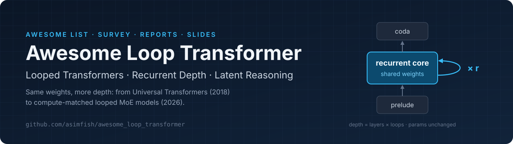
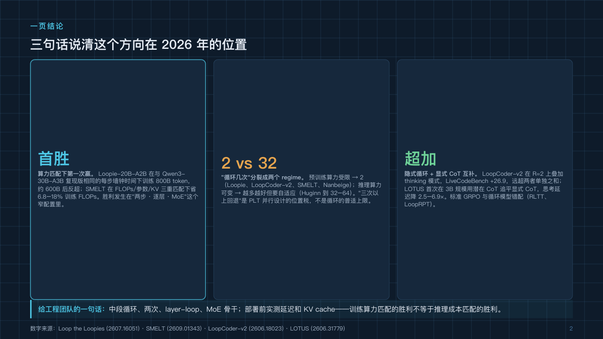
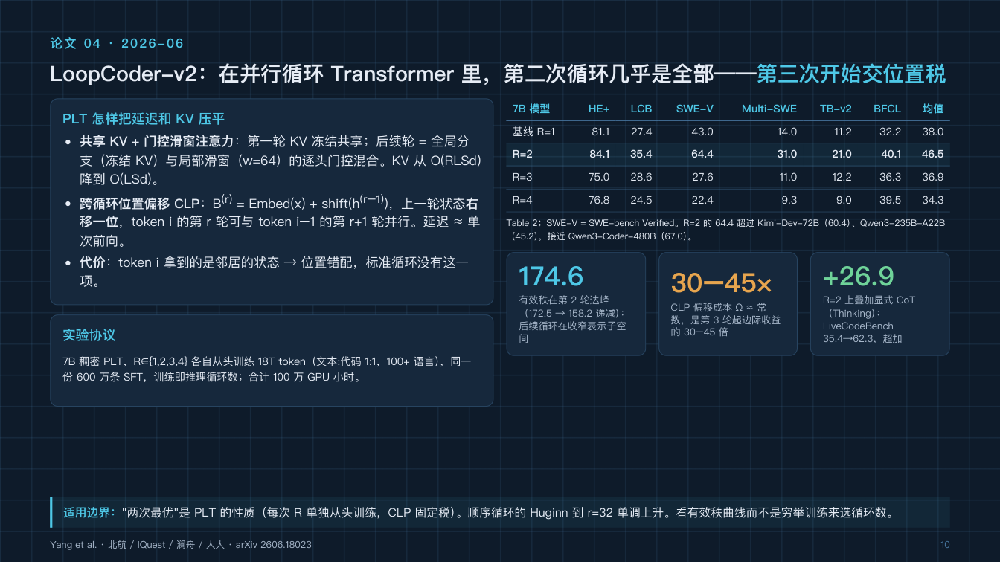

<div align="center">

<a href="https://github.com/asimfish/awesome_loop_transformer"></a>

[](https://awesome.re)
[](#content)
[](#news)
[](https://asimfish.github.io/awesome_loop_transformer/slides/html/)
[](LICENSE)
[](CONTRIBUTING.md)
[](https://github.com/asimfish/awesome_loop_transformer/stargazers)

**English** · [中文导读](README_zh.md) · [Survey](survey/en/survey_en.md) · [Paper reports](reports/en/) · [Online slides](https://asimfish.github.io/awesome_loop_transformer/slides/html/) · [Contributing](CONTRIBUTING.md)

</div>

A curated list of **333 papers** on **looped / recurrent-depth / weight-tied transformers** and the latent-reasoning work around them, from Universal Transformers (2018) to the compute-matched looped MoE models of 2026 — the technique reported to sit behind GPT-6 Astra. Papers are grouped into 14 categories; five core papers come with full-length reports, layout-preserving Chinese translations, and a survey with ten trend insights.

The repository started from the WeChat article [《刚刚，GPT-6 Astra 背后的 Loop 技术全被挖出来了》](https://mp.weixin.qq.com/s/7vEMyFVpf2O9WL4Lu4gSFQ) (PaperAgent, after a thread by [@nrehiew_](https://x.com/nrehiew_/status/2095115984873062675)). The list was first built from arXiv searches on 2026-09-06 and last updated on 2026-11-06.

## News

- **2026-11-06** — Added 211 papers from September–November 2026 (marked 🆕) and a [what changed since September](#what-changed-since-september-2026) section; README redesigned (scope line per category, compact entries, venue tags).
- **2026-09-08** — Every report now opens with an at-a-glance box and a diagram and closes with a glossary; reading guides for 5-minute, 30-minute and 2-hour readers.
- **2026-09-06** — Editable PPTX deck (ppt-master) and Chinese README.
- **2026-09-06** — First release: 122 papers, five core-paper reports (ZH/EN), translated PDFs, a survey with ten trend insights, HTML and Beamer slides.

## What is in this repository

| Deliverable | Path |
|---|---|
| 📄 Five core papers, original PDFs + arXiv full text | [`papers/original/`](papers/original/), [`papers/src/`](papers/src/) |
| 🈶 Layout-preserving Chinese translations with object-level QA reports | [`papers/zh/`](papers/zh/) ([QA record](papers/zh/QA_SUMMARY.md)) |
| 🔬 Per-paper deep-dive reports, English and Chinese | [`reports/en/`](reports/en/), [`reports/zh/`](reports/zh/) |
| 📚 Full report PDFs (survey + five reports) | [English](reports/pdf/awesome_loop_transformer_report_en.pdf) · [中文](reports/pdf/awesome_loop_transformer_report_zh.pdf) |
| 🧭 Survey: taxonomy, timeline, ~60-paper map, ten trend insights, open problems | [`survey/en/survey_en.md`](survey/en/survey_en.md) ([PDF](survey/en/survey_en.pdf)) · [`survey/zh/survey_zh.md`](survey/zh/survey_zh.md) ([PDF](survey/zh/survey_zh.pdf)) |
| 🖥️ HTML slide deck (21 slides, Chinese) + PDF export | [online](https://asimfish.github.io/awesome_loop_transformer/slides/html/) · [`slides/html/`](slides/html/index.html) · [PDF](slides/html/awesome_loop_transformer_slides_zh.pdf) |
| 🎓 Beamer slide deck (English, 16:9, with backup slides) | [PDF](slides/beamer/loop_transformer_slides.pdf) ([source](slides/beamer/loop_transformer_slides.tex)) |
| ✏️ Editable PowerPoint deck (Chinese, native shapes via ppt-master) | [PPTX](slides/pptx/awesome_loop_transformer_slides_zh.pptx) ([preview PDF](slides/pptx/awesome_loop_transformer_slides_zh.preview.pdf), [page SVGs](slides/pptx/svg_output/)) |
| 🗂️ Machine-readable paper list and abstracts | [`data/papers.csv`](data/papers.csv), [`data/related_abstracts.json`](data/related_abstracts.json) |

<p align="center">
  <a href="https://asimfish.github.io/awesome_loop_transformer/slides/html/"></a>
  <a href="https://asimfish.github.io/awesome_loop_transformer/slides/html/"></a>
</p>

## Where to start

| You have | Read |
|---|---|
| 5 minutes | the ten insights below, then Appendix A of the survey (five popular claims the papers do not support) |
| 30 minutes | the [survey](survey/en/survey_en.md) §2–4 and §6, or the 21-slide [HTML deck](https://asimfish.github.io/awesome_loop_transformer/slides/html/) |
| 2 hours | the five [paper reports](reports/en/) — each opens with an at-a-glance box and a diagram, and closes with a glossary |
| a talk to give | the [Beamer deck](slides/beamer/loop_transformer_slides.pdf) (English) or the editable [PPTX](slides/pptx/awesome_loop_transformer_slides_zh.pptx) (Chinese) |

## What changed since September 2026

211 papers were added on 2026-11-06: 167 first submitted between 2026-09-01 and 2026-11-06, plus 44 from June–August that the first search missed. Every number below appears in the cited abstract.

1. **Looped models trained from scratch now beat matched baselines without MoE; looping an already-pretrained model is a mixed bet** (refines insight 1). Loopback reaches lower loss than standard Transformers with 40–75% of their Transformer parameters at matched tokens and executed depth ([2611.07226](https://arxiv.org/abs/2611.07226)). A scaling law fitted on about 600 runs finds that two fully trained loops beat the compute-optimal non-looped model with 27% fewer non-embedding parameters for 8% more compute ([2610.26030](https://arxiv.org/abs/2610.26030)). Looping pretrained Qwen3/Qwen3.5 models after the fact beats equal-parameter and equal-FLOPs baselines only at 0.8B ([2610.42030](https://arxiv.org/abs/2610.42030)), while RELOAD, which fine-tunes a damped middle-block loop, gains up to 23 points for encoders on longer reasoning chains ([2611.07736](https://arxiv.org/abs/2611.07736)).
2. **Two loops is the optimum of current designs, not a rule, and adaptive-halting savings are overstated** (revises insight 2). With bounded residual variance and per-loop routers, LOOM scales looped MoE to 9–12 loops, and its 700M model is best at 5 loops at near-iso-FLOPs ([2610.01153](https://arxiv.org/abs/2610.01153)); gated layer-wise looping of Qwen3-4B is best at three ([2610.25004](https://arxiv.org/abs/2610.25004)). Halting heads trained on mixed iterations run almost every iteration under the standard stopping rule, and batched generation removes most of the reported saving ([2610.32246](https://arxiv.org/abs/2610.32246)).
3. **Serving became the largest technical cluster, and looped models now run in production engines** (revises the toolchain half of insight 10, refines insight 6). Efficiency is the primary category of 26 of the 167 new papers. LoopVQ reaches up to 6.1× Ouro serving throughput in SGLang ([2611.05304](https://arxiv.org/abs/2611.05304)); LoopKV's fused vLLM kernel gets 1.7–2.2× the goodput of KIVI-4 on Ouro-1.4B ([2611.04137](https://arxiv.org/abs/2611.04137)). Caching only the last loop's keys and values ships in open checkpoints such as Dory1.0-4B ([2611.03998](https://arxiv.org/abs/2611.03998)), but recent-window KV sharing fails on Ouro-1.4B because its cost depends on how far late loops have converged ([2610.34436](https://arxiv.org/abs/2610.34436)).
4. **Loop depth changes safety behaviour, a dimension none of the ten insights covers.** At half depth, Ouro-1.4B-Thinking keeps 89% of its GSM8K accuracy while its rate of helping with harmful requests rises 5.3×; training at random depths restores refusal at every depth ([2610.15218](https://arxiv.org/abs/2610.15218)). Jailbreak success varies across recurrent depths and transfers between them ([2610.10625](https://arxiv.org/abs/2610.10625)). Post-training (insight 7) has to cover every depth a model may run at.
5. **"Loops manipulate knowledge, they do not store it" is turning into architecture: explicit memory and state channels inside the loop** (supports insight 8). Recurrence past the training horizon improves reasoning but degrades knowledge ([2609.36636](https://arxiv.org/abs/2609.36636)). In a synthetic edit study, factual edits propagate with addressable memory (0.71–0.96) but only weakly with loops alone (0.04–0.30) ([2606.20737](https://arxiv.org/abs/2606.20737)). A bounded gated cell lets LSTM-UT keep 99.7% exact-row accuracy at depth 60 after training to depth 12 ([2609.19521](https://arxiv.org/abs/2609.19521)).
6. **Applications spread to generative and scientific foundation models** (extends insight 9). A 260M Looped-DiT surpasses a 6.5× larger text-to-image model at 4.9× lower inference compute ([2609.40305](https://arxiv.org/abs/2609.40305)); Eco-RNA at four iterations surpasses Evo 2 40B on RNAGym fitness with 500× fewer parameters ([2610.13106](https://arxiv.org/abs/2610.13106)).

## Ten trend insights

<sub>As of 2026-09-06; the section above records what the September–November papers changed.</sub>

1. **Recurrent depth passed the compute-matching gate in 2026, through a narrow door.** Loopie (matched measured step time) and SMELT (matched FLOPs/params/KV) beat vanilla MoE transformers; the win needs MoE + layer/mid-stack looping + two loops, and comes from converting saved activation memory into width rather than from loops replacing parameters (one recurrence is worth $r^{0.46}$ unique parameters).
2. **"How many loops" splits into two regimes.** Fixed pretraining budget: 2 (Loopie, LoopCoder-v2, SMELT, Nanbeige4.2). Variable inference compute: adaptive and deep (Huginn to 32–64). LoopCoder-v2's "three regress" is the positional tax of the Parallel Loop Transformer, not a law.
3. **Loop granularity is shrinking and converging on the middle of the stack** (depth fraction ≈ 0.5); MoE requires layer-mode looping.
4. **Two philosophies:** treat a pretrained mid-stack as an ODE flow (sub-step, keep the endpoint) versus train the loop to be a fixed point (STARS, Fixed-Point Reasoners, Attractor Models).
5. **Training stability went from folklore to theorems** (residual scaling 1/N, DeepLoop exponent 1/2, LR transfer across loop counts).
6. **Inference cost decomposes into latency, KV memory, and quantization**, each with 2025–2026 fixes (PLT, diffusion-style samplers, MELT, Looped Latent Attention 32×, LoopQ). Matched training compute is not matched inference cost.
7. **Latent loops and explicit CoT are complements**: super-additive in LoopCoder-v2, gap-closing in LOTUS; standard GRPO mis-assigns credit to looped models (RLTT, LoopRPT).
8. **Loops manipulate knowledge, they do not store it** — pair them with retrieval, long context, or MoE expert banks.
9. **Applications moved from puzzles to agents and embodiment** (SWE-bench, tool calling, VLA).
10. **Productization has started; the toolchain has not caught up.**

Full text with sources: [`survey/en/survey_en.md`](survey/en/survey_en.md) · [`survey/zh/survey_zh.md`](survey/zh/survey_zh.md).

## [Content](#content)

<table>
<tr>
	<td>&emsp;<a href=#core-papers>1. Core Papers (5)</a></td>
	<td>&emsp;<a href=#surveys>2. Surveys (1)</a></td>
</tr>
<tr>
	<td>&emsp;<a href=#foundations-precursors>3. Foundations & Precursors (14)</a></td>
	<td>&emsp;<a href=#theory-expressivity-icl-length-generalization>4. Theory: Expressivity, ICL & Length Generalization (39)</a></td>
</tr>
<tr>
	<td>&emsp;<a href=#scaled-pretraining>5. Scaled Pretraining (50)</a></td>
	<td>&emsp;<a href=#efficiency-latency-kv-cache-quantization>6. Efficiency: Latency, KV Cache & Quantization (46)</a></td>
</tr>
<tr>
	<td>&emsp;<a href=#stability-training-theory>7. Stability & Training Theory (29)</a></td>
	<td>&emsp;<a href=#adaptive-computation-halting>8. Adaptive Computation & Halting (41)</a></td>
</tr>
<tr>
	<td>&emsp;<a href=#retrofitting-training-free>9. Retrofitting & Training-Free (23)</a></td>
	<td>&emsp;<a href=#post-training-rl-for-looped-models>10. Post-Training & RL for Looped Models (18)</a></td>
</tr>
<tr>
	<td>&emsp;<a href=#interpretability-latent-dynamics>11. Interpretability & Latent Dynamics (32)</a></td>
	<td>&emsp;<a href=#tiny-recursive-reasoners>12. Tiny Recursive Reasoners (50)</a></td>
</tr>
<tr>
	<td>&emsp;<a href=#applications-cross-modal>13. Applications & Cross-Modal (75)</a></td>
	<td>&emsp;<a href=#related-latent-reasoning-beyond-looping>14. Related: Latent Reasoning Beyond Looping (21)</a></td>
</tr>
<tr>
	<td>&emsp;<a href=#industry-reports-threads>15. Industry Reports & Threads</a></td>
	<td>&emsp;<a href=#open-models>16. Open Models</a></td>
</tr>
</table>

⭐ core paper with a full report and a Chinese translation · 🆕 added in the latest update (2026-11-06) · a paper can appear under several topics.

## [Core Papers](#content)

The five papers threaded together by the WeChat article / @nrehiew_ thread, in reading order. Each has a full report (ZH/EN) and a layout-preserving Chinese translation.

1. ⭐ **Universal Transformers** `ICLR 2019` · [paper](https://arxiv.org/abs/1807.03819) · [code](https://github.com/tensorflow/tensor2tensor) · [report-en](reports/en/01_universal_transformers.md) · [report-zh](reports/zh/01_universal_transformers.md) · [中译PDF](papers/zh/1807.03819.zh.pdf)<br><sub>Mostafa Dehghani, Stephan Gouws, Oriol Vinyals, Jakob Uszkoreit, Łukasz Kaiser</sub>
2. ⭐ **Scaling up Test-Time Compute with Latent Reasoning: A Recurrent Depth Approach** `arXiv 2025` · [paper](https://arxiv.org/abs/2502.05171) · [code](https://github.com/seal-rg/recurrent-pretraining) · [report-en](reports/en/02_recurrent_depth_huginn.md) · [report-zh](reports/zh/02_recurrent_depth_huginn.md) · [中译PDF](papers/zh/2502.05171.zh.pdf)<br><sub>Jonas Geiping, Sean McLeish, Neel Jain, John Kirchenbauer, Siddharth Singh, Brian R. Bartoldson, et al.</sub>
3. ⭐ **Training-Free Looped Transformers** `arXiv 2026` · [paper](https://arxiv.org/abs/2605.23872) · [report-en](reports/en/03_training_free_looped.md) · [report-zh](reports/zh/03_training_free_looped.md) · [中译PDF](papers/zh/2605.23872.zh.pdf)<br><sub>Lizhang Chen, Jonathan Li, Chen Liang, Ni Lao, Qiang Liu</sub>
4. ⭐ **LoopCoder-v2: Only Loop Once for Efficient Test-Time Computation Scaling** `arXiv 2026` · [paper](https://arxiv.org/abs/2606.18023) · [code](https://huggingface.co/Multilingual-Multimodal-NLP/LoopCoder-V2) · [report-en](reports/en/04_loopcoder_v2.md) · [report-zh](reports/zh/04_loopcoder_v2.md) · [中译PDF](papers/zh/2606.18023.zh.pdf)<br><sub>Jian Yang, Shawn Guo, Wei Zhang, Tianyu Zheng, Yaxin Du, Haau-Sing Li, et al.</sub>
5. ⭐ **Loop the Loopies!** `arXiv 2026` · [paper](https://arxiv.org/abs/2607.16051) · [report-en](reports/en/05_loop_the_loopies.md) · [report-zh](reports/zh/05_loop_the_loopies.md) · [中译PDF](papers/zh/2607.16051.zh.pdf)<br><sub>Zitian Gao, Yilong Chen, Yihao Xiao, Xinyu Yang, Ran Tao, Joey Zhou, Bryan Dai</sub>

## [Surveys](#content)

Surveys that cover looped models as part of latent reasoning.

1. **A Survey on Latent Reasoning** `arXiv 2025` · [paper](https://arxiv.org/abs/2507.06203) · [code](https://github.com/multimodal-art-projection/LatentCoT-Horizon/)<br><sub>Rui-Jie Zhu, Tianhao Peng, Tianhao Cheng, Xingwei Qu, Jinfa Huang, Dawei Zhu, et al.</sub>

## [Foundations & Precursors](#content)

Weight sharing across depth, adaptive computation time, equilibrium models, and recurrent algorithm learners that later looped models build on.

1. **Neural GPUs Learn Algorithms** `ICLR 2016` · [paper](https://arxiv.org/abs/1511.08228)<br><sub>Łukasz Kaiser, Ilya Sutskever</sub>
2. **Adaptive Computation Time for Recurrent Neural Networks** `arXiv 2016` · [paper](https://arxiv.org/abs/1603.08983)<br><sub>Alex Graves</sub>
3. ⭐ **Universal Transformers** `ICLR 2019` · [paper](https://arxiv.org/abs/1807.03819) · [code](https://github.com/tensorflow/tensor2tensor) · [report-en](reports/en/01_universal_transformers.md) · [report-zh](reports/zh/01_universal_transformers.md) · [中译PDF](papers/zh/1807.03819.zh.pdf)<br><sub>Mostafa Dehghani, Stephan Gouws, Oriol Vinyals, Jakob Uszkoreit, Łukasz Kaiser</sub>
4. **Deep Equilibrium Models** `NeurIPS 2019` · [paper](https://arxiv.org/abs/1909.01377)<br><sub>Shaojie Bai, J. Zico Kolter, Vladlen Koltun</sub>
5. **ALBERT: A Lite BERT for Self-supervised Learning of Language Representations** `ICLR 2020` · [paper](https://arxiv.org/abs/1909.11942)<br><sub>Zhenzhong Lan, Mingda Chen, Sebastian Goodman, Kevin Gimpel, Piyush Sharma, Radu Soricut</sub>
6. **Lessons on Parameter Sharing across Layers in Transformers** `arXiv 2023` · [paper](https://arxiv.org/abs/2104.06022)<br><sub>Sho Takase, Shun Kiyono</sub>
7. **Can You Learn an Algorithm? Generalizing from Easy to Hard Problems with Recurrent Networks** `NeurIPS 2021` · [paper](https://arxiv.org/abs/2106.04537)<br><sub>Avi Schwarzschild, Eitan Borgnia, Arjun Gupta, Furong Huang, Uzi Vishkin, Micah Goldblum, Tom Goldstein</sub>
8. **PonderNet: Learning to Ponder** `ICML Workshop 2021` · [paper](https://arxiv.org/abs/2107.05407)<br><sub>Andrea Banino, Jan Balaguer, Charles Blundell</sub>
9. **End-to-end Algorithm Synthesis with Recurrent Networks: Logical Extrapolation Without Overthinking** `NeurIPS 2022` · [paper](https://arxiv.org/abs/2202.05826)<br><sub>Arpit Bansal, Avi Schwarzschild, Eitan Borgnia, Zeyad Emam, Furong Huang, Micah Goldblum, Tom Goldstein</sub>
10. **Path Independent Equilibrium Models Can Better Exploit Test-Time Computation** `NeurIPS 2022` · [paper](https://arxiv.org/abs/2211.09961)<br><sub>Cem Anil, Ashwini Pokle, Kaiqu Liang, Johannes Treutlein, Yuhuai Wu, Shaojie Bai, Zico Kolter, Roger Grosse</sub>
11. **Sparse Universal Transformer** `EMNLP 2023` · [paper](https://arxiv.org/abs/2310.07096)<br><sub>Shawn Tan, Yikang Shen, Zhenfang Chen, Aaron Courville, Chuang Gan</sub>
12. **CoTFormer: A Chain-of-Thought Driven Architecture with Budget-Adaptive Computation Cost at Inference** `ICLR 2025` · [paper](https://arxiv.org/abs/2310.10845)<br><sub>Amirkeivan Mohtashami, Matteo Pagliardini, Martin Jaggi</sub>
13. **MoEUT: Mixture-of-Experts Universal Transformers** `NeurIPS 2024` · [paper](https://arxiv.org/abs/2405.16039)<br><sub>Róbert Csordás, Kazuki Irie, Jürgen Schmidhuber, Christopher Potts, Christopher D. Manning</sub>
14. **Relaxed Recursive Transformers: Effective Parameter Sharing with Layer-wise LoRA** `ICLR 2025` · [paper](https://arxiv.org/abs/2410.20672)<br><sub>Sangmin Bae, Adam Fisch, Hrayr Harutyunyan, Ziwei Ji, Seungyeon Kim, Tal Schuster</sub>

## [Theory: Expressivity, ICL & Length Generalization](#content)

What looping adds in expressivity, in-context learning, and length or compositional generalization, and how it compares with chain-of-thought.

1. **Looped Transformers as Programmable Computers** `ICML 2023` · [paper](https://arxiv.org/abs/2301.13196)<br><sub>Angeliki Giannou, Shashank Rajput, Jy-yong Sohn, Kangwook Lee, Jason D. Lee, Dimitris Papailiopoulos</sub>
2. **Looped Transformers are Better at Learning Learning Algorithms** `ICLR 2024` · [paper](https://arxiv.org/abs/2311.12424)<br><sub>Liu Yang, Kangwook Lee, Robert Nowak, Dimitris Papailiopoulos</sub>
3. **Simulation of Graph Algorithms with Looped Transformers** `ICML 2024` · [paper](https://arxiv.org/abs/2402.01107)<br><sub>Artur Back de Luca, Kimon Fountoulakis</sub>
4. **Looped Transformers for Length Generalization** `ICLR 2025` · [paper](https://arxiv.org/abs/2409.15647)<br><sub>Ying Fan, Yilun Du, Kannan Ramchandran, Kangwook Lee</sub>
5. **On Expressive Power of Looped Transformers: Theoretical Analysis and Enhancement via Timestep Encoding** `arXiv 2024` · [paper](https://arxiv.org/abs/2410.01405)<br><sub>Kevin Xu, Issei Sato</sub>
6. **Can Looped Transformers Learn to Implement Multi-step Gradient Descent for In-context Learning?** `ICML 2024` · [paper](https://arxiv.org/abs/2410.08292)<br><sub>Khashayar Gatmiry, Nikunj Saunshi, Sashank J. Reddi, Stefanie Jegelka, Sanjiv Kumar</sub>
7. **Looped ReLU MLPs May Be All You Need as Practical Programmable Computers** `arXiv 2024` · [paper](https://arxiv.org/abs/2410.09375)<br><sub>Yingyu Liang, Zhizhou Sha, Zhenmei Shi, Zhao Song, Yufa Zhou</sub>
8. **Bypassing the Exponential Dependency: Looped Transformers Efficiently Learn In-context by Multi-step Gradient Descent** `AISTATS 2025` · [paper](https://arxiv.org/abs/2410.11268)<br><sub>Bo Chen, Xiaoyu Li, Yingyu Liang, Zhenmei Shi, Zhao Song</sub>
9. **On the Role of Depth and Looping for In-Context Learning with Task Diversity** `arXiv 2024` · [paper](https://arxiv.org/abs/2410.21698)<br><sub>Khashayar Gatmiry, Nikunj Saunshi, Sashank J. Reddi, Stefanie Jegelka, Sanjiv Kumar</sub>
10. **Reasoning with Latent Thoughts: On the Power of Looped Transformers** `ICLR 2025` · [paper](https://arxiv.org/abs/2502.17416)<br><sub>Nikunj Saunshi, Nishanth Dikkala, Zhiyuan Li, Sanjiv Kumar, Sashank J. Reddi</sub>
11. **To CoT or To Loop? A Formal Comparison Between Chain-of-Thought and Looped Transformers** `arXiv 2025` · [paper](https://arxiv.org/abs/2505.19245)<br><sub>Kevin Xu, Issei Sato</sub>
12. **What Makes Looped Transformers Perform Better Than Non-Recursive Ones** `arXiv 2025` · [paper](https://arxiv.org/abs/2510.10089)<br><sub>Zixuan Gong, Yong Liu, Jiaye Teng</sub>
13. **SpiralFormer: Looped Transformers Can Learn Hierarchical Dependencies via Multi-Resolution Recursion** `arXiv 2026` · [paper](https://arxiv.org/abs/2602.11698)<br><sub>Chengting Yu, Xiaobo Shu, Yadao Wang, Yizhen Zhang, Haoyi Wu, You Wu, et al.</sub>
14. **Thinking Deeper, Not Longer: Depth-Recurrent Transformers for Compositional Generalization** `arXiv 2026` · [paper](https://arxiv.org/abs/2603.21676)<br><sub>Hung-Hsuan Chen</sub>
15. **Loop, Think, & Generalize: Implicit Reasoning in Recurrent-Depth Transformers** `COLM 2026` · [paper](https://arxiv.org/abs/2604.07822)<br><sub>Harsh Kohli, Srinivasan Parthasarathy, Huan Sun, Yuekun Yao</sub>
16. **Stability and Generalization in Looped Transformers** `arXiv 2026` · [paper](https://arxiv.org/abs/2604.15259)<br><sub>Asher Labovich</sub>
17. **How Much Is One Recurrence Worth? Iso-Depth Scaling Laws for Looped Language Models** `arXiv 2026` · [paper](https://arxiv.org/abs/2604.21106)<br><sub>Kristian Schwethelm, Daniel Rueckert, Georgios Kaissis</sub>
18. **Universal Transformers Need Memory: Depth-State Trade-offs in Adaptive Recursive Reasoning** `arXiv 2026` · [paper](https://arxiv.org/abs/2604.21999)<br><sub>Grigory Sapunov</sub>
19. **Length Generalization with Log-Depth Recurrent Units** `arXiv 2026` · [paper](https://arxiv.org/abs/2605.26035)<br><sub>Charles Pert, Dalal Alrajeh, Alessandra Russo</sub>
20. **Chain-of-Thought and Compressed Looped Transformers: A Memory-Budget Separation** `arXiv 2026` · [paper](https://arxiv.org/abs/2605.30757)<br><sub>Haozhou Zhang</sub>
21. **Looped Transformers with Layer Normalization Provably Learn the Power Method** `arXiv 2026` · [paper](https://arxiv.org/abs/2606.00605)<br><sub>Lyumin Wu, Chenyang Zhang, Yuan Cao</sub>
22. 🆕 **Repeated Shared Access Enables Grokking, but Edit Propagation Depends on an Addressable Memory** `arXiv 2026` · [paper](https://arxiv.org/abs/2606.20737)<br><sub>Yanan Niu</sub>
23. **DiscoLoop: Looping Discrete Embeddings and Continuous Hidden States for Multi-hop Reasoning** `arXiv 2026` · [paper](https://arxiv.org/abs/2607.00341)<br><sub>Hengyu Fu, Tianyu Guo, Zixuan Wang, Hanlin Zhu, Jason D. Lee, Jiantao Jiao, Stuart Russell, Song Mei</sub>
24. **When Does Recurrence Become an Algorithm? Convergence Selection in Weight-Tied Looped Transformers** `arXiv 2026` · [paper](https://arxiv.org/abs/2607.20594)<br><sub>Tong Zhang, Junhao Hu, Yun Peng, Tao Xie</sub>
25. 🆕 **Dynamical phase selection controls compute scaling in looped transformers** `arXiv 2026` · [paper](https://arxiv.org/abs/2608.26556)<br><sub>Gunn Kim</sub>
26. **Universal Transformers for Circuit Computations: Perfect Length Generalization in Tiny Transformers** `arXiv 2026` · [paper](https://arxiv.org/abs/2608.31067)<br><sub>Takuya Ito, Ruchir Puri, Murray Campbell, Parikshit Ram</sub>
27. 🆕 **Storing Is Not Remembering: LSTM-UT and Bounded Gated Memory for Looped Transformers** `arXiv 2026` · [paper](https://arxiv.org/abs/2609.19521)<br><sub>Aras Kavuncu, Muhammad Burhan Hafez</sub>
28. 🆕 **Statistical Gains from Looped Estimation under Parameter Budgets** `arXiv 2026` · [paper](https://arxiv.org/abs/2609.25778)<br><sub>Xinyu Tian, Xiaotong Shen</sub>
29. 🆕 **Beyond the Training Horizon: Mechanisms and Limits of Length Generalization in Looped Transformers** `arXiv 2026` · [paper](https://arxiv.org/abs/2609.33144)<br><sub>Jia Liang, Xi Jin, Liangming Pan</sub>
30. 🆕 **Rotate the Loop: Blockwise Conformality for Looped Transformers** `NeurIPS Workshop 2026` · [paper](https://arxiv.org/abs/2610.14030)<br><sub>Alexey Zemtsov, Albina Klepach, Vadim Lomshakov, Andrei Polubarov, Nikita Lyubaykin, Alexander Derevyagin, Vladislav Kurenkov, Alexander Nikulin</sub>
31. 🆕 **Recurrent Looped Transformer** `arXiv 2026` · [paper](https://arxiv.org/abs/2610.07591) · [code](https://github.com/yifanzhang-pro/recurrent-looped-tranformer)<br><sub>Yifan Zhang, Jichen Feng, Shihan Qin, Sun-Yuan Kung, Mengdi Wang</sub>
32. 🆕 **Learning to Extrapolate in Depth with Looped Transformers** `arXiv 2026` · [paper](https://arxiv.org/abs/2610.14456)<br><sub>Huitao Yang, Jianhao Huang, Zixuan Wang, Baharan Mirzasoleiman</sub>
33. 🆕 **Learning to Compute Is Not Learning to Retain or Reuse in Looped Transformers** `arXiv 2026` · [paper](https://arxiv.org/abs/2610.19768)<br><sub>Peilong Zhou, Hongtao Zhang, Yulong Huang, Cangyuan Li, Mingyu Chen, Ying Wang</sub>
34. 🆕 **Test-Time Forecasting: Recurrent Depth Enables In-Context Dynamics Prediction** `arXiv 2026` · [paper](https://arxiv.org/abs/2610.19552)<br><sub>Jeffrey B. Lai, John Quinn, Anthony Bao, William Gilpin</sub>
35. 🆕 **Inside the Loop: A Mechanistic Study of Weight-Tied Transformers on Depth-Bound Algorithmic Tasks** `NeurIPS 2026` · [paper](https://arxiv.org/abs/2610.24135) · [code](https://github.com/magnus-sesodia/insidetheloop)<br><sub>Magnus Sesodia, Juil Sock, Philip Torr, Christian Schroeder de Witt</sub>
36. 🆕 **Looped GNNs Beyond Fixed Depth: Graph Size Generalization and Parameter-Efficient Adaptation** `arXiv 2026` · [paper](https://arxiv.org/abs/2610.24112)<br><sub>Zhiyang Wang, Zhishang Luo, Yusu Wang</sub>
37. 🆕 **Internalizing Chain-of-thought into Looped Transformers** `arXiv 2026` · [paper](https://arxiv.org/abs/2610.25998)<br><sub>Kehang Zhou, Pinyan Lu</sub>
38. 🆕 **PAR: Progress-Aligned Recurrence for Length Generalization in State Tracking** `arXiv 2026` · [paper](https://arxiv.org/abs/2610.27628)<br><sub>Pan Wang, Yihao Hu, Guangyuan Dong, Yitong Lin, Hang Wang, Zimi Liu, et al.</sub>
39. 🆕 **How Depth Growth and Looping Shape In-Context Learning in Language Models** `arXiv 2026` · [paper](https://arxiv.org/abs/2610.31421)<br><sub>Ferdinand Kapl, Kaitlin Maile, Stefan Bauer, Johannes von Oswald</sub>

## [Scaled Pretraining](#content)

Looped and recurrent-depth language models pretrained at scale, their scaling laws, and compute-matched comparisons with standard transformers.

1. **MoEUT: Mixture-of-Experts Universal Transformers** `NeurIPS 2024` · [paper](https://arxiv.org/abs/2405.16039)<br><sub>Róbert Csordás, Kazuki Irie, Jürgen Schmidhuber, Christopher Potts, Christopher D. Manning</sub>
2. ⭐ **Scaling up Test-Time Compute with Latent Reasoning: A Recurrent Depth Approach** `arXiv 2025` · [paper](https://arxiv.org/abs/2502.05171) · [code](https://github.com/seal-rg/recurrent-pretraining) · [report-en](reports/en/02_recurrent_depth_huginn.md) · [report-zh](reports/zh/02_recurrent_depth_huginn.md) · [中译PDF](papers/zh/2502.05171.zh.pdf)<br><sub>Jonas Geiping, Sean McLeish, Neel Jain, John Kirchenbauer, Siddharth Singh, Brian R. Bartoldson, et al.</sub>
3. **Parallel Loop Transformer for Efficient Test-Time Computation Scaling** `arXiv 2025` · [paper](https://arxiv.org/abs/2510.24824)<br><sub>Bohong Wu, Mengzhao Chen, Xiang Luo, Shen Yan, Qifan Yu, Fan Xia, et al.</sub>
4. **Scaling Latent Reasoning via Looped Language Models** `arXiv 2025` · [paper](https://arxiv.org/abs/2510.25741) · [code](http://ouro-llm.github.io)<br><sub>Rui-Jie Zhu, Zixuan Wang, Kai Hua, Tianyu Zhang, Ziniu Li, Haoran Que, et al.</sub>
5. **Depth-Recurrent Attention Mixtures: Giving Latent Reasoning the Attention it Deserves** `arXiv 2026` · [paper](https://arxiv.org/abs/2601.21582)<br><sub>Jonas Knupp, Jan Hendrik Metzen, Jeremias Bohn, Georg Groh, Kristian Kersting</sub>
6. **Adaptive Loops and Memory in Transformers: Think Harder or Know More?** `ICLR Workshop 2026` · [paper](https://arxiv.org/abs/2603.08391)<br><sub>Markus Frey, Behzad Shomali, Ali Hamza Bashir, David Berghaus, Joachim Koehler, Mehdi Ali</sub>
7. **How Much Is One Recurrence Worth? Iso-Depth Scaling Laws for Looped Language Models** `arXiv 2026` · [paper](https://arxiv.org/abs/2604.21106)<br><sub>Kristian Schwethelm, Daniel Rueckert, Georgios Kaissis</sub>
8. **Hyperloop Transformers** `arXiv 2026` · [paper](https://arxiv.org/abs/2604.21254)<br><sub>Abbas Zeitoun, Lucas Torroba-Hennigen, Yoon Kim</sub>
9. **Latent Recurrent Transformer: Architecture Exploration, Training Strategies, and Scaling Behavior** `arXiv 2026` · [paper](https://arxiv.org/abs/2605.26797)<br><sub>Zeyi Huang, Xuehai He, LiLiang Ren, Yiping Wang, Baolin Peng, Hao Cheng, et al.</sub>
10. **A Dual-Path Architecture for Scaling Compute and Capacity in LLMs** `arXiv 2026` · [paper](https://arxiv.org/abs/2605.30202)<br><sub>Markus Frey, Behzad Shomali, Joachim Koehler, Mehdi Ali</sub>
11. 🆕 **LoopMoE: Unifying Iterative Computation with Mixture-of-Experts for Language Modeling** `arXiv 2026` · [paper](https://arxiv.org/abs/2606.04438)<br><sub>Wenkai Chen, Tianshu Li, Wenyong Huang, Yichun Yin, Lifeng Shang, Chengwei Qin</sub>
12. 🆕 **Tying the Loop -- Tied Expert Layers in Mixture-of-Experts Language Models** `arXiv 2026` · [paper](https://arxiv.org/abs/2606.16825) · [code](https://github.com/epfml/looped-moe)<br><sub>Martin Jaggi</sub>
13. ⭐ **LoopCoder-v2: Only Loop Once for Efficient Test-Time Computation Scaling** `arXiv 2026` · [paper](https://arxiv.org/abs/2606.18023) · [code](https://huggingface.co/Multilingual-Multimodal-NLP/LoopCoder-V2) · [report-en](reports/en/04_loopcoder_v2.md) · [report-zh](reports/zh/04_loopcoder_v2.md) · [中译PDF](papers/zh/2606.18023.zh.pdf)<br><sub>Jian Yang, Shawn Guo, Wei Zhang, Tianyu Zheng, Yaxin Du, Haau-Sing Li, et al.</sub>
14. **Hidden Decoding at Scale: Latent Computation Scaling for Large Language Models** `arXiv 2026` · [paper](https://arxiv.org/abs/2607.08186) — *contrast: sequence-length scaling*<br><sub>Aiwei Liu, Cheng Shi, Chuhan Wu, Ci Lei, Di Lu, Donald He, et al.</sub>
15. ⭐ **Loop the Loopies!** `arXiv 2026` · [paper](https://arxiv.org/abs/2607.16051) · [report-en](reports/en/05_loop_the_loopies.md) · [report-zh](reports/zh/05_loop_the_loopies.md) · [中译PDF](papers/zh/2607.16051.zh.pdf)<br><sub>Zitian Gao, Yilong Chen, Yihao Xiao, Xinyu Yang, Ran Tao, Joey Zhou, Bryan Dai</sub>
16. 🆕 **Mobius Learning: Cyclic Depth Folding in Transformers** `arXiv 2026` · [paper](https://arxiv.org/abs/2607.17843)<br><sub>Tongtian Zhu</sub>
17. **Nanbeige4.2-3B: Unlocking Agentic Capabilities in a Compact Model** `arXiv 2026` · [paper](https://arxiv.org/abs/2607.22083)<br><sub>Nanbeige Lab, Chen Yang, Chengrui Huang, Fufeng Lan, Hanhui Chen, Hao Zhou, et al.</sub>
18. 🆕 **Mimir: A Sub-2B Hierarchical Reasoning Model Trained on Permissible Data Punches Above Its Weight Class** `arXiv 2026` · [paper](https://arxiv.org/abs/2608.13517)<br><sub>Peter Schneider-Kamp, Jacob Nielsen, Gianluca Barmina, Danial Namazifard, Annemette Brok Pirchert, Kenneth Enevoldsen, Lukas Galke Poech</sub>
19. **Gated Recurrent Transformers: Expressive Depth through Recurrent Modulation** `arXiv 2026` · [paper](https://arxiv.org/abs/2608.15062)<br><sub>Amr Hegazy, Amr Alanwar, Mostafa Elhoushi</sub>
20. **Allocating Recurrent Compute in Looped Language Models** `arXiv 2026` · [paper](https://arxiv.org/abs/2608.18230)<br><sub>Ruhai Lin, Yiyang Guo, Rui-Jie Zhu, Hao Ye, Jason K. Eshraghian</sub>
21. 🆕 **Squeezing More from Limited Data with Recursive Transformers** `arXiv 2026` · [paper](https://arxiv.org/abs/2608.26973)<br><sub>Serdar Gülbahar, Lukas Edman, Alexander Fraser</sub>
22. **SMELT: Scaling Laws for Compute-Matched MoE Looped Transformers** `arXiv 2026` · [paper](https://arxiv.org/abs/2609.01343)<br><sub>Shaowen Wang, Ge Zhang, Kairong Luo, Yuhao Wu, Shaofan Liu, Jiaheng Liu, et al.</sub>
23. 🆕 **Looped GPT-BERT: Trading Parameters for Computation in Small Language Modeling** `arXiv 2026` · [paper](https://arxiv.org/abs/2609.09691)<br><sub>Tingshuo Fan, Hongtao Mu, Tianyu Zhou, Hansen Liu, Tao Ji</sub>
24. 🆕 **How Model Growth, Recursion, and Boundary Operators Influence Scaling Exponents** `arXiv 2026` · [paper](https://arxiv.org/abs/2609.19107) · [code](https://github.com/qlabs-eng/scaling-exponents)<br><sub>Zixi Chen, Akshay Vegesna, Samip Dahal, Andrew Gordon Wilson</sub>
25. 🆕 **Trading Depth for Time in Recurrent Transformers** `arXiv 2026` · [paper](https://arxiv.org/abs/2609.21605)<br><sub>Zeyi Huang, Xuehai He, Yelong Shen, Yong Jae Lee</sub>
26. 🆕 **How to Loop MoE: Flatten the Experts, Untie the Attention** `arXiv 2026` · [paper](https://arxiv.org/abs/2609.35751) · [code](https://github.com/SR-A-W/how-to-loop-moe)<br><sub>Shouren Wang, Chuang Ma, Mohsen Hariri, Debargha Ganguly, Wang Yang, Xiaoqing Tong, et al.</sub>
27. 🆕 **LoopVL: Recurrent Visual Intelligence** `arXiv 2026` · [paper](https://arxiv.org/abs/2609.38426)<br><sub>Zhe Qian, Ziyang Gong, Zhongxing Xu, Hehan Li, Zhonghua Wang, Hanmeng Liu, et al.</sub>
28. 🆕 **What Makes Recurrence Effective in Looped Language Models?** `arXiv 2026` · [paper](https://arxiv.org/abs/2609.36636)<br><sub>Xinlin Zhuang, Siyuan Wang, Imran Razzak, Weiyang Liu</sub>
29. 🆕 **Scaling Laws for Looped Mixture of Experts** `arXiv 2026` · [paper](https://arxiv.org/abs/2609.40316)<br><sub>Yanbei Chen, Anirudh Goyal, Raghuraman Krishnamoorthi</sub>
30. 🆕 **Closing the Loop: Practical Training Recipes for Looped Language Models** `arXiv 2026` · [paper](https://arxiv.org/abs/2610.00673)<br><sub>Andrei Marchenko, Viacheslav Bezrukov, Oleg Kashurin, Inessa Fedorova, Dmitry Bocharov, Yuliana Shakhvalieva, Maria Tikhonova, Valerii Ternovskii</sub>
31. 🆕 **The Surprising Effectiveness of Shared Memory in Looped Transformers** `arXiv 2026` · [paper](https://arxiv.org/abs/2610.02383)<br><sub>Giovanni Monea, Keshav Ramji, Yousef El-Kurdi, Luis A. Lastras, Yoav Artzi, Nathan Godey, Ramón Fernandez Astudillo</sub>
32. 🆕 **Looping Beyond Twice: A Scalable Recipe for Looped Mixture-of-Experts** `arXiv 2026` · [paper](https://arxiv.org/abs/2610.01153) · [code](https://github.com/hed-ucas/LOOM)<br><sub>Di He, Pengxiang Li, Da Chang, Qingyan Meng, Lu Yin, Shiwei Liu</sub>
33. 🆕 **One Model to Loop Them All: Elastic Latent Recurrence for Language Models** `arXiv 2026` · [paper](https://arxiv.org/abs/2610.12582)<br><sub>Faisal Ladhak, Shantanu Acharya, Santiago Akle Serano, Simeng Sun, Boris Ginsburg, Krishna C Puvvada</sub>
34. 🆕 **Adaptive-Depth Is a Finishing Stage** `NeurIPS Workshop 2026` · [paper](https://arxiv.org/abs/2610.14252)<br><sub>Andrei Piterbarg, Sean McLeish, Dhruv Pai, Benjamin Keigwin</sub>
35. 🆕 **LatentLoop: Scaling Looped MoE Models with Asymmetric Compute Allocation** `arXiv 2026` · [paper](https://arxiv.org/abs/2610.19975)<br><sub>Zefeng He, Yunkai Chai, Xiaoyang Chen, Tong Zhu, Zongliang Wu, Yun Luo, Yafu Li, Yu Cheng</sub>
36. 🆕 **Causal Latent Workspaces for Looped Transformers** `arXiv 2026` · [paper](https://arxiv.org/abs/2610.22796) · [code](https://github.com/izaznov/causal-latent-workspace-transformer)<br><sub>Ilia Zaznov</sub>
37. 🆕 **Towards Looped Models Done Right, Part I: Topology, Input Injection, Recurrent-State Design** `arXiv 2026` · [paper](https://arxiv.org/abs/2610.23036) · [code](https://github.com/ifm-ai/xllm-loop)<br><sub>Benhao Huang, Chufan Shi, Junlin Chen, Shicheng Wen, Zhengzhong Liu, Eric Xing, Xuezhe Ma</sub>
38. 🆕 **Dual-Slot: From Serial Loops to Parallel Slots in Language Models** `arXiv 2026` · [paper](https://arxiv.org/abs/2610.25086)<br><sub>Yiqin Hao, Zitong Wang, Boyi Zeng, He Li, Shixiang Song, Feichen Song, et al.</sub>
39. 🆕 **Block Recursive Transformers for Structured Parameter Sharing** `EMNLP Findings 2026` · [paper](https://arxiv.org/abs/2610.24998) · [code](https://aim-skku.github.io/BRT/)<br><sub>Josep Marques, Hyunyoung A. Cho, Youngeun Kim, Youjia Zhang, Aecheon Jung, Kyuhong Shim, Sungeun Hong</sub>
40. 🆕 **Truncate or Not? A Scaling Study of Looped Transformers with Truncated Backpropagation** `arXiv 2026` · [paper](https://arxiv.org/abs/2610.26030)<br><sub>Xuyuan Xiong, Siyu Chen, Zihan Shao, Yue Su, Weiyang Jin, Ping Luo, Zhuoran Yang, Xihui Liu</sub>
41. 🆕 **Asymmetric Looped Transformers: Fixed Global Representations for an Iterative Decoder** `arXiv 2026` · [paper](https://arxiv.org/abs/2610.28489)<br><sub>Cheng Liang, Tengfei Zhang, Wenjie DU, Jianyu Wu, Changlian Ma, Shuchen Pu, et al.</sub>
42. 🆕 **Accordion: Elastic-Depth Inference via Fixed-Prefix Layer Looping** `arXiv 2026` · [paper](https://arxiv.org/abs/2610.32492)<br><sub>Yudong Zhang, Wei Ding, Kaili Zheng, Yuchen Ding, Zhenyu Zhang</sub>
43. 🆕 **StateLoop: Persistent State for Looped Transformers** `arXiv 2026` · [paper](https://arxiv.org/abs/2610.35544)<br><sub>Feichen Song, Boyi Zeng, He Li, Shixiang Song, Yiqin Hao, Zitong Wang, et al.</sub>
44. 🆕 **Think Twice: The Metis-1.6 Technical Report** `arXiv 2026` · [paper](https://arxiv.org/abs/2610.37903) · [code](https://huggingface.co/Lernex)<br><sub>Giulianno Vollmer</sub>
45. 🆕 **How to Loop Your Transformer: Loop Scaling, Specialization, and Parallel Inference** `arXiv 2026` · [paper](https://arxiv.org/abs/2610.40325)<br><sub>Chanakya Ekbote, Artidoro Pagnoni, Devendra Singh Sachan, Shruti Bhosale, Mike Lewis, Maryam Fazel-Zarandi, Shashank Rajput, Sujan Kumar Gonugondla</sub>
46. 🆕 **UpLoop: Training Looped Transformers via Upcycling at No Extra Pretraining Compute** `arXiv 2026` · [paper](https://arxiv.org/abs/2610.41720)<br><sub>Cheng Liang, Tengfei Zhang, Ya Zhang, Yanfeng Wang, Zhouhan Lin</sub>
47. 🆕 **Dory1.0-4B: A Looped Normalized-GPT** `arXiv 2026` · [paper](https://arxiv.org/abs/2611.03998)<br><sub>Maxim Fishman, Simeng Sun, Shantanu Acharya, Faisal Ladhak, Brian Chmiel, Santiago Akle Serano, et al.</sub>
48. 🆕 **ARLoop: Fully-Open Pre-trained Looped Transformers with Attention Residuals** `arXiv 2026` · [paper](https://arxiv.org/abs/2611.05234)<br><sub>Yuekun Yao, Yupei Du, Dawei Zhu, Huan Sun</sub>
49. 🆕 **Loopback Transformer: Towards a Unified View of Residual Looped Transformers** `arXiv 2026` · [paper](https://arxiv.org/abs/2611.07226) · [code](https://github.com/yancyou/Loopback)<br><sub>Xuan Ouyang, Zefan Cai, Chenlong Zhang, Cheng Luo, Ke Wan, Junjie Hu</sub>
50. 🆕 **Loop Before You Leap: What Recurrent Depth Can and Cannot Buy in Data-Limited Pretraining** `BabyLM 2026` · [paper](https://arxiv.org/abs/2611.06206)<br><sub>Daichi Hotta, Yohei Kobashi, Takeshi Kojima, Yusuke Iwasawa, Yutaka Matsuo</sub>

## [Efficiency: Latency, KV Cache & Quantization](#content)

The serving cost of looping: latency, KV-cache memory, linear-time variants, and quantization.

1. **Mixture-of-Recursions: Learning Dynamic Recursive Depths for Adaptive Token-Level Computation** `NeurIPS 2025` · [paper](https://arxiv.org/abs/2507.10524) · [code](https://github.com/raymin0223/mixture_of_recursions)<br><sub>Sangmin Bae, Yujin Kim, Reza Bayat, Sungnyun Kim, Jiyoun Ha, Tal Schuster, et al.</sub>
2. **Efficient Parallel Samplers for Recurrent-Depth Models and Their Connection to Diffusion Language Models** `arXiv 2025` · [paper](https://arxiv.org/abs/2510.14961) · [code](https://github.com/seal-rg/recurrent-pretraining)<br><sub>Jonas Geiping, Xinyu Yang, Guinan Su</sub>
3. **Parallel Loop Transformer for Efficient Test-Time Computation Scaling** `arXiv 2025` · [paper](https://arxiv.org/abs/2510.24824)<br><sub>Bohong Wu, Mengzhao Chen, Xiang Luo, Shen Yan, Qifan Yu, Fan Xia, et al.</sub>
4. **Hyperloop Transformers** `arXiv 2026` · [paper](https://arxiv.org/abs/2604.21254)<br><sub>Abbas Zeitoun, Lucas Torroba-Hennigen, Yoon Kim</sub>
5. **Memory-Efficient Looped Transformer: Decoupling Compute from Memory in Looped Language Models** `arXiv 2026` · [paper](https://arxiv.org/abs/2605.07721)<br><sub>Victor Conchello Vendrell, Arnau Padres Masdemont, Niccolò Grillo, Jordi Ros-Giralt, Arash Behboodi, Fabio Valerio Massoli</sub>
6. **LoopQ: Quantization for Recursive Transformers** `arXiv 2026` · [paper](https://arxiv.org/abs/2605.16343)<br><sub>Rui Fang, Hsi-Wen Chen, Ming-Syan Chen</sub>
7. **LT2: Linear-Time Looped Transformers** `arXiv 2026` · [paper](https://arxiv.org/abs/2605.20670)<br><sub>Chunyuan Deng, Yizhe Zhang, Rui-Jie Zhu, Yuanyuan Xu, Jiarui Liu, T. S. Eugene Ng, Hanjie Chen</sub>
8. 🆕 **Quantizing Recursive Reasoning Models** `arXiv 2026` · [paper](https://arxiv.org/abs/2607.16237)<br><sub>Thorir Mar Ingolfsson, Wajeeha Tahir, Anna Tegon, Lionnus Kesting, Gamze İslamoğlu, Luca Benini</sub>
9. 🆕 **What Survives When You Compress a Recursive Reasoner for the Edge?** `arXiv 2026` · [paper](https://arxiv.org/abs/2606.26488)<br><sub>Pearse Jim, Steven Kolawole, Opegbemi Matthias Busoye, Glory Bagai, Virginia Smith</sub>
10. **CHASE: Cache-Hole-Adapted Skip Exit for Looped State-Space Language Models** `arXiv 2026` · [paper](https://arxiv.org/abs/2607.10110)<br><sub>Zhenxuan Yu, Takeshi Kojima, Yutaka Matsuo, Yusuke Iwasawa</sub>
11. **Looped Latent Attention: Cross-Loop KV Compression for Looped Transformers** `arXiv 2026` · [paper](https://arxiv.org/abs/2607.15456)<br><sub>James O' Neill, Fergal Reid</sub>
12. 🆕 **Depth-adaptive Inference of Looped Language Models via Continuous Depth Batching** `arXiv 2026` · [paper](https://arxiv.org/abs/2608.09444)<br><sub>Kristian Schwethelm, Daniel Rueckert, Georgios Kaissis</sub>
13. 🆕 **MergeOver: Post-Training Token Merging for Recursive Vision Transformers** `arXiv 2026` · [paper](https://arxiv.org/abs/2608.13141)<br><sub>Junseo Kim, Uraz Odyurt, Amirreza Yousefzadeh</sub>
14. **Nanbeige4.2-3B on Apple Silicon: Fixing Deployment Bugs and Decreasing Looped Transformer Memory Overhead** `arXiv 2026` · [paper](https://arxiv.org/abs/2608.13987) · [code](https://github.com/johnhalloran321/Nanbeige4.2-3B-mps-fix)<br><sub>John T. Halloran</sub>
15. 🆕 **T-LoopFormer: Token-Level Elastic-Depth Looped Transformers with Dynamic Routing** `arXiv 2026` · [paper](https://arxiv.org/abs/2609.15160) · [code](https://github.com/YuMingQian1234/T-LoopFormer)<br><sub>Mingqian Yu, Wenpeng Zhang, Shaobo Cui, Peilin Zhao</sub>
16. 🆕 **LoopSpec: Pipelined Self-Speculative Decoding for Looped Transformers** `arXiv 2026` · [paper](https://arxiv.org/abs/2609.17184)<br><sub>SangLyul Cho, Langqing Cui, Sehoon Kim, Dongsu Han, Insu Han</sub>
17. 🆕 **WaveFront Decoding: Parallelized Self-Speculative Decoding for Looped Language Models** `arXiv 2026` · [paper](https://arxiv.org/abs/2609.23033) · [code](https://github.com/summerbro-hhj/wavefront-decoding)<br><sub>Hyeongju Ha, Jae-Joon Kim</sub>
18. 🆕 **Attention Routing Stabilizes Early: Working-Set Inference for Recurrent Language Models** `arXiv 2026` · [paper](https://arxiv.org/abs/2609.27373) · [code](https://github.com/tbn5pj/WISE_code)<br><sub>Ke Wan, Chen Chen</sub>
19. 🆕 **FlashLoop: Fast and Memory-Efficient Looped Transformers via Lazy Updates** `arXiv 2026` · [paper](https://arxiv.org/abs/2609.29812)<br><sub>Wanqi Yang, Shiwei Liu</sub>
20. 🆕 **Quantizing Looped Transformers: Feedback Exposure and Calibration Blindness** `arXiv 2026` · [paper](https://arxiv.org/abs/2609.30820)<br><sub>Nux Li</sub>
21. 🆕 **Shallow Queries, Mature Values: Depth-Asynchronous Self-Speculation for Looped Transformers** `arXiv 2026` · [paper](https://arxiv.org/abs/2609.34538)<br><sub>Guanghao Li, Zihan Su, Hao Yu, Jinyang Jiang, Tao Ren, Zehao Li, et al.</sub>
22. 🆕 **A Tilted Bowl Is Not a Slippery Slope: Compressing Looped Models** `arXiv 2026` · [paper](https://arxiv.org/abs/2609.39277)<br><sub>Steven Kolawole, Pearse Jim, Opegbemi M. Busoye, Glory Bagai, Virginia Smith</sub>
23. 🆕 **The Surprising Effectiveness of Shared Memory in Looped Transformers** `arXiv 2026` · [paper](https://arxiv.org/abs/2610.02383)<br><sub>Giovanni Monea, Keshav Ramji, Yousef El-Kurdi, Luis A. Lastras, Yoav Artzi, Nathan Godey, Ramón Fernandez Astudillo</sub>
24. 🆕 **Decoding Looped Transformers Better for (Almost) Free** `arXiv 2026` · [paper](https://arxiv.org/abs/2610.02185)<br><sub>Weihao Liu, Huangjie Zheng, Tianrong Chen, Rohit Dilip, Richard He Bai, Yizhu Jiao, Yuyang Wang, Ruixiang Zhang</sub>
25. 🆕 **Loopy: Low-Bit Quantization Framework for Looped Language Models** `arXiv 2026` · [paper](https://arxiv.org/abs/2610.05265) · [code](https://github.com/Shameless0817/Loopy-review.git)<br><sub>Zeyu Li, Yipu Zhang, Jintao Cheng, Xin Li, Wei Zhnag</sub>
26. 🆕 **Towards Looped Models Done Right, Part II: Rethinking at Fixed Points** `arXiv 2026` · [paper](https://arxiv.org/abs/2610.06833) · [code](https://github.com/ifm-ai/xllm-loop)<br><sub>Benhao Huang, Chufan Shi, Junlin Chen, Shicheng Wen, Zhengzhong Liu, Eric Xing, Xuezhe Ma</sub>
27. 🆕 **Hybrid Latent Attention for Looped Language Models** `arXiv 2026` · [paper](https://arxiv.org/abs/2610.07940)<br><sub>Yuhan Chen, Siyuan Zhang, Nan Wang, Feiyang Kang, Ruoxi Jia</sub>
28. 🆕 **Enabling Dynamic Computation in Looped LMs** `arXiv 2026` · [paper](https://arxiv.org/abs/2610.09013)<br><sub>Aayush Mishra, Arnau Padrés Masdemont, Victor Conchello Vendrell, Jordi Ros Giralt, Arash Behboodi, Fabio Valerio Massoli</sub>
29. 🆕 **ResidualQuant: KV Cache Quantization for Looped Transformers with 2-Bit Residuals** `arXiv 2026` · [paper](https://arxiv.org/abs/2610.10381)<br><sub>Heejun Kim, Junyoung Lee, SangLyul Cho, Dongsu Han, Insu Han, Sehoon Kim</sub>
30. 🆕 **RAMP: Recurrent Adaptive Mixed Precision for Efficient Prefill in Recurrent-Depth Language Models** `arXiv 2026` · [paper](https://arxiv.org/abs/2610.13041)<br><sub>Ke Wan, Chen Chen</sub>
31. 🆕 **LoopQuant: Accurate and Efficient Post-Training Quantization for Looped Transformers** `arXiv 2026` · [paper](https://arxiv.org/abs/2610.16368) · [code](https://github.com/Kishon-zzx/LoopQuant)<br><sub>Zhixiong Zhao, Zukang Xu, Xing Hu, Lifeng Liu, Guangyu Sun, Dawei Yang</sub>
32. 🆕 **LoopAhead: Speculating Ahead for Faster Decoding in Looped Language Models** `arXiv 2026` · [paper](https://arxiv.org/abs/2610.21594)<br><sub>Zixuan Liu, Nan Xue, Rui Bao, Yuhang Xu, Xiaofeng Cao, Jiangchao Yao, Zhiyong Chen</sub>
33. 🆕 **Dual-Slot: From Serial Loops to Parallel Slots in Language Models** `arXiv 2026` · [paper](https://arxiv.org/abs/2610.25086)<br><sub>Yiqin Hao, Zitong Wang, Boyi Zeng, He Li, Shixiang Song, Feichen Song, et al.</sub>
34. 🆕 **BeNice! Closing Looping's Inference-Memory Gap via KV-Sharing** `arXiv 2026` · [paper](https://arxiv.org/abs/2610.31633)<br><sub>Hayden Prairie, Jacob M. Ryan, Taylor Berg-Kirkpatrick, Daniel Y. Fu</sub>
35. 🆕 **LSTM-Style Looped Transformers with Shared KV Caches** `arXiv 2026` · [paper](https://arxiv.org/abs/2610.33360)<br><sub>Andreas Kirsch</sub>
36. 🆕 **Recency Is the Wrong Axis: A Negative Result on Windowed Deepest-Plane KV Caching in Looped Language Models** `arXiv 2026` · [paper](https://arxiv.org/abs/2610.34436)<br><sub>Dezhen Lu, Runguo Li, Zixiang Ni, Yuchen Tang, Xingquan Kong, Jiaxing Yang, Jiarui Guo</sub>
37. 🆕 **ScaleRLT: Exact Log-Probabilities and Fast Deferred Rollouts for Reinforcement Learning on Looped Transformers** `arXiv 2026` · [paper](https://arxiv.org/abs/2610.34427)<br><sub>Dezhen Lu, Zixiang Ni, Runguo Li</sub>
38. 🆕 **LoopFold: Parallelizing Recurrent Depth in Looped Transformers** `arXiv 2026` · [paper](https://arxiv.org/abs/2610.35556)<br><sub>Feichen Song, Boyi Zeng, Yiqin Hao, Shixiang Song, He Li, Yizhou Yang, et al.</sub>
39. 🆕 **CopyLoop: Fast Looped Transformer Decoding via Context Copying and Shallow Screening** `arXiv 2026` · [paper](https://arxiv.org/abs/2610.38822)<br><sub>Wenyu Du, Stephen Chung</sub>
40. 🆕 **How to Loop Your Transformer: Loop Scaling, Specialization, and Parallel Inference** `arXiv 2026` · [paper](https://arxiv.org/abs/2610.40325)<br><sub>Chanakya Ekbote, Artidoro Pagnoni, Devendra Singh Sachan, Shruti Bhosale, Mike Lewis, Maryam Fazel-Zarandi, Shashank Rajput, Sujan Kumar Gonugondla</sub>
41. 🆕 **Where KV-Cache Error Lives in Looped Language Models: A Diagnostic Study of Ouro and Huginn** `arXiv 2026` · [paper](https://arxiv.org/abs/2610.41825)<br><sub>Dezhen Lu, Runguo Li, Zixiang Ni, Yuchen Tang, Xingquan Kong, Jiaxing Yang, Jiarui Guo, Lingxiang Gao</sub>
42. 🆕 **LoopVQ: Sub 1-bit KV Cache Quantization for Looped Transformers** `arXiv 2026` · [paper](https://arxiv.org/abs/2611.05304)<br><sub>Minsoo Cheong, Sungjoo Yoo</sub>
43. 🆕 **LoopKV: Loop-Aware KV Cache Compression for Serving Looped Transformers** `arXiv 2026` · [paper](https://arxiv.org/abs/2611.04137)<br><sub>Tianle Zhou, Yang Zhang, Tianyu Wu, Zhuohan Wang, William Nixon, Juncheng Yang</sub>
44. 🆕 **What Sets the Serving Speed of Looped Language Models? Measurements and Optimizations Graded by Exactness** `arXiv 2026` · [paper](https://arxiv.org/abs/2611.05150)<br><sub>Dezhen Lu, Runguo Li, Zixiang Ni, Yuchen Tang, Xingquan Kong, Jiaxing Yang, Jiarui Guo, Lingxiang Gao</sub>
45. 🆕 **Not All Loops Cost the Same: Phase-Dependent Depth for Serving Looped Transformers** `arXiv 2026` · [paper](https://arxiv.org/abs/2611.07211)<br><sub>Zhixu Du, Yuhan Cheng, Hai "Helen" Li, Yiran Chen</sub>
46. 🆕 **LooM: Loop-Invariant Memory for Causal Encoder-Decoder Language Models** `arXiv 2026` · [paper](https://arxiv.org/abs/2611.06835)<br><sub>Lele Yang, Muxi Diao, Zhonghao Yan, Jiankang Chen, Bin Wen, Tingting Gao, et al.</sub>

## [Stability & Training Theory](#content)

Why deep loops diverge and how to keep them stable: contraction, residual scaling, normalization, fixed points.

1. **SCORE: Replacing Layer Stacking with Contractive Recurrent Depth** `arXiv 2026` · [paper](https://arxiv.org/abs/2603.10544)<br><sub>Guillaume Godin</sub>
2. **Simply Stabilizing the Loop via Fully Looped Transformer** `arXiv 2026` · [paper](https://arxiv.org/abs/2605.18797)<br><sub>Rao Fu, Zixuan Yang, Jiankun Zhang, Jing Ma, Hechang Chen, Yu Li, Yi Chang</sub>
3. **Solve the Loop: Attractor Models for Language and Reasoning** `arXiv 2026` · [paper](https://arxiv.org/abs/2605.12466)<br><sub>Jacob Fein-Ashley, Paria Rashidinejad</sub>
4. **Stabilizing Recurrent Dynamics for Test-Time Scalable Latent Reasoning in Looped Language Models** `ICML 2026` · [paper](https://arxiv.org/abs/2605.26733)<br><sub>Xiao-Wen Yang, Ziyu Han, Xi-Hua Zhang, Wen-Da Wei, Jie-Jing Shao, Lan-Zhe Guo, Yu-Feng Li</sub>
5. **On the Residual Scaling of Looped Transformers: Stability and Transferability** `arXiv 2026` · [paper](https://arxiv.org/abs/2606.18524)<br><sub>Shaowen Wang, Bingrui Li, Ge Zhang, Wenhao Huang, Shen Yan, Jian Li</sub>
6. **Fixed-Point Reasoners: Stable and Adaptive Deep Looped Transformers** `arXiv 2026` · [paper](https://arxiv.org/abs/2606.18206) · [code](https://github.com/nilskiKonjIzDunava/fprm)<br><sub>Sajad Movahedi, Vera Milovanović, Shlomo Libo Feigin, Alexander Theus, Thomas Hofmann, Valentina Boeva, T. Konstantin Rusch, Antonio Orvieto</sub>
7. **Stabilizing Extrapolation in Looped Transformers via Learned Stochastic Stopping** `arXiv 2026` · [paper](https://arxiv.org/abs/2606.29983)<br><sub>Hsun-Yu Kuo, El Mahdi Chayti, Patrik Reizinger, Wieland Brendel, Martin Jaggi</sub>
8. **LayerNorm as Implicit Gain Control in Looped Transformers** `arXiv 2026` · [paper](https://arxiv.org/abs/2607.10681)<br><sub>Matthias M. M. Buehlmaier</sub>
9. **DeepLoop: Depth Scaling for Looped Transformers** `arXiv 2026` · [paper](https://arxiv.org/abs/2607.13491)<br><sub>Shuzhen Li, Yifan Zhang, Jiacheng Guo, Quanquan Gu, Mengdi Wang</sub>
10. 🆕 **Looped Transformers with Source-Centered State Evolution** `arXiv 2026` · [paper](https://arxiv.org/abs/2607.27656)<br><sub>Bum Jun Kim, Kohei Hayashi, Shunsuke Kamiya, Masanori Koyama, Yusuke Iwasawa, Yutaka Matsuo</sub>
11. **Think Shallow, Solve Deep: Controlling Recurrent Dynamics for Reliable Test-Time Depth** `arXiv 2026` · [paper](https://arxiv.org/abs/2608.18222)<br><sub>Ivan Viakhirev, Kirill Borodin, Amirah Almutairi, Serguei Barannikov, Maxim Abramov, Grach Mkrtchian</sub>
12. 🆕 **DART: Distributional Adversarial Recurrent Training for Algorithm Learning** `arXiv 2026` · [paper](https://arxiv.org/abs/2609.05988)<br><sub>Hieu Tran Bao, Phung Thanh Dang, Pham Quang Nhat Minh, Hoang Thanh Tung</sub>
13. 🆕 **Right Direction, Wrong Step: Geometric Analysis of Finite-Step Failure in Looped Transformers** `arXiv 2026` · [paper](https://arxiv.org/abs/2609.16665)<br><sub>Zhihao Guo, Zonghan Wu, Haizhou Du, Huan Huo, Yilei Shao, Athanasios V. Vasilakos, Qingsong Wen</sub>
14. 🆕 **Storing Is Not Remembering: LSTM-UT and Bounded Gated Memory for Looped Transformers** `arXiv 2026` · [paper](https://arxiv.org/abs/2609.19521)<br><sub>Aras Kavuncu, Muhammad Burhan Hafez</sub>
15. 🆕 **Reasoning on the Simplex: Geometric Fixed-Point Models** `arXiv 2026` · [paper](https://arxiv.org/abs/2609.33540)<br><sub>Talgat Daulbaev, Ilya Glazkov, Maxim Rakhuba, Ivan Oseledets</sub>
16. 🆕 **Looped Transformers as Optimizers** `arXiv 2026` · [paper](https://arxiv.org/abs/2609.37379)<br><sub>Yulong Huang, Chen Jiang, Zhanpeng Zhou, Hongtao Zhang, Tianyu Li, Tianyu He, Xiangyu Zhang, Bojun Cheng</sub>
17. 🆕 **Scheduling Recursive Reasoning in Looped Transformers** `arXiv 2026` · [paper](https://arxiv.org/abs/2609.36653)<br><sub>Boyuan Wang, Chengyao Yu, Jiaxi Ren, Hongxin Wei, Bingyi Jing, Yuxin Tao</sub>
18. 🆕 **What Limits Recursive Reasoning Models: Optimization, Architecture and Test-Time Scaling** `arXiv 2026` · [paper](https://arxiv.org/abs/2609.39967)<br><sub>Yuliana Shakhvalieva, Dmitrii Kharchev, Viacheslav Bezrukov, Inessa Fedorova, Dmitry Bocharov, Ivan Oseledets, Valerii Ternovskii</sub>
19. 🆕 **Rotate the Loop: Blockwise Conformality for Looped Transformers** `NeurIPS Workshop 2026` · [paper](https://arxiv.org/abs/2610.14030)<br><sub>Alexey Zemtsov, Albina Klepach, Vadim Lomshakov, Andrei Polubarov, Nikita Lyubaykin, Alexander Derevyagin, Vladislav Kurenkov, Alexander Nikulin</sub>
20. 🆕 **A Tilted Bowl Is Not a Slippery Slope: Compressing Looped Models** `arXiv 2026` · [paper](https://arxiv.org/abs/2609.39277)<br><sub>Steven Kolawole, Pearse Jim, Opegbemi M. Busoye, Glory Bagai, Virginia Smith</sub>
21. 🆕 **Looping Beyond Twice: A Scalable Recipe for Looped Mixture-of-Experts** `arXiv 2026` · [paper](https://arxiv.org/abs/2610.01153) · [code](https://github.com/hed-ucas/LOOM)<br><sub>Di He, Pengxiang Li, Da Chang, Qingyan Meng, Lu Yin, Shiwei Liu</sub>
22. 🆕 **Towards Looped Models Done Right, Part II: Rethinking at Fixed Points** `arXiv 2026` · [paper](https://arxiv.org/abs/2610.06833) · [code](https://github.com/ifm-ai/xllm-loop)<br><sub>Benhao Huang, Chufan Shi, Junlin Chen, Shicheng Wen, Zhengzhong Liu, Eric Xing, Xuezhe Ma</sub>
23. 🆕 **Invariant-Measure Reasoners: Stable Representations for Latent Reasoning** `arXiv 2026` · [paper](https://arxiv.org/abs/2610.10996)<br><sub>Yuto Inui, Takuya Konishi, Yoshinobu Kawahara</sub>
24. 🆕 **Scaling to Tens of Thousands of Test-Time Iterations with Loop-Native Attention Residuals** `arXiv 2026` · [paper](https://arxiv.org/abs/2610.11570) · [code](https://github.com/pixeli99/InfiLoop)<br><sub>Pengxiang Li, Dilxat Muhtar, Di He, Guinan Su, Lu Yin, Shiwei Liu</sub>
25. 🆕 **Looped Reasoning Finishes Earlier Than You Think** `arXiv 2026` · [paper](https://arxiv.org/abs/2610.18174)<br><sub>Sumin Park, T. Konstantin Rusch</sub>
26. 🆕 **Truncate or Not? A Scaling Study of Looped Transformers with Truncated Backpropagation** `arXiv 2026` · [paper](https://arxiv.org/abs/2610.26030)<br><sub>Xuyuan Xiong, Siyu Chen, Zihan Shao, Yue Su, Weiyang Jin, Ping Luo, Zhuoran Yang, Xihui Liu</sub>
27. 🆕 **How Much Gradient Does Truncated Backprop Lose in Looped Transformers?** `arXiv 2026` · [paper](https://arxiv.org/abs/2610.28871) · [code](https://github.com/Aur-Shalev-Merin/lost-gradient-looped-transformers)<br><sub>Aur Shalev Merin</sub>
28. 🆕 **Agreement rather than normalisation keeps depth reusable in looped language models** `arXiv 2026` · [paper](https://arxiv.org/abs/2610.31943)<br><sub>Ivan Viakhirev, Kirill Borodin, Maxim Abramov, Grach Mkrtchian</sub>
29. 🆕 **Deeper Backpropagation or More Updates? Training Looped Language Models Across Budgets** `arXiv 2026` · [paper](https://arxiv.org/abs/2610.38422)<br><sub>Jiarun Shen, Xiao Li</sub>

## [Adaptive Computation & Halting](#content)

How many loops per input or per token: halting, routing, and elastic depth.

1. **PonderNet: Learning to Ponder** `ICML Workshop 2021` · [paper](https://arxiv.org/abs/2107.05407)<br><sub>Andrea Banino, Jan Balaguer, Charles Blundell</sub>
2. **CoTFormer: A Chain-of-Thought Driven Architecture with Budget-Adaptive Computation Cost at Inference** `ICLR 2025` · [paper](https://arxiv.org/abs/2310.10845)<br><sub>Amirkeivan Mohtashami, Matteo Pagliardini, Martin Jaggi</sub>
3. **Mixture-of-Recursions: Learning Dynamic Recursive Depths for Adaptive Token-Level Computation** `NeurIPS 2025` · [paper](https://arxiv.org/abs/2507.10524) · [code](https://github.com/raymin0223/mixture_of_recursions)<br><sub>Sangmin Bae, Yujin Kim, Reza Bayat, Sungnyun Kim, Jiyoun Ha, Tal Schuster, et al.</sub>
4. **Two-Scale Latent Dynamics for Recurrent-Depth Transformers** `arXiv 2025` · [paper](https://arxiv.org/abs/2509.23314)<br><sub>Francesco Pappone, Donato Crisostomi, Emanuele Rodolà</sub>
5. **Think-at-Hard: Dynamic Looped Transformers for Improved Reasoning** `ICML 2026` · [paper](https://arxiv.org/abs/2511.08577) · [code](https://github.com/thu-nics/TaH)<br><sub>Tianyu Fu, Yichen You, Zekai Chen, Guohao Dai, Huazhong Yang, Yu Wang</sub>
6. **LoopFormer: Elastic-Depth Looped Transformers for Latent Reasoning via Shortcut Modulation** `ICLR 2026` · [paper](https://arxiv.org/abs/2602.11451)<br><sub>Ahmadreza Jeddi, Marco Ciccone, Babak Taati</sub>
7. **Adaptive Loops and Memory in Transformers: Think Harder or Know More?** `ICLR Workshop 2026` · [paper](https://arxiv.org/abs/2603.08391)<br><sub>Markus Frey, Behzad Shomali, Ali Hamza Bashir, David Berghaus, Joachim Koehler, Mehdi Ali</sub>
8. 🆕 **Looped World Models** `arXiv 2026` · [paper](https://arxiv.org/abs/2606.18208)<br><sub>Hongyuan Adam Lu, Z. L. Victor Wei, Qun Zhang, Jinrui Zeng, Bowen Cao, Lingwei Meng, et al.</sub>
9. 🆕 **Recursive Scaling in Masked Diffusion Models** `arXiv 2026` · [paper](https://arxiv.org/abs/2606.18022)<br><sub>Alba Carballo-Castro, Julianna Piskorz, Paulius Rauba, Mihaela van der Schaar, Pascal Frossard</sub>
10. **Stabilizing Extrapolation in Looped Transformers via Learned Stochastic Stopping** `arXiv 2026` · [paper](https://arxiv.org/abs/2606.29983)<br><sub>Hsun-Yu Kuo, El Mahdi Chayti, Patrik Reizinger, Wieland Brendel, Martin Jaggi</sub>
11. **Adaptive Depth in Looped Transformers: Diagnosing Learned Halting Gates and Trajectory Readouts** `arXiv 2026` · [paper](https://arxiv.org/abs/2607.20519)<br><sub>Andrei Cristian Popescu, Haitz Sáez de Ocáriz Borde, Pietro Liò</sub>
12. 🆕 **Energy-guided Recursive Model** `arXiv 2026` · [paper](https://arxiv.org/abs/2607.10128)<br><sub>Yifei Zhao, Ying Tang</sub>
13. **Per-Token Fixed-Point Convergence in Depth-Recurrent Transformers** `arXiv 2026` · [paper](https://arxiv.org/abs/2607.14427)<br><sub>Joe Logan</sub>
14. 🆕 **bioMoR: Biology-Guided Mixture-of-Recursions for Effective Genomic Learning** `arXiv 2026` · [paper](https://arxiv.org/abs/2608.06727)<br><sub>Koushik Howlader, Tirtho Roy, Md Tauhidul Islam, Wei Le</sub>
15. 🆕 **Depth-adaptive Inference of Looped Language Models via Continuous Depth Batching** `arXiv 2026` · [paper](https://arxiv.org/abs/2608.09444)<br><sub>Kristian Schwethelm, Daniel Rueckert, Georgios Kaissis</sub>
16. 🆕 **Where Cognition Lives: Dissecting Emergent from Computed Function in a Minimal Complete Cognitive Architecture** `arXiv 2026` · [paper](https://arxiv.org/abs/2608.22347) · [code](https://github.com/fmarrabal/miuracognitive)<br><sub>Francisco M. Arrabal-Campos, Francisco G. Montoya, Alfredo Alcayde, Ignacio Fernández</sub>
17. **RecurTrace: Adaptive Latent Reasoning with Loop-Time Memory** `arXiv 2026` · [paper](https://arxiv.org/abs/2609.03379)<br><sub>Yuxiang Wang, Kunyu Feng, Yingda Shen, Haoning Xu, Junyu Wang, Zhizheng Wu</sub>
18. 🆕 **T-LoopFormer: Token-Level Elastic-Depth Looped Transformers with Dynamic Routing** `arXiv 2026` · [paper](https://arxiv.org/abs/2609.15160) · [code](https://github.com/YuMingQian1234/T-LoopFormer)<br><sub>Mingqian Yu, Wenpeng Zhang, Shaobo Cui, Peilin Zhao</sub>
19. 🆕 **MoR-MLLM: Mixture of Recursions for Efficient Multimodal Large Language Models** `arXiv 2026` · [paper](https://arxiv.org/abs/2610.08830)<br><sub>Pengcheng Zheng, Chaoning Zhang, Jiaxin Yan, Sihan Cao, Jianwei Zhang, Xudong Wang, et al.</sub>
20. 🆕 **Improving Test-Time Scaling with Adaptive Looped Transformers** `arXiv 2026` · [paper](https://arxiv.org/abs/2609.35748) · [code](https://github.com/thu-nics/TaH)<br><sub>Yichen You, Tianyu Fu, Aosong Feng, Xingtai Lv, Xuefei Ning, Ning Ding, Yu Wang</sub>
21. 🆕 **FlexLoop: Depth-Elastic Looped Policies for Adaptive Test-Time Computation in Deep RL** `arXiv 2026` · [paper](https://arxiv.org/abs/2609.34488)<br><sub>Xun Wang, Ruishuo Chen, Yu Chen, Zhuoran Li, Longbo Huang</sub>
22. 🆕 **Looped Actor: Depth-Recurrent Reasoning Models for Reinforcement Learning** `arXiv 2026` · [paper](https://arxiv.org/abs/2609.37432) · [code](https://github.com/camail-official/LoopedActor)<br><sub>T. Konstantin Rusch, Tim Seyde, Jared Boyer, Zach J. Patterson, Daniela Rus</sub>
23. 🆕 **ALoDLM: Adaptively Looped Diffusion Language Models** `arXiv 2026` · [paper](https://arxiv.org/abs/2610.04198)<br><sub>Liancheng Fang, Zhuowei Li, Youngeun Kim, Tianchen Zhao, Rajat Koner, Jiaye Wu, et al.</sub>
24. 🆕 **AdaLoop: Adaptive-Depth Latent Reasoning for Audio Language Models** `arXiv 2026` · [paper](https://arxiv.org/abs/2610.06949)<br><sub>Lee Seung-woo, Bowen Qi</sub>
25. 🆕 **LoopMoEVR: Loop-Based Degradation-Aware Mixture-of-Experts for Unified UHD Video Restoration** `arXiv 2026` · [paper](https://arxiv.org/abs/2610.05109)<br><sub>Yucheng Xin, Runci Bai, Yongcong Wang, Guangwei Gao, Jiao Liu, Dianjie Lu, Linwei Fan, Zhuoran Zheng</sub>
26. 🆕 **Enabling Dynamic Computation in Looped LMs** `arXiv 2026` · [paper](https://arxiv.org/abs/2610.09013)<br><sub>Aayush Mishra, Arnau Padrés Masdemont, Victor Conchello Vendrell, Jordi Ros Giralt, Arash Behboodi, Fabio Valerio Massoli</sub>
27. 🆕 **One Model to Loop Them All: Elastic Latent Recurrence for Language Models** `arXiv 2026` · [paper](https://arxiv.org/abs/2610.12582)<br><sub>Faisal Ladhak, Shantanu Acharya, Santiago Akle Serano, Simeng Sun, Boris Ginsburg, Krishna C Puvvada</sub>
28. 🆕 **Adaptive-Depth Is a Finishing Stage** `NeurIPS Workshop 2026` · [paper](https://arxiv.org/abs/2610.14252)<br><sub>Andrei Piterbarg, Sean McLeish, Dhruv Pai, Benjamin Keigwin</sub>
29. 🆕 **Dynamic K-Head: Difficulty-Supervised Budget Selection for Continuous Latent Reasoning** `arXiv 2026` · [paper](https://arxiv.org/abs/2610.17679)<br><sub>Ying Li, Yuqi Chen, Sixuan Li, Yunfeng Cai</sub>
30. 🆕 **LEV: Thinking Fast and Deep with Looped Decision Models** `arXiv 2026` · [paper](https://arxiv.org/abs/2610.20951) · [code](https://github.com/OpenLAIR/lev)<br><sub>Dingjie Song, Zhiling Yan, Yuxuan Zhang, Lichao Sun</sub>
31. 🆕 **Spherical Fixed-Point Reasoners: Adaptive Loop Halting on the Hypersphere** `arXiv 2026` · [paper](https://arxiv.org/abs/2610.25646)<br><sub>Arber Zela, Artavazd Maranjyan, Pol Puigdemont, David Berghaus, Valentyn Boreiko, Volkan Cevher</sub>
32. 🆕 **recAMPLIFY: Large-Scale Pretraining of Recursive Protein Language Models** `arXiv 2026` · [paper](https://arxiv.org/abs/2610.26747) · [code](https://github.com/chandar-lab/AMPLIFY/tree/recamplify)<br><sub>Saurav Jha, Qianli Liao, Robert Vernon, Sarath Chandar, Quentin Fournier</sub>
33. 🆕 **Think Harder Where It Matters: Item-Level Adaptive Recursion for Sequential Recommendation** `arXiv 2026` · [paper](https://arxiv.org/abs/2610.30128) · [code](https://github.com/Elpmis117/LoopRec)<br><sub>Zhanshuo Cao, Jiakai Tang, Yuqi Zhou, Sunhao Dai, Jun Xu</sub>
34. 🆕 **Loop to Look Better: Learning Adaptive Depth for Question-Guided Perception in Vision-Language Models** `arXiv 2026` · [paper](https://arxiv.org/abs/2610.30824)<br><sub>Wencheng Ye, Anning Hu, Hongye Fang, Tianyi Wang, Junchi Yan</sub>
35. 🆕 **Accordion: Elastic-Depth Inference via Fixed-Prefix Layer Looping** `arXiv 2026` · [paper](https://arxiv.org/abs/2610.32492)<br><sub>Yudong Zhang, Wei Ding, Kaili Zheng, Yuchen Ding, Zhenyu Zhang</sub>
36. 🆕 **Do Halting Heads Really Save Compute in Looped Language Models?** `arXiv 2026` · [paper](https://arxiv.org/abs/2610.32246)<br><sub>Tsung-Han Wu, Minsuk Heo, Kenny Tan</sub>
37. 🆕 **ElTab: Elastically Looped Tabular Transformers** `arXiv 2026` · [paper](https://arxiv.org/abs/2610.41819)<br><sub>Mieszko Komisarczyk, Saurabh Mathur, Maurice Kraus, Sriraam Natarajan, Kristian Kersting</sub>
38. 🆕 **When Does Adaptive Halting Win? Selection Rules Matter in Looped Language Models** `arXiv 2026` · [paper](https://arxiv.org/abs/2611.02333) · [code](https://github.com/lonewolf15116/lookahead-halting)<br><sub>Mahesh Reddy Pagadala</sub>
39. 🆕 **Library of Layers (LoL): Adaptively Ordering Transformer Layers at Runtime** `arXiv 2026` · [paper](https://arxiv.org/abs/2611.03526)<br><sub>Abdellah Rahmani, Sean McLeish, Ang Li, Sanae Lotfi, Pascal Frossard, Micah Goldblum</sub>
40. 🆕 **LooM: Loop-Invariant Memory for Causal Encoder-Decoder Language Models** `arXiv 2026` · [paper](https://arxiv.org/abs/2611.06835)<br><sub>Lele Yang, Muxi Diao, Zhonghao Yan, Jiankang Chen, Bin Wen, Tingting Gao, et al.</sub>
41. 🆕 **Extending Reasoning in Typed Decision Models via Looping** `arXiv 2026` · [paper](https://arxiv.org/abs/2611.07736)<br><sub>David Berghaus, Arber Zela, Behzad Shomali, Markus Frey, Mehdi Ali, Rafet Sifa, Volkan Cevher</sub>

## [Retrofitting & Training-Free](#content)

Turning pretrained non-looped models into looped ones with little or no extra training.

1. **Relaxed Recursive Transformers: Effective Parameter Sharing with Layer-wise LoRA** `ICLR 2025` · [paper](https://arxiv.org/abs/2410.20672)<br><sub>Sangmin Bae, Adam Fisch, Hrayr Harutyunyan, Ziwei Ji, Seungyeon Kim, Tal Schuster</sub>
2. **Teaching Pretrained Language Models to Think Deeper with Retrofitted Recurrence** `arXiv 2025` · [paper](https://arxiv.org/abs/2511.07384) · [code](https://github.com/mcleish7/retrofitting-recurrence)<br><sub>Sean McLeish, Ang Li, John Kirchenbauer, Dayal Singh Kalra, Brian R. Bartoldson, Bhavya Kailkhura, et al.</sub>
3. **Improving Recursive Transformers with Mixture of LoRAs** `arXiv 2025` · [paper](https://arxiv.org/abs/2512.12880)<br><sub>Mohammadmahdi Nouriborji, Morteza Rohanian, Omid Rohanian</sub>
4. **Ouroboros: Dynamic Weight Generation for Recursive Transformers via Input-Conditioned LoRA Modulation** `arXiv 2026` · [paper](https://arxiv.org/abs/2604.02051)<br><sub>Jaber Jaber, Osama Jaber</sub>
5. ⭐ **Training-Free Looped Transformers** `arXiv 2026` · [paper](https://arxiv.org/abs/2605.23872) · [report-en](reports/en/03_training_free_looped.md) · [report-zh](reports/zh/03_training_free_looped.md) · [中译PDF](papers/zh/2605.23872.zh.pdf)<br><sub>Lizhang Chen, Jonathan Li, Chen Liang, Ni Lao, Qiang Liu</sub>
6. **Skip a Layer or Loop It? Learning Program-of-Layers in LLMs** `ICML 2026` · [paper](https://arxiv.org/abs/2606.06574)<br><sub>Ziyue Li, Yang Li, Tianyi Zhou</sub>
7. 🆕 **T^2MLR: Transformer with Temporal Middle-Layer Recurrence** `arXiv 2026` · [paper](https://arxiv.org/abs/2607.15178)<br><sub>Ziyang Cai, Xingyu Zhu, Yihe Dong, Yinghui He, Sanjeev Arora</sub>
8. 🆕 **Penelope: Localized Latent Recurrence for Efficient Structured Reasoning** `arXiv 2026` · [paper](https://arxiv.org/abs/2607.25915)<br><sub>Yutong Chen, Shouqian Shi, Xinran Liu, Haochen Wang, Jiaying Wang, Tianxing Xu, Yuanxi Wang, Zirui Ding</sub>
9. **Retrofitting Recurrent Depth into a Pretrained Language Model: Installation, Extrapolation, Transfer, and Retention at Two Parameter Budgets** `arXiv 2026` · [paper](https://arxiv.org/abs/2608.11233)<br><sub>Mark Shapiro</sub>
10. 🆕 **MACRO: Markov Chain Routing of Transformer Layers** `arXiv 2026` · [paper](https://arxiv.org/abs/2608.05872) · [code](https://github.com/Batorskq/MACRO)<br><sub>Paweł Batorski, Abtin Pourhadi, Akylgali Aitaza, Przemysław Spurek, Paul Swoboda</sub>
11. 🆕 **Think Deep, Speak Once: Relit, A Recursive Latent Implicit Transformer Framework** `arXiv 2026` · [paper](https://arxiv.org/abs/2608.08113)<br><sub>Abhishek Panwar, Maheep Singh, Saksham Bansal</sub>
12. 🆕 **Training-Free Hidden-State Refinement for Flow-Matching Image Generators** `arXiv 2026` · [paper](https://arxiv.org/abs/2608.29160)<br><sub>Yuanyi Yan, Xinzhe Rao, Canyu Shen, Yang Chen, Yunlu Chen, Meng Tang, Teng Long, Vincent Tao Hu</sub>
13. 🆕 **LoopCD: Loop-wise Contrastive Decoding for Improving Reasoning in Looped Language Models** `EMNLP 2026` · [paper](https://arxiv.org/abs/2609.24196)<br><sub>Byeongho Yu, Junhyuk So, Eunhyeok Park</sub>
14. 🆕 **FlashLoop: Fast and Memory-Efficient Looped Transformers via Lazy Updates** `arXiv 2026` · [paper](https://arxiv.org/abs/2609.29812)<br><sub>Wanqi Yang, Shiwei Liu</sub>
15. 🆕 **Closing the Loop: Practical Training Recipes for Looped Language Models** `arXiv 2026` · [paper](https://arxiv.org/abs/2610.00673)<br><sub>Andrei Marchenko, Viacheslav Bezrukov, Oleg Kashurin, Inessa Fedorova, Dmitry Bocharov, Yuliana Shakhvalieva, Maria Tikhonova, Valerii Ternovskii</sub>
16. 🆕 **Decoding Looped Transformers Better for (Almost) Free** `arXiv 2026` · [paper](https://arxiv.org/abs/2610.02185)<br><sub>Weihao Liu, Huangjie Zheng, Tianrong Chen, Rohit Dilip, Richard He Bai, Yizhu Jiao, Yuyang Wang, Ruixiang Zhang</sub>
17. 🆕 **LoOPSD: On-Policy Self-Distillation with Looped Teachers** `arXiv 2026` · [paper](https://arxiv.org/abs/2610.18162)<br><sub>Wei Fan, Qingyue Yang, Chao-Hong Tan, Qian Chen, Wen Wang, Xiangang Li, et al.</sub>
18. 🆕 **Retrofitting Recurrent Vision-Language Models from Pretrained Backbones** `arXiv 2026` · [paper](https://arxiv.org/abs/2610.22075) · [code](https://madhavesdios.github.io/recurrent-vlms)<br><sub>Madhav Iyengar, Andreas Geiger, Hilde Kühne</sub>
19. 🆕 **UpLoop: Upcycling Large Language Models with Gated Loop** `arXiv 2026` · [paper](https://arxiv.org/abs/2610.25004)<br><sub>Tieyuan Chen, Huabin Liu, Yingtao Zhang, Shijie Li, Tengyu Pan, Weiyao Lin, Jianguo Li</sub>
20. 🆕 **Dynamic System Inspired Continuous Large Language Model for AI4Science Tasks** `arXiv 2026` · [paper](https://arxiv.org/abs/2610.26959)<br><sub>Zhaoxin Fan, Zheng Zhu, Yuqing Ma, Faguo Wu, Jian Yang, Wenjun Wu</sub>
21. 🆕 **One Model, Two Paths: Balancing Single-Pass and Looped Performance in Language Models** `arXiv 2026` · [paper](https://arxiv.org/abs/2610.33517)<br><sub>Jiarun Shen, Lei Zhao, Xiao Li</sub>
22. 🆕 **There Is No Free Loop: When Does Looping a Trained Model Pay for Its Inference Compute?** `arXiv 2026` · [paper](https://arxiv.org/abs/2610.42030)<br><sub>Rhea Sanjay Sukthanker, Pashmina Cameron</sub>
23. 🆕 **Extending Reasoning in Typed Decision Models via Looping** `arXiv 2026` · [paper](https://arxiv.org/abs/2611.07736)<br><sub>David Berghaus, Arber Zela, Behzad Shomali, Markus Frey, Mehdi Ali, Rafet Sifa, Volkan Cevher</sub>

## [Post-Training & RL for Looped Models](#content)

SFT and RL for looped models, including credit assignment across latent iterations.

1. **Enhancing Auto-regressive Chain-of-Thought through Loop-Aligned Reasoning** `arXiv 2025` · [paper](https://arxiv.org/abs/2502.08482)<br><sub>Qifan Yu, Zhenyu He, Sijie Li, Xun Zhou, Jun Zhang, Jingjing Xu, Di He</sub>
2. **Prioritize the Process, Not Just the Outcome: Rewarding Latent Thought Trajectories Improves Reasoning in Looped Language Models** `ICML 2026` · [paper](https://arxiv.org/abs/2602.10520) · [code](https://github.com/jonwill8/RLTT)<br><sub>Jonathan Williams, Esin Tureci</sub>
3. **LoopRPT: Reinforcement Pre-Training for Looped Language Models** `arXiv 2026` · [paper](https://arxiv.org/abs/2603.19714)<br><sub>Guo Tang, Shixin Jiang, Heng Chang, Nuo Chen, Yuhan Li, Huiming Fan, et al.</sub>
4. **Demystifying Hidden-State Recurrence: Switchable Latent Reasoning with On-Policy Reinforcement Learning** `arXiv 2026` · [paper](https://arxiv.org/abs/2606.13106)<br><sub>Jiayu Yang, Chao Chen, Shengen Wu, Yinhong Liu, Yuxuan Fan, Lujundong Li, et al.</sub>
5. **Dense Supervision Is Not Enough: The Readout Blind Spot in Looped Language Models** `arXiv 2026` · [paper](https://arxiv.org/abs/2606.24898)<br><sub>Rituraj Sharma, Tu Vu</sub>
6. **Bridging the Gap Between Latent and Explicit Reasoning with Looped Transformers** `arXiv 2026` · [paper](https://arxiv.org/abs/2606.31779) · [code](https://github.com/yingfan-bot/lotus)<br><sub>Ying Fan, Anej Svete, Kangwook Lee</sub>
7. 🆕 **SLPO: Scaling Latent Reasoning via a Surrogate Policy** `arXiv 2026` · [paper](https://arxiv.org/abs/2607.19691)<br><sub>Runyang You, Zhiyuan Liu, Yongqi Li, Wenjie Li</sub>
8. **LoopMTP: A looped transformer guided by latent multi-token prediction** `arXiv 2026` · [paper](https://arxiv.org/abs/2608.03624)<br><sub>Behzad Shomali, Markus Frey, David Berghaus, Joachim Koehler, Mehdi Ali</sub>
9. 🆕 **Improving Test-Time Scaling with Adaptive Looped Transformers** `arXiv 2026` · [paper](https://arxiv.org/abs/2609.35748) · [code](https://github.com/thu-nics/TaH)<br><sub>Yichen You, Tianyu Fu, Aosong Feng, Xingtai Lv, Xuefei Ning, Ning Ding, Yu Wang</sub>
10. 🆕 **Loop Dropout: Regularizing Shared Updates in Looped Language Models** `arXiv 2026` · [paper](https://arxiv.org/abs/2609.34218) · [code](https://github.com/NUS-HPC-AI-Lab/loop-dropout)<br><sub>Zirui Zhu, Hailun Xu, Xuanlei Zhao, Yong Liu, Yingxuan Ren, Kanchan Sarkar, Kun Xu, Yang You</sub>
11. 🆕 **SanSi: A Looped Typed Decision Model for System 1.5 Thinking** `arXiv 2026` · [paper](https://arxiv.org/abs/2610.07730) · [code](https://minnesotanlp.github.io/Sansi/)<br><sub>Shuyu Gan, Young-Jun Lee, Dongyeop Kang</sub>
12. 🆕 **Safe at One Loop, Risky at Another: Aligning Safety Across Recurrent Depths in Looped Language Models** `arXiv 2026` · [paper](https://arxiv.org/abs/2610.10625)<br><sub>Yi Wang, Xiuyuan Qi, Dongqi Han, Dongsheng Li, Wenjie Wang</sub>
13. 🆕 **Recurrent Self-Improvement: Dynamic Cross-Loop On-Policy Distillation for Looped Language Models** `arXiv 2026` · [paper](https://arxiv.org/abs/2610.10623)<br><sub>Yi Wang, Rui Qian, Yu Li, Haoyang Yao, Wenjie Wang</sub>
14. 🆕 **From Chain-of-Thought to Loops: Non-Autoregressive Latent Reasoning via Looped Transformers** `arXiv 2026` · [paper](https://arxiv.org/abs/2610.11472)<br><sub>Gerard Grau García, Arnau Padrés Masdemont, Niccolò Grillo, Jordi Ros-Giralt, Arash Behboodi, Victor Conchello Vendrell</sub>
15. 🆕 **Running Fewer Loops Removes Refusal Behaviour in Recurrent-Depth Language Models** `arXiv 2026` · [paper](https://arxiv.org/abs/2610.15218)<br><sub>Seyedarmin Azizi, Erfan Baghaei Potraghloo, Arya Fayyazi, Saeid Shokoufa, Massoud Pedram</sub>
16. 🆕 **LoOPSD: On-Policy Self-Distillation with Looped Teachers** `arXiv 2026` · [paper](https://arxiv.org/abs/2610.18162)<br><sub>Wei Fan, Qingyue Yang, Chao-Hong Tan, Qian Chen, Wen Wang, Xiangang Li, et al.</sub>
17. 🆕 **ScaleRLT: Exact Log-Probabilities and Fast Deferred Rollouts for Reinforcement Learning on Looped Transformers** `arXiv 2026` · [paper](https://arxiv.org/abs/2610.34427)<br><sub>Dezhen Lu, Zixiang Ni, Runguo Li</sub>
18. 🆕 **Best-of-Depth: Learning Exploratory Dynamics in Looped Transformers** `arXiv 2026` · [paper](https://arxiv.org/abs/2611.04663)<br><sub>Shota Takashiro, Takeshi Kojima, Masanori Koyama, Kohei Hayashi, Yusuke Iwasawa</sub>

## [Interpretability & Latent Dynamics](#content)

What happens inside the loop: decoded latent trajectories, attractors, and attribution across steps.

1. **Latent Chain-of-Thought? Decoding the Depth-Recurrent Transformer** `Workshop 2025` · [paper](https://arxiv.org/abs/2507.02199) · [code](https://github.com/wenquanlu/huginn-latent-cot)<br><sub>Wenquan Lu, Yuechuan Yang, Kyle Lee, Yanshu Li, Enqi Liu</sub>
2. **Two-Scale Latent Dynamics for Recurrent-Depth Transformers** `arXiv 2025` · [paper](https://arxiv.org/abs/2509.23314)<br><sub>Francesco Pappone, Donato Crisostomi, Emanuele Rodolà</sub>
3. **Loop as a Bridge: Can Looped Transformers Truly Link Representation Space and Natural Language Outputs?** `arXiv 2026` · [paper](https://arxiv.org/abs/2601.10242)<br><sub>Guanxu Chen, Dongrui Liu, Jing Shao</sub>
4. **Step-resolved data attribution for looped transformers** `arXiv 2026` · [paper](https://arxiv.org/abs/2602.10097)<br><sub>Georgios Kaissis, David Mildenberger, Juan Felipe Gomez, Martin J. Menten, Eleni Triantafillou</sub>
5. **Observable Patterns Are Not Explanations: A Causal-Geometric Analysis of Latent Reasoning Models** `arXiv 2026` · [paper](https://arxiv.org/abs/2606.12689)<br><sub>Darpan Aswal, Thomas Palmeira Ferraz, Yongxin Zhou, Maxime Peyrard</sub>
6. 🆕 **Repeated Shared Access Enables Grokking, but Edit Propagation Depends on an Addressable Memory** `arXiv 2026` · [paper](https://arxiv.org/abs/2606.20737)<br><sub>Yanan Niu</sub>
7. 🆕 **Operational Proto-Introspection in Looped Language Models: Process-Quality Taps, Executable Branching, and the Readout-Control Boundary** `arXiv 2026` · [paper](https://arxiv.org/abs/2607.18553)<br><sub>Jan Kirin</sub>
8. 🆕 **The Ignition Is Real, and It Lives at the Readout: Latent composition, difficulty-clocked ignition, and the interface-constituted commit in a recurrent-depth reasoner** `arXiv 2026` · [paper](https://arxiv.org/abs/2608.03263)<br><sub>Simon Lam-Muir</sub>
9. 🆕 **Behaviour Is an Incomplete Measure of Reasoning Development: Cross-surface pre-arrival accessibility and the limits of developmental inference in a recurrent-depth reasoner** `arXiv 2026` · [paper](https://arxiv.org/abs/2608.16085)<br><sub>Simon Lam-Muir</sub>
10. 🆕 **Dynamical phase selection controls compute scaling in looped transformers** `arXiv 2026` · [paper](https://arxiv.org/abs/2608.26556)<br><sub>Gunn Kim</sub>
11. 🆕 **Dissecting Hierarchical Reasoning Models: A Mechanistic Study** `arXiv 2026` · [paper](https://arxiv.org/abs/2609.22197)<br><sub>Leo Raphael Rodrigues, Jian Kang</sub>
12. **Looped Transformers under the Jacobian Lens: Does the Global Workspace Survive Recurrence?** `arXiv 2026` · [paper](https://arxiv.org/abs/2609.01924)<br><sub>Wenlong Wang, Fergal Reid</sub>
13. 🆕 **Same path, different walk: a mechanistic comparison of looped and stacked transformer encoders on 12-lead ECG** `arXiv 2026` · [paper](https://arxiv.org/abs/2609.15498)<br><sub>Pawel Olszowiec, Michal Byra, Grzegorz Gruszczynski, Grzegorz Stefanski, Alberto Presta</sub>
14. 🆕 **Right Direction, Wrong Step: Geometric Analysis of Finite-Step Failure in Looped Transformers** `arXiv 2026` · [paper](https://arxiv.org/abs/2609.16665)<br><sub>Zhihao Guo, Zonghan Wu, Haizhou Du, Huan Huo, Yilei Shao, Athanasios V. Vasilakos, Qingsong Wen</sub>
15. 🆕 **Beyond Depth Truncation: Controlled Evaluation of Depth Utilization in Recursive Language Models** `arXiv 2026` · [paper](https://arxiv.org/abs/2609.19934)<br><sub>Ha Van Dau, Thanh Tung Khuat, Nguyen Thanh Dung</sub>
16. 🆕 **Prediction Dynamics in Depth-Recurrent Language Models** `arXiv 2026` · [paper](https://arxiv.org/abs/2609.21383)<br><sub>Xinyue Luo, Fei Yu</sub>
17. 🆕 **When Recursive Models Finish Computing** `arXiv 2026` · [paper](https://arxiv.org/abs/2609.26487)<br><sub>Hare Krishna, Shubham Singh, Stephen Ebert, Hao-Yu Sun</sub>
18. 🆕 **Stream Recursion Model (SRM)** `arXiv 2026` · [paper](https://arxiv.org/abs/2609.28809)<br><sub>Asael Sorensen, Charles Brock, David Chamberlain, Jennifer Minnich, Matthew Hoffman, Ramyaa Ramyaa</sub>
19. 🆕 **Beyond the Training Horizon: Mechanisms and Limits of Length Generalization in Looped Transformers** `arXiv 2026` · [paper](https://arxiv.org/abs/2609.33144)<br><sub>Jia Liang, Xi Jin, Liangming Pan</sub>
20. 🆕 **Not All Thinking is Created Equal: Latent Reasoning Discovers a Recurrent Search Algorithm for Depth Generalization** `arXiv 2026` · [paper](https://arxiv.org/abs/2609.35643)<br><sub>Huzi Cheng, Zhewei Zhang</sub>
21. 🆕 **Shared Weights, Selected Computations: How Looped Transformers Route What Each Loop Does** `arXiv 2026` · [paper](https://arxiv.org/abs/2609.39892) · [code](https://github.com/wjjpku/howloop)<br><sub>Jiaju Wu, Yi Hu, Muhan Zhang</sub>
22. 🆕 **On the Chain-of-Thought Monitorability of Looped Language Models** `arXiv 2026` · [paper](https://arxiv.org/abs/2610.02741)<br><sub>Han Wang, Ishwar B Balappanawar, Huan Zhang</sub>
23. 🆕 **Safe at One Loop, Risky at Another: Aligning Safety Across Recurrent Depths in Looped Language Models** `arXiv 2026` · [paper](https://arxiv.org/abs/2610.10625)<br><sub>Yi Wang, Xiuyuan Qi, Dongqi Han, Dongsheng Li, Wenjie Wang</sub>
24. 🆕 **Running Fewer Loops Removes Refusal Behaviour in Recurrent-Depth Language Models** `arXiv 2026` · [paper](https://arxiv.org/abs/2610.15218)<br><sub>Seyedarmin Azizi, Erfan Baghaei Potraghloo, Arya Fayyazi, Saeid Shokoufa, Massoud Pedram</sub>
25. 🆕 **Monitoring latent reasoning in looped language models** `arXiv 2026` · [paper](https://arxiv.org/abs/2610.18127)<br><sub>Pawel Olszowiec, Paulina Tomaszewska, Maciej Żelaszczyk, Michal Byra, Neo Christopher Chung</sub>
26. 🆕 **Learning to Compute Is Not Learning to Retain or Reuse in Looped Transformers** `arXiv 2026` · [paper](https://arxiv.org/abs/2610.19768)<br><sub>Peilong Zhou, Hongtao Zhang, Yulong Huang, Cangyuan Li, Mingyu Chen, Ying Wang</sub>
27. 🆕 **Does Latent Chain-of-Thought Actually Reason? A Single, Unifying Taxonomy for Latent Reasoning** `arXiv 2026` · [paper](https://arxiv.org/abs/2610.21182)<br><sub>Jingjie Qiu, Sheldon Yu, Xunyi Jiang, Jiajin Liu, Zihan Huang, Zhendong Chu, et al.</sub>
28. 🆕 **Inside the Loop: A Mechanistic Study of Weight-Tied Transformers on Depth-Bound Algorithmic Tasks** `NeurIPS 2026` · [paper](https://arxiv.org/abs/2610.24135) · [code](https://github.com/magnus-sesodia/insidetheloop)<br><sub>Magnus Sesodia, Juil Sock, Philip Torr, Christian Schroeder de Witt</sub>
29. 🆕 **Present but Hard to Read: Probing Latent Reasoning with Minimal Pairs** `arXiv 2026` · [paper](https://arxiv.org/abs/2610.28498) · [code](https://github.com/Aur-Shalev-Merin/present-but-hard-to-read)<br><sub>Aur Shalev Merin</sub>
30. 🆕 **How Depth Growth and Looping Shape In-Context Learning in Language Models** `arXiv 2026` · [paper](https://arxiv.org/abs/2610.31421)<br><sub>Ferdinand Kapl, Kaitlin Maile, Stefan Bauer, Johannes von Oswald</sub>
31. 🆕 **Cross-Loop Query Handoff: How Later Loops Redirect Two-Hop Retrieval in the Ouro Looped Language Models** `arXiv 2026` · [paper](https://arxiv.org/abs/2610.34639) · [code](https://github.com/Muuzzziiy/cql-handoff)<br><sub>Ziyu Mu, Zehua Wang</sub>
32. 🆕 **Where KV-Cache Error Lives in Looped Language Models: A Diagnostic Study of Ouro and Huginn** `arXiv 2026` · [paper](https://arxiv.org/abs/2610.41825)<br><sub>Dezhen Lu, Runguo Li, Zixiang Ni, Yuchen Tang, Xingquan Kong, Jiaxing Yang, Jiarui Guo, Lingxiang Gao</sub>

## [Tiny Recursive Reasoners](#content)

Small recursive networks (HRM, TRM and successors) on puzzle-style reasoning such as Sudoku, mazes, and ARC.

1. **Hierarchical Reasoning Model** `arXiv 2025` · [paper](https://arxiv.org/abs/2506.21734)<br><sub>Guan Wang, Jin Li, Yuhao Sun, Xing Chen, Changling Liu, Yue Wu, et al.</sub>
2. **Hierarchical Reasoning Models: Perspectives and Misconceptions** `arXiv 2025` · [paper](https://arxiv.org/abs/2510.00355)<br><sub>Renee Ge, Qianli Liao, Tomaso Poggio</sub>
3. **Less is More: Recursive Reasoning with Tiny Networks** `arXiv 2025` · [paper](https://arxiv.org/abs/2510.04871)<br><sub>Alexia Jolicoeur-Martineau</sub>
4. **Latent Reasoning in TRMs is Secretly a Policy Improvement Operator** `arXiv 2025` · [paper](https://arxiv.org/abs/2511.16886)<br><sub>Arip Asadulaev, Rayan Banerjee, Fakhri Karray, Martin Takac</sub>
5. **Are Your Reasoning Models Reasoning or Guessing? A Mechanistic Analysis of Hierarchical Reasoning Models** `arXiv 2026` · [paper](https://arxiv.org/abs/2601.10679)<br><sub>Zirui Ren, Ziming Liu</sub>
6. **Dynamical Systems Theory Behind a Hierarchical Reasoning Model** `arXiv 2026` · [paper](https://arxiv.org/abs/2603.22871)<br><sub>Vasiliy A. Es'kin, Mikhail E. Smorkalov</sub>
7. **One Step Forward and K Steps Back: Better Reasoning with Denoising Recursion Models** `arXiv 2026` · [paper](https://arxiv.org/abs/2604.18839)<br><sub>Chris Cameron, Wangzheng Wang, Nikita Ivanov, Ashmita Bhattacharyya, Didier Chételat, Yingxue Zhang</sub>
8. **Solve the Loop: Attractor Models for Language and Reasoning** `arXiv 2026` · [paper](https://arxiv.org/abs/2605.12466)<br><sub>Jacob Fein-Ashley, Paria Rashidinejad</sub>
9. 🆕 **Slots, Transitions, Loops: Learning Composable World Models for ARC** `arXiv 2026` · [paper](https://arxiv.org/abs/2606.12316)<br><sub>Gege Gao, Bernhard Schölkopf, Andreas Geiger</sub>
10. **Fixed-Point Reasoners: Stable and Adaptive Deep Looped Transformers** `arXiv 2026` · [paper](https://arxiv.org/abs/2606.18206) · [code](https://github.com/nilskiKonjIzDunava/fprm)<br><sub>Sajad Movahedi, Vera Milovanović, Shlomo Libo Feigin, Alexander Theus, Thomas Hofmann, Valentina Boeva, T. Konstantin Rusch, Antonio Orvieto</sub>
11. 🆕 **Quantizing Recursive Reasoning Models** `arXiv 2026` · [paper](https://arxiv.org/abs/2607.16237)<br><sub>Thorir Mar Ingolfsson, Wajeeha Tahir, Anna Tegon, Lionnus Kesting, Gamze İslamoğlu, Luca Benini</sub>
12. 🆕 **What Survives When You Compress a Recursive Reasoner for the Edge?** `arXiv 2026` · [paper](https://arxiv.org/abs/2606.26488)<br><sub>Pearse Jim, Steven Kolawole, Opegbemi Matthias Busoye, Glory Bagai, Virginia Smith</sub>
13. 🆕 **Flow Reasoning Models: Turning Flows Into Efficient Recurrent Reasoners** `arXiv 2026` · [paper](https://arxiv.org/abs/2606.29150)<br><sub>Alec Helbling, Andrey Bryutkin, Mauro Martino, Duen Horng Chau, Nima Dehmamy, Hendrik Strobelt</sub>
14. 🆕 **G-RRM: Guiding Symbolic Solvers with Recurrent Reasoning Models** `arXiv 2026` · [paper](https://arxiv.org/abs/2607.02491)<br><sub>Timo Bertram, Sidhant Bhavnani, Richard Freinschlag, Erich Kobler, Andreas Mayr, Günter Klambauer</sub>
15. 🆕 **Energy-guided Recursive Model** `arXiv 2026` · [paper](https://arxiv.org/abs/2607.10128)<br><sub>Yifei Zhao, Ying Tang</sub>
16. 🆕 **TraceViT: Grounded Trace Supervision for Visual Abstract Reasoning** `arXiv 2026` · [paper](https://arxiv.org/abs/2607.29586) · [code](https://github.com/LiuBinnan/TraceViT)<br><sub>Binnan Liu, Yechi Ma, Tian Xie, Wei Hua</sub>
17. 🆕 **Recursive Vision Language Models for General Symbolic Reasoning** `arXiv 2026` · [paper](https://arxiv.org/abs/2608.01534)<br><sub>Omid Nejati Manzari, Guillaume Lajoie, Hassan Rivaz</sub>
18. 🆕 **Think Deep, Speak Once: Relit, A Recursive Latent Implicit Transformer Framework** `arXiv 2026` · [paper](https://arxiv.org/abs/2608.08113)<br><sub>Abhishek Panwar, Maheep Singh, Saksham Bansal</sub>
19. 🆕 **BDH-CQ: In-Context Learning with Recurrent Latent Reasoning** `arXiv 2026` · [paper](https://arxiv.org/abs/2608.09888) · [code](https://github.com/pathwaycom/arc-task-gen)<br><sub>Björn Engdahl, Adrian Kosowski, Jan Chorowski, Zuzanna Stamirowska, Przemysław Uznański, Junlin Jiang, et al.</sub>
20. 🆕 **Mimir: A Sub-2B Hierarchical Reasoning Model Trained on Permissible Data Punches Above Its Weight Class** `arXiv 2026` · [paper](https://arxiv.org/abs/2608.13517)<br><sub>Peter Schneider-Kamp, Jacob Nielsen, Gianluca Barmina, Danial Namazifard, Annemette Brok Pirchert, Kenneth Enevoldsen, Lukas Galke Poech</sub>
21. 🆕 **Steering Recurrent Reasoners at Inference Time with Readout Feedback** `arXiv 2026` · [paper](https://arxiv.org/abs/2608.24136)<br><sub>Shunsuke Kamiya, Masanori Koyama, Seongcheol Jeong, Fumiya Uchiyama, Kenji Kubo, Kohei Hayashi, Masahiro Suzuki, Yutaka Matsuo</sub>
22. 🆕 **Evaluating Tiny Recursive Models Across Training for Code Generation** `CASCON 2026` · [paper](https://arxiv.org/abs/2608.29376)<br><sub>Anjani Sirivella, Aanisha Newaz, Glaucia Melo</sub>
23. 🆕 **Dissecting Hierarchical Reasoning Models: A Mechanistic Study** `arXiv 2026` · [paper](https://arxiv.org/abs/2609.22197)<br><sub>Leo Raphael Rodrigues, Jian Kang</sub>
24. 🆕 **Diffusion as a Training Curriculum for Timestep-Free Iterative Reasoning** `NeurIPS Workshop 2026` · [paper](https://arxiv.org/abs/2609.01449)<br><sub>Mariia Drozdova, Aidan Sirbu, Pietro Miotti, Robert Obryk, Mayalen Etcheverry, Eyvind Niklasson, Blake Richards</sub>
25. 🆕 **Latent Recurrent Thoughts: Recurrent Refinement of Proposed Latents for Reasoning with Frozen LLMs** `arXiv 2026` · [paper](https://arxiv.org/abs/2609.01117)<br><sub>Zhaoliang Chen, Jie Fu</sub>
26. 🆕 **DART: Distributional Adversarial Recurrent Training for Algorithm Learning** `arXiv 2026` · [paper](https://arxiv.org/abs/2609.05988)<br><sub>Hieu Tran Bao, Phung Thanh Dang, Pham Quang Nhat Minh, Hoang Thanh Tung</sub>
27. 🆕 **Thinking with Looped Flows** `arXiv 2026` · [paper](https://arxiv.org/abs/2609.11801)<br><sub>Ayhan Suleymanzade, Chanhyuk Lee, Floor Eijkelboom, Nicholas M. Boffi, İsmail İlkan Ceylan, Jinwoo Kim</sub>
28. 🆕 **When Recursive Models Finish Computing** `arXiv 2026` · [paper](https://arxiv.org/abs/2609.26487)<br><sub>Hare Krishna, Shubham Singh, Stephen Ebert, Hao-Yu Sun</sub>
29. 🆕 **Stream Recursion Model (SRM)** `arXiv 2026` · [paper](https://arxiv.org/abs/2609.28809)<br><sub>Asael Sorensen, Charles Brock, David Chamberlain, Jennifer Minnich, Matthew Hoffman, Ramyaa Ramyaa</sub>
30. 🆕 **Reasoning on the Simplex: Geometric Fixed-Point Models** `arXiv 2026` · [paper](https://arxiv.org/abs/2609.33540)<br><sub>Talgat Daulbaev, Ilya Glazkov, Maxim Rakhuba, Ivan Oseledets</sub>
31. 🆕 **Structured Sparse Memory for Recurrent Reasoning** `NeurIPS 2026` · [paper](https://arxiv.org/abs/2609.33270) · [code](https://github.com/water-vapor/charm)<br><sub>Zixuan Zhao, Samuel Wheeler, Neil Getty, Xiaotian Duan, Rick Stevens, Fangfang Xia</sub>
32. 🆕 **Compute Time Scaling with Recursive Models for Combinatorial Optimization** `arXiv 2026` · [paper](https://arxiv.org/abs/2609.34585)<br><sub>Zhengxi Zhang, Paul Swoboda</sub>
33. 🆕 **Scheduling Recursive Reasoning in Looped Transformers** `arXiv 2026` · [paper](https://arxiv.org/abs/2609.36653)<br><sub>Boyuan Wang, Chengyao Yu, Jiaxi Ren, Hongxin Wei, Bingyi Jing, Yuxin Tao</sub>
34. 🆕 **What Limits Recursive Reasoning Models: Optimization, Architecture and Test-Time Scaling** `arXiv 2026` · [paper](https://arxiv.org/abs/2609.39967)<br><sub>Yuliana Shakhvalieva, Dmitrii Kharchev, Viacheslav Bezrukov, Inessa Fedorova, Dmitry Bocharov, Ivan Oseledets, Valerii Ternovskii</sub>
35. 🆕 **Random Recursive Models** `arXiv 2026` · [paper](https://arxiv.org/abs/2610.00541)<br><sub>Jama Hussein Mohamud, Mirco Ravanelli</sub>
36. 🆕 **Invariant-Measure Reasoners: Stable Representations for Latent Reasoning** `arXiv 2026` · [paper](https://arxiv.org/abs/2610.10996)<br><sub>Yuto Inui, Takuya Konishi, Yoshinobu Kawahara</sub>
37. 🆕 **Think Before You Paint: Recursive Latent Reasoning for Diffusion Models** `arXiv 2026` · [paper](https://arxiv.org/abs/2610.09876)<br><sub>Paweł Skierś, Małgorzata Grzanka, Wojciech Masarczyk, Jan-Willem van de Meent, Kamil Deja</sub>
38. 🆕 **Scaling to Tens of Thousands of Test-Time Iterations with Loop-Native Attention Residuals** `arXiv 2026` · [paper](https://arxiv.org/abs/2610.11570) · [code](https://github.com/pixeli99/InfiLoop)<br><sub>Pengxiang Li, Dilxat Muhtar, Di He, Guinan Su, Lu Yin, Shiwei Liu</sub>
39. 🆕 **Pretraining and Test-Time Training Budgets Matter for ARC: A Controlled Study of VARC and TRM** `BNAIC/BeNeLearn 2026` · [paper](https://arxiv.org/abs/2610.13660)<br><sub>Adrien Deliege, Marc Van Droogenbroeck</sub>
40. 🆕 **RELAGRAM: Recursive Latent Graph Model for the Capacitated Vehicle Routing Problem** `NeurIPS Workshop 2026` · [paper](https://arxiv.org/abs/2610.15106)<br><sub>Vladimir Kirill Bickov, Neil Yorke-Smith</sub>
41. 🆕 **Knowledge transfer between simple discrete worlds** `arXiv 2026` · [paper](https://arxiv.org/abs/2610.15081)<br><sub>Silvère Gangloff, Jan Hula</sub>
42. 🆕 **Resample the Answer: Where to Spend Test-Time Compute in Recursive Reasoning** `arXiv 2026` · [paper](https://arxiv.org/abs/2610.16427) · [code](https://github.com/MaximeILL/GAR)<br><sub>Maxime Illouz</sub>
43. 🆕 **Input-Conditioned Search for Efficient Test-Time Scaling of Recursive Reasoners** `arXiv 2026` · [paper](https://arxiv.org/abs/2610.18547)<br><sub>Haochen Shi, Tianwen Fu, Qianggang Ding, Yinhan Lu, Yizhan Li, Huan Zhang, et al.</sub>
44. 🆕 **Tiny Recursive Message Passing** `arXiv 2026` · [paper](https://arxiv.org/abs/2610.18649)<br><sub>Tommaso Salvatori, Matteo Forasassi, Alexis Toumi, Giovanni de Felice</sub>
45. 🆕 **Looped Reasoning Finishes Earlier Than You Think** `arXiv 2026` · [paper](https://arxiv.org/abs/2610.18174)<br><sub>Sumin Park, T. Konstantin Rusch</sub>
46. 🆕 **Look, Reason, Draw a Region: Recursive Refinement for Spatial Context Prediction** `arXiv 2026` · [paper](https://arxiv.org/abs/2610.23302)<br><sub>Wajeeha Tahir, Anna Tegon, Lionnus Kesting, Gamze İslamoğlu, Kristóf Karacs, Luca Benini, Thorir Mar Ingolfsson</sub>
47. 🆕 **Nested Shared-Operator Recursion on ARC-AGI-1: An Empirical Study of HRM, TRM and URM** `arXiv 2026` · [paper](https://arxiv.org/abs/2610.26666)<br><sub>Sara Neri, Eugenio Gaeta, Andrea Ceschini, Andrea Facchinetti, Giuseppe Fico</sub>
48. 🆕 **Spherical Fixed-Point Reasoners: Adaptive Loop Halting on the Hypersphere** `arXiv 2026` · [paper](https://arxiv.org/abs/2610.25646)<br><sub>Arber Zela, Artavazd Maranjyan, Pol Puigdemont, David Berghaus, Valentyn Boreiko, Volkan Cevher</sub>
49. 🆕 **Tiny Recursive Policy: Recursive Latent Refinement for Visuomotor Control** `arXiv 2026` · [paper](https://arxiv.org/abs/2610.33288)<br><sub>Hakan Aktas, Cengiz Oztireli</sub>
50. 🆕 **Best-of-Depth: Learning Exploratory Dynamics in Looped Transformers** `arXiv 2026` · [paper](https://arxiv.org/abs/2611.04663)<br><sub>Shota Takashiro, Takeshi Kojima, Masanori Koyama, Kohei Hayashi, Yusuke Iwasawa</sub>

## [Applications & Cross-Modal](#content)

Looping outside text language modeling: vision, 3D, speech, translation, embeddings, tool calling, and robotics.

1. **Block-Recurrent Dynamics in Vision Transformers** `arXiv 2025` · [paper](https://arxiv.org/abs/2512.19941)<br><sub>Mozes Jacobs, Thomas Fel, Richard Hakim, Alessandra Brondetta, Demba Ba, T. Andy Keller</sub>
2. **LoopViT: Scaling Visual ARC with Looped Transformers** `arXiv 2026` · [paper](https://arxiv.org/abs/2602.02156) · [code](https://github.com/WenjieShu/LoopViT)<br><sub>Wen-Jie Shu, Xuerui Qiu, Rui-Jie Zhu, Harold Haodong Chen, Yexin Liu, Harry Yang</sub>
3. **Recurrent-Depth VLA: Implicit Test-Time Compute Scaling of Vision-Language-Action Models via Latent Iterative Reasoning** `arXiv 2026` · [paper](https://arxiv.org/abs/2602.07845) · [code](https://rd-vla.github.io/)<br><sub>Yalcin Tur, Jalal Naghiyev, Haoquan Fang, Wei-Chuan Tsai, Jiafei Duan, Dieter Fox, Ranjay Krishna</sub>
4. **Looping Back to Move Forward: Recursive Transformers for Efficient and Flexible Large Multimodal Models** `arXiv 2026` · [paper](https://arxiv.org/abs/2602.09080)<br><sub>Ruihan Xu, Yuting Gao, Lan Wang, Jianing Li, Weihao Chen, Qingpei Guo, Ming Yang, Shiliang Zhang</sub>
5. **ELT: Elastic Looped Transformers for Visual Generation** `arXiv 2026` · [paper](https://arxiv.org/abs/2604.09168)<br><sub>Sahil Goyal, Swayam Agrawal, Gautham Govind Anil, Prateek Jain, Sujoy Paul, Aditya Kusupati</sub>
6. **RD-ViT: Recurrent-Depth Vision Transformer for Semantic Segmentation with Reduced Data Dependence Extending the Recurrent-Depth Transformer Architecture to Dense Prediction** `arXiv 2026` · [paper](https://arxiv.org/abs/2605.03999)<br><sub>Renjie He</sub>
7. **Déjà View: Looping Transformers for Multi-View 3D Reconstruction** `arXiv 2026` · [paper](https://arxiv.org/abs/2605.30215)<br><sub>Alessandro Burzio, Tobias Fischer, Sven Elflein, Qunjie Zhou, Riccardo de Lutio, Jiawei Ren, et al.</sub>
8. **Test-Time Compute Scaling for ASR with Depth-Conditioned Looped Transformers** `arXiv 2026` · [paper](https://arxiv.org/abs/2606.04678)<br><sub>Yacouba Kaloga, Shashi Kumar, Shakeel A. Sheikh, Driss Khalil, Petr Motlicek, Ina Kodrasi</sub>
9. 🆕 **Rethinking Depth: A study of the Recursive-Transformer for Speech Recognition** `arXiv 2026` · [paper](https://arxiv.org/abs/2606.09357)<br><sub>Thomas Rolland, Carlos Carvalho, Alberto Abad</sub>
10. 🆕 **Slots, Transitions, Loops: Learning Composable World Models for ARC** `arXiv 2026` · [paper](https://arxiv.org/abs/2606.12316)<br><sub>Gege Gao, Bernhard Schölkopf, Andreas Geiger</sub>
11. 🆕 **Looped World Models** `arXiv 2026` · [paper](https://arxiv.org/abs/2606.18208)<br><sub>Hongyuan Adam Lu, Z. L. Victor Wei, Qun Zhang, Jinrui Zeng, Bowen Cao, Lingwei Meng, et al.</sub>
12. 🆕 **Recursive Scaling in Masked Diffusion Models** `arXiv 2026` · [paper](https://arxiv.org/abs/2606.18022)<br><sub>Alba Carballo-Castro, Julianna Piskorz, Paulius Rauba, Mihaela van der Schaar, Pascal Frossard</sub>
13. 🆕 **Soft Mixture-of-Recursions: Going Deeper with Recursive Vision Transformers** `WACV 2026` · [paper](https://arxiv.org/abs/2607.00774) · [code](https://github.com/sangin-lee/sr-vit)<br><sub>Sang In Lee, Jihun Park</sub>
14. 🆕 **G-RRM: Guiding Symbolic Solvers with Recurrent Reasoning Models** `arXiv 2026` · [paper](https://arxiv.org/abs/2607.02491)<br><sub>Timo Bertram, Sidhant Bhavnani, Richard Freinschlag, Erich Kobler, Andreas Mayr, Günter Klambauer</sub>
15. 🆕 **RecRec: Recursive Refinement for Sequential Recommendation** `arXiv 2026` · [paper](https://arxiv.org/abs/2607.10541)<br><sub>Pervez Shaik, Prosenjit Biswas, Abhinav Thorat, Ravi Kolla, Niranjan Pedanekar</sub>
16. 🆕 **RecRec: Latent Interests Recursive Reasoning for Sequential Recommendation** `RecSys 2026` · [paper](https://arxiv.org/abs/2607.12945)<br><sub>Wenhao Deng, Junchen Fu, Hanwen Du, Alexandros Karatzoglou, Ioannis Arapakis, Hangjun Guo, et al.</sub>
17. **LatentMT: Machine Translation with Latent Reasoning** `arXiv 2026` · [paper](https://arxiv.org/abs/2607.18618)<br><sub>Wei-Rui Chen, Samar M. Magdy, Chiyu Zhang, Wenhui Zhu, Zhipeng Wang, Muhammad Abdul-Mageed</sub>
18. **Nanbeige4.2-3B: Unlocking Agentic Capabilities in a Compact Model** `arXiv 2026` · [paper](https://arxiv.org/abs/2607.22083)<br><sub>Nanbeige Lab, Chen Yang, Chengrui Huang, Fufeng Lan, Hanhui Chen, Hao Zhou, et al.</sub>
19. 🆕 **Recursive transformers for semiconductor thermo-mechanical reliability** `arXiv 2026` · [paper](https://arxiv.org/abs/2607.27251)<br><sub>Kart-leong Lim</sub>
20. **ReLoop-UME: Recurrent Depth with Learnable Retrieval Registers for Universal Multimodal Embedding** `arXiv 2026` · [paper](https://arxiv.org/abs/2607.28751)<br><sub>Shijie Wang, Xiangzhao Hao, Yueti Li, Guangyu Cao, Xinyu Tang, Haiyun Guo</sub>
21. 🆕 **TraceViT: Grounded Trace Supervision for Visual Abstract Reasoning** `arXiv 2026` · [paper](https://arxiv.org/abs/2607.29586) · [code](https://github.com/LiuBinnan/TraceViT)<br><sub>Binnan Liu, Yechi Ma, Tian Xie, Wei Hua</sub>
22. 🆕 **REIMU: Efficient Heterogeneous Hierarchical Reasoning for SSL-Based Speech Deepfake Detection** `arXiv 2026` · [paper](https://arxiv.org/abs/2608.00857)<br><sub>Kwok-Ho Ng, Tingting Song, Bingwen Feng, Peiya Li</sub>
23. 🆕 **Training Crossroads for Recurrent Vision Transformers: Recurrence, Neural ODEs, and Deep Supervision** `arXiv 2026` · [paper](https://arxiv.org/abs/2608.04879)<br><sub>Grzegorz Gruszczynski, Pawel Olszowiec, Michal Byra, Grzegorz Stefanski, Alberto Presta</sub>
24. 🆕 **bioMoR: Biology-Guided Mixture-of-Recursions for Effective Genomic Learning** `arXiv 2026` · [paper](https://arxiv.org/abs/2608.06727)<br><sub>Koushik Howlader, Tirtho Roy, Md Tauhidul Islam, Wei Le</sub>
25. 🆕 **MergeOver: Post-Training Token Merging for Recursive Vision Transformers** `arXiv 2026` · [paper](https://arxiv.org/abs/2608.13141)<br><sub>Junseo Kim, Uraz Odyurt, Amirreza Yousefzadeh</sub>
26. **Looped Language Models Improve Compositional Tool Calling** `arXiv 2026` · [paper](https://arxiv.org/abs/2608.18171)<br><sub>Andrei Cristian Popescu, Haitz Sáez de Ocáriz Borde, Pietro Liò</sub>
27. 🆕 **Evaluating Tiny Recursive Models Across Training for Code Generation** `CASCON 2026` · [paper](https://arxiv.org/abs/2608.29376)<br><sub>Anjani Sirivella, Aanisha Newaz, Glaucia Melo</sub>
28. 🆕 **Training-Free Hidden-State Refinement for Flow-Matching Image Generators** `arXiv 2026` · [paper](https://arxiv.org/abs/2608.29160)<br><sub>Yuanyi Yan, Xinzhe Rao, Canyu Shen, Yang Chen, Yunlu Chen, Meng Tang, Teng Long, Vincent Tao Hu</sub>
29. 🆕 **Looped GPT-BERT: Trading Parameters for Computation in Small Language Modeling** `arXiv 2026` · [paper](https://arxiv.org/abs/2609.09691)<br><sub>Tingshuo Fan, Hongtao Mu, Tianyu Zhou, Hansen Liu, Tao Ji</sub>
30. 🆕 **LoopVAE: Recurrent Depth Across Scales for Visual Tokenization** `arXiv 2026` · [paper](https://arxiv.org/abs/2609.11516)<br><sub>Zhiying Lu</sub>
31. 🆕 **FlowTSFM: Turning Encoder Depth into Quantile Transport** `arXiv 2026` · [paper](https://arxiv.org/abs/2609.13640)<br><sub>Bahaeddine Abdessalem, Shifeng Xie, Zehao Xiao, Youssef Attia El Hili, Ambroise Odonnat, Jianfeng Zhang, et al.</sub>
32. 🆕 **Same path, different walk: a mechanistic comparison of looped and stacked transformer encoders on 12-lead ECG** `arXiv 2026` · [paper](https://arxiv.org/abs/2609.15498)<br><sub>Pawel Olszowiec, Michal Byra, Grzegorz Gruszczynski, Grzegorz Stefanski, Alberto Presta</sub>
33. 🆕 **Depth through recurrence: Looped transformers for flow-matching TTS** `arXiv 2026` · [paper](https://arxiv.org/abs/2609.29768)<br><sub>Jiabao Ai, Peng Han, Yuchen Song, Zhengjun Yue</sub>
34. 🆕 **LoopTrack: A Simple Baseline for Parameter-Efficient Transformer Tracking** `arXiv 2026` · [paper](https://arxiv.org/abs/2609.33306)<br><sub>Liang Peng, Chenxiao Li, Libo Zhang, Xingping Dong, Heng Fan</sub>
35. 🆕 **MoR-MLLM: Mixture of Recursions for Efficient Multimodal Large Language Models** `arXiv 2026` · [paper](https://arxiv.org/abs/2610.08830)<br><sub>Pengcheng Zheng, Chaoning Zhang, Jiaxin Yan, Sihan Cao, Jianwei Zhang, Xudong Wang, et al.</sub>
36. 🆕 **LoopICL: Looping a single transformer block to solve tabular tasks** `arXiv 2026` · [paper](https://arxiv.org/abs/2609.36108)<br><sub>Amir Rezaei Balef, Katharina Eggensperger</sub>
37. 🆕 **FlexLoop: Depth-Elastic Looped Policies for Adaptive Test-Time Computation in Deep RL** `arXiv 2026` · [paper](https://arxiv.org/abs/2609.34488)<br><sub>Xun Wang, Ruishuo Chen, Yu Chen, Zhuoran Li, Longbo Huang</sub>
38. 🆕 **Compute Time Scaling with Recursive Models for Combinatorial Optimization** `arXiv 2026` · [paper](https://arxiv.org/abs/2609.34585)<br><sub>Zhengxi Zhang, Paul Swoboda</sub>
39. 🆕 **LoopVL: Recurrent Visual Intelligence** `arXiv 2026` · [paper](https://arxiv.org/abs/2609.38426)<br><sub>Zhe Qian, Ziyang Gong, Zhongxing Xu, Hehan Li, Zhonghua Wang, Hanmeng Liu, et al.</sub>
40. 🆕 **Thinking in Depth, Speaking Directly: Recurrent Latent Reasoning for Paralinguistically Grounded Spoken Dialogue** `arXiv 2026` · [paper](https://arxiv.org/abs/2609.37818)<br><sub>Shengbo Cai, Yuxiang Wang, Jingran Xie, Zhisheng Zhang, Shun Lei, Di Cao, Teddy Sun, Zhiyong Wu</sub>
41. 🆕 **Looped Actor: Depth-Recurrent Reasoning Models for Reinforcement Learning** `arXiv 2026` · [paper](https://arxiv.org/abs/2609.37432) · [code](https://github.com/camail-official/LoopedActor)<br><sub>T. Konstantin Rusch, Tim Seyde, Jared Boyer, Zach J. Patterson, Daniela Rus</sub>
42. 🆕 **Looped Diffusion Transformer** `arXiv 2026` · [paper](https://arxiv.org/abs/2609.40305)<br><sub>Yong Xien Chng, Tianyi Chen, Wenwen Tong, Haiwen Diao, Zhongang Cai, Lei Yang, et al.</sub>
43. 🆕 **LAST: Looped Audio Spectrogram Transformer** `arXiv 2026` · [paper](https://arxiv.org/abs/2610.01926)<br><sub>Haider Al-Tahan, Sean O'Brien, Anastasia Razdaibiedina, N. Apurva Ratan Murty</sub>
44. 🆕 **ALoDLM: Adaptively Looped Diffusion Language Models** `arXiv 2026` · [paper](https://arxiv.org/abs/2610.04198)<br><sub>Liancheng Fang, Zhuowei Li, Youngeun Kim, Tianchen Zhao, Rajat Koner, Jiaye Wu, et al.</sub>
45. 🆕 **AdaLoop: Adaptive-Depth Latent Reasoning for Audio Language Models** `arXiv 2026` · [paper](https://arxiv.org/abs/2610.06949)<br><sub>Lee Seung-woo, Bowen Qi</sub>
46. 🆕 **LoopMoEVR: Loop-Based Degradation-Aware Mixture-of-Experts for Unified UHD Video Restoration** `arXiv 2026` · [paper](https://arxiv.org/abs/2610.05109)<br><sub>Yucheng Xin, Runci Bai, Yongcong Wang, Guangwei Gao, Jiao Liu, Dianjie Lu, Linwei Fan, Zhuoran Zheng</sub>
47. 🆕 **LiFT: Loop Flow Transformers** `arXiv 2026` · [paper](https://arxiv.org/abs/2610.05538)<br><sub>Mohammad Mahdi Derakhshani, Pedro M. P. Curvo, Gertjan J. Burghouts, Jan-Willem van de Meent, Cees G. M. Snoek</sub>
48. 🆕 **TAFFY: A Task-Adaptive Tabular Foundation Model with In-Context Diversity** `arXiv 2026` · [paper](https://arxiv.org/abs/2610.07559)<br><sub>Zijian Li, Xiangchen Song, Gongxu Luo, Jie Qiao, Ruichu Cai, Zhenhao Chen, et al.</sub>
49. 🆕 **SanSi: A Looped Typed Decision Model for System 1.5 Thinking** `arXiv 2026` · [paper](https://arxiv.org/abs/2610.07730) · [code](https://minnesotanlp.github.io/Sansi/)<br><sub>Shuyu Gan, Young-Jun Lee, Dongyeop Kang</sub>
50. 🆕 **Think Before You Paint: Recursive Latent Reasoning for Diffusion Models** `arXiv 2026` · [paper](https://arxiv.org/abs/2610.09876)<br><sub>Paweł Skierś, Małgorzata Grzanka, Wojciech Masarczyk, Jan-Willem van de Meent, Kamil Deja</sub>
51. 🆕 **One Block, Multiple Depths: Recurrent Vision Transformers with Depth-Programmed Experts** `arXiv 2026` · [paper](https://arxiv.org/abs/2610.12448)<br><sub>Adrian Bulat, Yassine Ouali, Georgios Tzimiropoulos</sub>
52. 🆕 **Scaling RNA Foundation Models through Iterative Refinement** `arXiv 2026` · [paper](https://arxiv.org/abs/2610.13106)<br><sub>Pengan Chen, Liang Hong, Xinyuan Liu, Han Huang, Ziqian Lin, Jiayang Chen, et al.</sub>
53. 🆕 **RELAGRAM: Recursive Latent Graph Model for the Capacitated Vehicle Routing Problem** `NeurIPS Workshop 2026` · [paper](https://arxiv.org/abs/2610.15106)<br><sub>Vladimir Kirill Bickov, Neil Yorke-Smith</sub>
54. 🆕 **Recurrent In-Context Learning for Tabular Foundation Models** `arXiv 2026` · [paper](https://arxiv.org/abs/2610.14998)<br><sub>Tejas Vaidhya, Gaurav Sahu, Irina Rish</sub>
55. 🆕 **Chain Dimension Scaling: Communication-Efficient Loop-Style Scaling for Industrial Short-Video Ranking** `arXiv 2026` · [paper](https://arxiv.org/abs/2610.16415)<br><sub>Zhimeng Jiang, Yuening Li, Ruixiao Sun, Yuanzhen Lin, Kun Jin, Chuan He, Liang Liu</sub>
56. 🆕 **LoopREG: Representation Supervision Enables Test-Time Recurrent Depth in Diffusion Transformers** `arXiv 2026` · [paper](https://arxiv.org/abs/2610.17877)<br><sub>Zipeng Wang, Anping Xiong, Jing Zhang, Xiaoya Zhu, Yi Jiang, Yanbing Xiao, et al.</sub>
57. 🆕 **Test-Time Forecasting: Recurrent Depth Enables In-Context Dynamics Prediction** `arXiv 2026` · [paper](https://arxiv.org/abs/2610.19552)<br><sub>Jeffrey B. Lai, John Quinn, Anthony Bao, William Gilpin</sub>
58. 🆕 **LEV: Thinking Fast and Deep with Looped Decision Models** `arXiv 2026` · [paper](https://arxiv.org/abs/2610.20951) · [code](https://github.com/OpenLAIR/lev)<br><sub>Dingjie Song, Zhiling Yan, Yuxuan Zhang, Lichao Sun</sub>
59. 🆕 **Retrofitting Recurrent Vision-Language Models from Pretrained Backbones** `arXiv 2026` · [paper](https://arxiv.org/abs/2610.22075) · [code](https://madhavesdios.github.io/recurrent-vlms)<br><sub>Madhav Iyengar, Andreas Geiger, Hilde Kühne</sub>
60. 🆕 **Look, Reason, Draw a Region: Recursive Refinement for Spatial Context Prediction** `arXiv 2026` · [paper](https://arxiv.org/abs/2610.23302)<br><sub>Wajeeha Tahir, Anna Tegon, Lionnus Kesting, Gamze İslamoğlu, Kristóf Karacs, Luca Benini, Thorir Mar Ingolfsson</sub>
61. 🆕 **Looped GNNs Beyond Fixed Depth: Graph Size Generalization and Parameter-Efficient Adaptation** `arXiv 2026` · [paper](https://arxiv.org/abs/2610.24112)<br><sub>Zhiyang Wang, Zhishang Luo, Yusu Wang</sub>
62. 🆕 **Dynamic System Inspired Continuous Large Language Model for AI4Science Tasks** `arXiv 2026` · [paper](https://arxiv.org/abs/2610.26959)<br><sub>Zhaoxin Fan, Zheng Zhu, Yuqing Ma, Faguo Wu, Jian Yang, Wenjun Wu</sub>
63. 🆕 **recAMPLIFY: Large-Scale Pretraining of Recursive Protein Language Models** `arXiv 2026` · [paper](https://arxiv.org/abs/2610.26747) · [code](https://github.com/chandar-lab/AMPLIFY/tree/recamplify)<br><sub>Saurav Jha, Qianli Liao, Robert Vernon, Sarath Chandar, Quentin Fournier</sub>
64. 🆕 **HistoLoop: Iterative Contextual Inference with a Looped Transformer for Histology-Based Spatial Gene Expression Prediction** `arXiv 2026` · [paper](https://arxiv.org/abs/2610.28339)<br><sub>Ziang Liu, Jie Liu, Shuai Li, Yigui Feng, Qinglin Wang</sub>
65. 🆕 **Exploring Recurrent-Depth Language Models for Multitask Clinical Text Processing** `arXiv 2026` · [paper](https://arxiv.org/abs/2610.27559)<br><sub>Xi Yang, Guodong Liu, Cheng Peng, Kaleb Smith, Yingying Zhang, Xing He, et al.</sub>
66. 🆕 **Looped Uniform Diffusion Language Models** `arXiv 2026` · [paper](https://arxiv.org/abs/2610.30066)<br><sub>Saiteja Utpala, Chieh-Hsin Lai, Yuki Mitsufuji, Praneeth Vepakomma</sub>
67. 🆕 **Think Harder Where It Matters: Item-Level Adaptive Recursion for Sequential Recommendation** `arXiv 2026` · [paper](https://arxiv.org/abs/2610.30128) · [code](https://github.com/Elpmis117/LoopRec)<br><sub>Zhanshuo Cao, Jiakai Tang, Yuqi Zhou, Sunhao Dai, Jun Xu</sub>
68. 🆕 **Loop to Look Better: Learning Adaptive Depth for Question-Guided Perception in Vision-Language Models** `arXiv 2026` · [paper](https://arxiv.org/abs/2610.30824)<br><sub>Wencheng Ye, Anning Hu, Hongye Fang, Tianyi Wang, Junchi Yan</sub>
69. 🆕 **Tiny Recursive Policy: Recursive Latent Refinement for Visuomotor Control** `arXiv 2026` · [paper](https://arxiv.org/abs/2610.33288)<br><sub>Hakan Aktas, Cengiz Oztireli</sub>
70. 🆕 **LoopGR: Parameter-Efficient Scaling for Generative Recommendation via Recurrent Depth** `arXiv 2026` · [paper](https://arxiv.org/abs/2610.34157)<br><sub>Huizhe Zhang, Yudong Li, Liang Chen, Chengxiang Zhuo, Zang Li</sub>
71. 🆕 **Recursive CLIP: Vision-Language Distillation with Looped Transformer Blocks** `arXiv 2026` · [paper](https://arxiv.org/abs/2610.34563)<br><sub>Szymon Mazurek, Alberto Presta, Michał Byra</sub>
72. 🆕 **Depth through Recurrence: Towards Ultra-Efficient On-Device ASR** `arXiv 2026` · [paper](https://arxiv.org/abs/2610.37833)<br><sub>Chen Feng, Tianyi Xu, Ramchalam Kinattinkara Ramakrishnan, Yicheng Lin, Shaojie Zhuo, Zhaocong Yuan, Chenzheng Su, Xiaopeng Zhang</sub>
73. 🆕 **ElTab: Elastically Looped Tabular Transformers** `arXiv 2026` · [paper](https://arxiv.org/abs/2610.41819)<br><sub>Mieszko Komisarczyk, Saurabh Mathur, Maurice Kraus, Sriraam Natarajan, Kristian Kersting</sub>
74. 🆕 **Solv3R: 3D Looped Transformer as a Multi-view Solver** `arXiv 2026` · [paper](https://arxiv.org/abs/2611.02857) · [code](https://ubc-vision.github.io/solv3r/)<br><sub>Jeong-gi Kwak, Andrea Tagliasacchi, Sho Kagami, Yuki Ono, Kwang Moo Yi</sub>
75. 🆕 **Loop Before You Leap: What Recurrent Depth Can and Cannot Buy in Data-Limited Pretraining** `BabyLM 2026` · [paper](https://arxiv.org/abs/2611.06206)<br><sub>Daichi Hotta, Yohei Kobashi, Takeshi Kojima, Yusuke Iwasawa, Yutaka Matsuo</sub>

## [Related: Latent Reasoning Beyond Looping](#content)

Latent-reasoning methods that add computation without looping weights: pause tokens, continuous thoughts, mixture-of-depths.

1. **Think before you speak: Training Language Models With Pause Tokens** `ICLR 2024` · [paper](https://arxiv.org/abs/2310.02226)<br><sub>Sachin Goyal, Ziwei Ji, Ankit Singh Rawat, Aditya Krishna Menon, Sanjiv Kumar, Vaishnavh Nagarajan</sub>
2. **Mixture-of-Depths: Dynamically allocating compute in transformer-based language models** `arXiv 2024` · [paper](https://arxiv.org/abs/2404.02258)<br><sub>David Raposo, Sam Ritter, Blake Richards, Timothy Lillicrap, Peter Conway Humphreys, Adam Santoro</sub>
3. **Training Large Language Models to Reason in a Continuous Latent Space** `COLM 2025` · [paper](https://arxiv.org/abs/2412.06769)<br><sub>Shibo Hao, Sainbayar Sukhbaatar, DiJia Su, Xian Li, Zhiting Hu, Jason Weston, Yuandong Tian</sub>
4. **Compressed Chain of Thought: Efficient Reasoning Through Dense Representations** `arXiv 2024` · [paper](https://arxiv.org/abs/2412.13171)<br><sub>Jeffrey Cheng, Benjamin Van Durme</sub>
5. **PonderLM: Pretraining Language Models to Ponder in Continuous Space** `arXiv 2025` · [paper](https://arxiv.org/abs/2505.20674)<br><sub>Boyi Zeng, Shixiang Song, Siyuan Huang, Yixuan Wang, He Li, Ziwei He, et al.</sub>
6. **AbbIE: Autoregressive Block-Based Iterative Encoder for Efficient Sequence Modeling** `arXiv 2025` · [paper](https://arxiv.org/abs/2507.08567)<br><sub>Preslav Aleksandrov, Meghdad Kurmanji, Fernando Garcia Redondo, David O'Shea, William Shen, Alex Iacob, et al.</sub>
7. **Encode, Think, Decode: Scaling test-time reasoning with recursive latent thoughts** `arXiv 2025` · [paper](https://arxiv.org/abs/2510.07358)<br><sub>Yeskendir Koishekenov, Aldo Lipani, Nicola Cancedda</sub>
8. **Closed-Loop Transformers: Autoregressive Modeling as Iterative Latent Equilibrium** `arXiv 2025` · [paper](https://arxiv.org/abs/2511.21882)<br><sub>Akbar Anbar Jafari, Gholamreza Anbarjafari</sub>
9. 🆕 **Why Limit the Residual Stream to Layers and Not Tokens? Persistent Memory for Continuous Latent Reasoning** `arXiv 2026` · [paper](https://arxiv.org/abs/2606.07720)<br><sub>Mujtaba Farhan, Maheep Chaudhary</sub>
10. 🆕 **T^2MLR: Transformer with Temporal Middle-Layer Recurrence** `arXiv 2026` · [paper](https://arxiv.org/abs/2607.15178)<br><sub>Ziyang Cai, Xingyu Zhu, Yihe Dong, Yinghui He, Sanjeev Arora</sub>
11. 🆕 **SLPO: Scaling Latent Reasoning via a Surrogate Policy** `arXiv 2026` · [paper](https://arxiv.org/abs/2607.19691)<br><sub>Runyang You, Zhiyuan Liu, Yongqi Li, Wenjie Li</sub>
12. 🆕 **J-CoT: Chain-of-Thought in J-Space** `arXiv 2026` · [paper](https://arxiv.org/abs/2607.21981)<br><sub>Junde Wu, Jiayuan Zhu, Fengling Liu, Minhao Hu, Jiazhen Pan</sub>
13. 🆕 **Penelope: Localized Latent Recurrence for Efficient Structured Reasoning** `arXiv 2026` · [paper](https://arxiv.org/abs/2607.25915)<br><sub>Yutong Chen, Shouqian Shi, Xinran Liu, Haochen Wang, Jiaying Wang, Tianxing Xu, Yuanxi Wang, Zirui Ding</sub>
14. 🆕 **Latent Recurrent Thoughts: Recurrent Refinement of Proposed Latents for Reasoning with Frozen LLMs** `arXiv 2026` · [paper](https://arxiv.org/abs/2609.01117)<br><sub>Zhaoliang Chen, Jie Fu</sub>
15. 🆕 **Assessing Adversarial Robustness of Latent Reasoning Models** `arXiv 2026` · [paper](https://arxiv.org/abs/2609.22228) · [code](https://github.com/PKU-ML/latent-reasoning-model-assessment)<br><sub>Shaolong Chen, Ang Li, Mingjie Li, Yisen Wang</sub>
16. 🆕 **Trading Depth for Time in Recurrent Transformers** `arXiv 2026` · [paper](https://arxiv.org/abs/2609.21605)<br><sub>Zeyi Huang, Xuehai He, Yelong Shen, Yong Jae Lee</sub>
17. 🆕 **Not All Thinking is Created Equal: Latent Reasoning Discovers a Recurrent Search Algorithm for Depth Generalization** `arXiv 2026` · [paper](https://arxiv.org/abs/2609.35643)<br><sub>Huzi Cheng, Zhewei Zhang</sub>
18. 🆕 **Dynamic K-Head: Difficulty-Supervised Budget Selection for Continuous Latent Reasoning** `arXiv 2026` · [paper](https://arxiv.org/abs/2610.17679)<br><sub>Ying Li, Yuqi Chen, Sixuan Li, Yunfeng Cai</sub>
19. 🆕 **INTACT: Inducing Latent Reasoning on a Frozen Backbone** `arXiv 2026` · [paper](https://arxiv.org/abs/2610.19568)<br><sub>Kutay Tire, Atula Tejaswi, Haris Vikalo, Sujay Sanghavi</sub>
20. 🆕 **Does Latent Chain-of-Thought Actually Reason? A Single, Unifying Taxonomy for Latent Reasoning** `arXiv 2026` · [paper](https://arxiv.org/abs/2610.21182)<br><sub>Jingjie Qiu, Sheldon Yu, Xunyi Jiang, Jiajin Liu, Zihan Huang, Zhendong Chu, et al.</sub>
21. 🆕 **Learning When to Think Aloud in Latent Reasoning** `arXiv 2026` · [paper](https://arxiv.org/abs/2611.06108)<br><sub>Zhehao Zhou, Tongrui Su, Shengyu Zhu, Da Li, Zeyu Liu, Jun Zhu, Xueqi Cheng</sub>

## [Industry Reports & Threads](#content)

1. **GPT-6 Astra.** OpenAI, 2026-09. [page](https://openai.com/index/gpt-6-astra/) — release page; no architectural details disclosed.
2. **Secret Technique Behind OpenAI's Astra Model Sparks Security Concerns.** The Information, 2026-09-02. Stephanie Palazzolo — reports Astra uses "recurrent depth" (anonymously sourced; paywalled, not accessed for this repository).
3. **Thread: five papers behind recurrent depth.** X, 2026-09. [@nrehiew_](https://x.com/nrehiew_/status/2095115984873062675) · [@kimmonismus](https://x.com/kimmonismus/status/2095045887131087357).
4. **刚刚，GPT-6 Astra 背后的 Loop 技术全被挖出来了.** 微信公众号 PaperAgent, 2026-09. [article](https://mp.weixin.qq.com/s/7vEMyFVpf2O9WL4Lu4gSFQ) — the Chinese write-up this repository started from; a snapshot is kept in [`source/`](source/).

## [Open Models](#content)

| Model | Params | Tokens | Loops | Link |
|---|---|---|---|---|
| Huginn-0125 | 3.5B dense | 0.8T | random at train, free at test (r̄=32) | [HF](https://huggingface.co/tomg-group-umd/huginn-0125) · [code](https://github.com/seal-rg/recurrent-pretraining) |
| Ouro 1.4B / 2.6B (+Thinking) | dense | 7.7T | 4 | [site](http://ouro-llm.github.io) |
| LoopCoder-V2 | 7B dense PLT | 18T | 2 | [HF](https://huggingface.co/Multilingual-Multimodal-NLP/LoopCoder-V2) |
| Loopie-20B-A2B / 6B-A0.6B | MoE | 3.5T | 2 (layer-loop) | see paper [2607.16051](https://arxiv.org/abs/2607.16051) (megatron-loopie, vllm-loopie) |
| Nanbeige4.2-3B | 3B | 28T | 2 | see paper [2607.22083](https://arxiv.org/abs/2607.22083) |
| Mimir v1 / v1.5 🆕 | 1.78B HRM-Text (L/H stacks) | 70.5B / 103B per epoch, multi-epoch | interleaved L/H schedule | see paper [2608.13517](https://arxiv.org/abs/2608.13517) |
| Metis-1.6 Praxis / Logos 🆕 | 2.94B-A0.46B / 10.23B-A1.18B hybrid Mamba-2/attention MoE | 1.02T | 2 (whole stack) | [HF](https://huggingface.co/Lernex) · paper [2610.37903](https://arxiv.org/abs/2610.37903) |
| Dory1.0-4B 🆕 | 4B dense nGPT, elastic depth | 6T | variable; KV cached from the last loop only | BF16 / MXFP8 / NVFP4 / GGUF checkpoints, see paper [2611.03998](https://arxiv.org/abs/2611.03998) |
| ARLoop 0.6B / 1.2B 🆕 | dense, attention residuals over depth | 0.5T (1.2B) | 3 | fully open, see paper [2611.05234](https://arxiv.org/abs/2611.05234) |

## Reproducing the artifacts

<details>
<summary>Build commands for the list, translations, report PDFs, and slides</summary>

```bash
# 1. Paper list -> README
python3 src/fetch_metadata.py      # refresh titles/authors from arXiv into data/papers.csv
python3 src/generator.py           # regenerate README.md from data/header.md + papers.csv + footer.md

# 2. Chinese translations (SuperTranslate, https://github.com/asimfish/super_translate)
export PAPER_CHINA_DEEPSEEK_API_KEY=...   # never on the command line
export SUPER_TRANSLATE_HOME=/path/to/super_translate   # after `uv sync` there
bash scripts/translate_papers.sh          # -> papers/zh/*.zh.pdf + *.inspect.json

# 3. Report PDFs (pandoc + XeLaTeX; macOS CJK fonts by default, override with CJK_FONT / CJK_SANS)
bash scripts/build_pdfs.sh

# 4. Slides
open slides/html/index.html               # arrow keys / space to navigate, P to print
python3 scripts/export_slides.py          # HTML -> PDF + PNG previews with headless Chromium (set CHROME_BIN if needed)
cd slides/beamer && xelatex loop_transformer_slides.tex && xelatex loop_transformer_slides.tex

# 5. Editable PPTX through ppt-master (https://github.com/hugohe3/ppt-master; python>=3.10 + its requirements.txt)
export PPT_MASTER_HOME=/path/to/ppt-master
bash scripts/build_pptx.sh                # page SVGs -> quality gate -> SVG-to-DrawingML export -> slides/pptx/
```

</details>

## How this was made

<details>
<summary>Reading, translation, literature search, writing style, layout</summary>

- **Reading.** Each core paper was read in full from the arXiv PDF and HTML text; every number in the reports carries its table or section reference, and an appendix in the survey lists five claims from secondary coverage that the papers do not support.
- **Translation.** [SuperTranslate](https://github.com/asimfish/super_translate) native engine (layout-preserving, formulas and figures frozen, DeepSeek backend) followed by its object-level `inspect` QA. Three of five PDFs pass with zero issues; the remaining flags are documented in [`papers/zh/QA_SUMMARY.md`](papers/zh/QA_SUMMARY.md).
- **Literature search.** arXiv API queries on 2026-09-06 (updated 2026-11-06) for looped / recurrent-depth / depth-recurrent transformers, latent reasoning with loops or recursion, and named model families; every entry's title, authors and date come from the arXiv API through `src/fetch_metadata.py`; abstracts of the 60 most relevant works are kept in [`data/related_abstracts.json`](data/related_abstracts.json).
- **Writing style.** Claims first, necessary limits stated once, numbers checkable in place — following [anti-defensive-writing](https://github.com/Kiterlin/anti-defensive-writing) and [说人话 shuorenhua](https://github.com/MrGeDiao/shuorenhua).
- **Layout.** Report PDFs via pandoc + XeLaTeX with a shared header (`scripts/pandoc_header.tex`); the Beamer deck follows the [beamer-skill](https://github.com/Noi1r/beamer-skill) rules (16:9, 10pt, no overlays, semantic color-blind-safe palette, references and backup slides); the HTML deck and the PPTX follow the `technical-deepdive` style contract of [ppt-master](https://github.com/hugohe3/ppt-master) (problem → mechanism → trade-off → implication, blueprint palette, every number with its conditions); the PPTX itself is produced by ppt-master's Quick Generate route — `scripts/build_pptx_svgs.py` emits contract-conforming page SVGs (root bounds per module, one text frame per paragraph block, NBSP frame slack so renderers that ignore `wrap="none"` do not re-wrap), which pass its final quality gate and are exported to native DrawingML shapes. Paper-writing conventions were checked against [PaperOrchestra](https://github.com/Ar9av/PaperOrchestra).
- **Readability.** Each report opens with an at-a-glance box (problem / method / result / limits / plain words) and one explanatory diagram, and closes with a glossary; the survey has a reading guide for 5-minute, 30-minute and 2-hour readers. Diagrams are authored in `scripts/build_diagrams.py` (SVG) and rendered to PNG by `scripts/render_diagrams.sh`.
- **List format.** Follows [awesome-ml4co](https://github.com/Thinklab-SJTU/awesome-ml4co): `data/papers.csv` is the source of truth and `src/generator.py` renders the README.

</details>

## Contributing

Missing a paper or found a wrong venue? Open an issue or a pull request — see [CONTRIBUTING.md](CONTRIBUTING.md). In short: add the arXiv ID to `CURATED` in [`src/fetch_metadata.py`](src/fetch_metadata.py) (or a row to [`data/papers.csv`](data/papers.csv)), run `python3 src/generator.py`, and never edit `README.md` by hand.

## Citation

```bibtex
@misc{awesome_loop_transformer_2026,
  title  = {Awesome Loop Transformer: Looped Transformers, Recurrent Depth and Latent Reasoning (2018--2026)},
  author = {{awesome\_loop\_transformer contributors}},
  year   = {2026},
  url    = {https://github.com/asimfish/awesome_loop_transformer}
}
```

## License

Text, reports, and slides in this repository are released under [CC BY 4.0](LICENSE); code under `src/` and `scripts/` under MIT. Original papers remain under their authors' licenses; PDFs in `papers/original/` are redistributed from arXiv, and the Chinese translations in `papers/zh/` are derived works provided for study.

## Star History

<a href="https://star-history.com/#asimfish/awesome_loop_transformer&Date">
  <picture>
    <source media="(prefers-color-scheme: dark)" srcset="https://api.star-history.com/svg?repos=asimfish/awesome_loop_transformer&type=Date&theme=dark">
    
  </picture>
</a>
