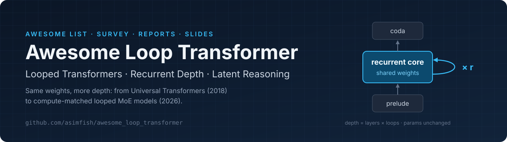

<div align="center">

<a href="https://github.com/asimfish/awesome_loop_transformer"></a>

[](https://awesome.re)
[](README.md#content)
[](#最近更新)
[](https://asimfish.github.io/awesome_loop_transformer/slides/html/)
[](LICENSE)
[](https://github.com/asimfish/awesome_loop_transformer/stargazers)

[English](README.md) · **中文导读** · [综述](survey/zh/survey_zh.md) · [逐篇解读](reports/zh/) · [在线幻灯](https://asimfish.github.io/awesome_loop_transformer/slides/html/) · [参与贡献](CONTRIBUTING.md)

</div>

# Awesome Loop Transformer：循环 Transformer、循环深度与潜在推理

论文列表（333 篇、14 个主题）以英文维护在 [README.md](README.md)，本文件是中文导读。

这是一个围绕 **循环 Transformer（looped / recurrent-depth / weight-tied transformer）** 及其周边潜在推理工作的资料库，覆盖 2018 年的 Universal Transformer 到 2026 年在算力匹配下首次战胜普通 MoE 的循环模型——也就是 The Information 报道中 GPT-6 Astra 所用的 "recurrent depth" 技术路线。

起点是微信文章[《刚刚，GPT-6 Astra 背后的 Loop 技术全被挖出来了》](https://mp.weixin.qq.com/s/7vEMyFVpf2O9WL4Lu4gSFQ)（PaperAgent，整理自 [@nrehiew_](https://x.com/nrehiew_/status/2095115984873062675) 的推文串）。文章串起的五篇论文在 README 中加 ⭐ 标注，每篇都有逐篇深度解读、保版式中译 PDF，并有一份含十条趋势洞察的综述。其余文献来自 2026-09-06 的 arXiv 全量检索，2026-11-06 补充了 9–11 月的新论文（README 中以 🆕 标注）。

## 最近更新

- **2026-11-06**：新增 2026 年 9–11 月的 211 篇论文（🆕），新增[九月以来的变化](#九月以来的变化)一节；英文 README 重排（每个主题加一句范围说明、条目压缩为一行并标注会议）。
- **2026-09-08**：每篇解读开头加"读前速览"和示意图、结尾加术语小词典；新增 5 分钟 / 30 分钟 / 2 小时阅读路线。
- **2026-09-06**：可编辑 PPTX（ppt-master）与中文 README。
- **2026-09-06**：首版：122 篇论文、五篇核心论文中英文解读、保版式中译、含十条洞察的综述、HTML 与 Beamer 幻灯。

## 仓库内容

| 交付物 | 路径 |
|---|---|
| 五篇核心论文原文 PDF + arXiv 全文（Markdown） | [`papers/original/`](papers/original/)、[`papers/src/`](papers/src/) |
| 保版式中译 PDF + 对象级 QA 报告（SuperTranslate） | [`papers/zh/`](papers/zh/)（[QA 记录](papers/zh/QA_SUMMARY.md)） |
| 逐篇深度解读（中、英） | [`reports/zh/`](reports/zh/)、[`reports/en/`](reports/en/) |
| 完整报告 PDF（综述 + 五篇解读，中、英） | [`reports/pdf/awesome_loop_transformer_report_zh.pdf`](reports/pdf/awesome_loop_transformer_report_zh.pdf)、[`…_en.pdf`](reports/pdf/awesome_loop_transformer_report_en.pdf) |
| 趋势综述：分类、八年时间线、约 60 篇文献图谱、十条洞察、未解问题 | [`survey/zh/survey_zh.md`](survey/zh/survey_zh.md)（[PDF](survey/zh/survey_zh.pdf)）、[`survey/en/`](survey/en/) |
| HTML 演示（21 页，中文）+ PDF 导出 · [在线查看](https://asimfish.github.io/awesome_loop_transformer/slides/html/) | [`slides/html/index.html`](slides/html/index.html)、[`slides/html/awesome_loop_transformer_slides_zh.pdf`](slides/html/awesome_loop_transformer_slides_zh.pdf) |
| 可编辑 PPTX（中文，ppt-master 原生形状导出）+ 预览 PDF | [`slides/pptx/awesome_loop_transformer_slides_zh.pptx`](slides/pptx/awesome_loop_transformer_slides_zh.pptx)（[预览](slides/pptx/awesome_loop_transformer_slides_zh.preview.pdf)） |
| Beamer 学术幻灯（英文，16:9，含备用页） | [`slides/beamer/loop_transformer_slides.pdf`](slides/beamer/loop_transformer_slides.pdf)（[源码](slides/beamer/loop_transformer_slides.tex)） |
| 机器可读论文表与摘要 | [`data/papers.csv`](data/papers.csv)、[`data/related_abstracts.json`](data/related_abstracts.json) |

## 从哪里开始读

| 你有 | 读什么 |
|---|---|
| 5 分钟 | 下面的十条洞察，再看综述附录 A（五处被二次传播放大的说法与原文对照） |
| 30 分钟 | [综述](survey/zh/survey_zh.md)第 2–4 节和第 6 节，或 21 页的 [HTML 演示](https://asimfish.github.io/awesome_loop_transformer/slides/html/) |
| 2 小时 | 五篇[逐篇解读](reports/zh/)——每篇开头有"读前速览"和一张示意图，结尾有术语小词典 |
| 要做汇报 | [可编辑 PPTX](slides/pptx/awesome_loop_transformer_slides_zh.pptx)（中文）或 [Beamer](slides/beamer/loop_transformer_slides.pdf)（英文） |

## 五篇核心论文一句话

| 论文 | 一句话 | 解读 |
|---|---|---|
| Universal Transformers（2018） | 把 N 层换成同一层重复 T 次，加 ACT 自适应停机；bAbI 联合训练错误率 22.1 → 0.29 | [zh](reports/zh/01_universal_transformers.md) · [中译](papers/zh/1807.03819.zh.pdf) |
| Recurrent Depth / Huginn-3.5B（2025-02） | 800B token 训成 3.5B 循环模型，r 从 4 到 32 时 ARC-E 49.1 → 69.9；定名 recurrent depth | [zh](reports/zh/02_recurrent_depth_huginn.md) · [中译](papers/zh/2502.05171.zh.pdf) |
| Training-Free Looped Transformers（2026-05） | 一层 = ODE 的一步欧拉，正确的循环是细分步长；不训练即让 Qwen3-4B MMLU-Pro +2.64 | [zh](reports/zh/03_training_free_looped.md) · [中译](papers/zh/2605.23872.zh.pdf) |
| LoopCoder-v2（2026-06） | 并行循环 Transformer 中第二次循环几乎是全部：SWE-bench Verified 43.0 → 64.4 → 27.6 | [zh](reports/zh/04_loopcoder_v2.md) · [中译](papers/zh/2606.18023.zh.pdf) |
| Loop the Loopies!（2026-07） | layer-loop + 实测步时匹配 + 两次循环，循环 MoE 第一次在算力匹配下反超 Qwen3-30B-A3B | [zh](reports/zh/05_loop_the_loopies.md) · [中译](papers/zh/2607.16051.zh.pdf) |

## 九月以来的变化

2026-11-06 新增 211 篇：167 篇首版提交于 2026-09-01 至 11-06，另有 44 篇是首轮检索漏掉的 6–8 月论文。下文数字均出自所引论文的摘要。

1. **从头训练的循环模型不靠 MoE 也能胜过匹配基线；给已训练模型事后加循环的收益不稳定**（细化洞察 1）。Loopback 在 token 数和执行深度相同的条件下，用标准 Transformer 40–75% 的 Transformer 参数达到更低的 loss（[2611.07226](https://arxiv.org/abs/2611.07226)）；约 600 次训练拟合的缩放律显示，完整训练的两次循环比算力最优的非循环模型少用 27% 非嵌入参数、多用 8% 算力（[2610.26030](https://arxiv.org/abs/2610.26030)）。对已训练的 Qwen3/Qwen3.5 事后加循环，只在 0.8B 上胜过等参数和等 FLOPs 基线（[2610.42030](https://arxiv.org/abs/2610.42030)）；RELOAD 微调带阻尼的中段循环，编码器在更长推理链上最多提高 23 分（[2611.07736](https://arxiv.org/abs/2611.07736)）。
2. **"两次循环"是现有设计的最优点，不是规律；自适应停机的节省被高估**（修正洞察 2）。LOOM 限制残差方差并为每次循环配路由器，把循环 MoE 扩到 9–12 次，700M 模型在近似等 FLOPs 下 5 次最好（[2610.01153](https://arxiv.org/abs/2610.01153)）；Qwen3-4B 的门控逐层循环 3 次最好（[2610.25004](https://arxiv.org/abs/2610.25004)）。在混合迭代数上训练的停机头按标准停机规则几乎每次都跑满，批量生成又抵消了大部分报告中的节省（[2610.32246](https://arxiv.org/abs/2610.32246)）。
3. **推理部署成为最大的技术方向，循环模型已进入生产推理引擎**（修正洞察 10 的工具链部分，细化洞察 6）。167 篇新论文中 26 篇以效率为主类。LoopVQ 在 SGLang 中把 Ouro 的服务吞吐最多提高到 6.1 倍（[2611.05304](https://arxiv.org/abs/2611.05304)）；LoopKV 的 vLLM 融合内核在 Ouro-1.4B 上达到 KIVI-4 的 1.7–2.2 倍 goodput（[2611.04137](https://arxiv.org/abs/2611.04137)）。只缓存最后一次循环的 KV 已写进 Dory1.0-4B 等开源权重（[2611.03998](https://arxiv.org/abs/2611.03998)），但近窗口 KV 共享在 Ouro-1.4B 上失效，因为共享代价取决于后几次循环收敛到什么程度（[2610.34436](https://arxiv.org/abs/2610.34436)）。
4. **循环深度会改变安全行为，十条洞察都没有覆盖这一维度。** Ouro-1.4B-Thinking 在一半深度下保留 89% 的 GSM8K 准确率，协助有害请求的比例却升到 5.3 倍；在随机深度上训练可以恢复各个深度的拒答（[2610.15218](https://arxiv.org/abs/2610.15218)）。越狱成功率随循环深度变化，并能在深度之间迁移（[2610.10625](https://arxiv.org/abs/2610.10625)）。后训练（洞察 7）需要覆盖模型可能运行的每个深度。
5. **"循环操作知识、不存储知识"开始落到架构上：在循环内加入显式记忆或状态通道**（支持洞察 8）。超出训练深度继续循环能提升推理、损害知识（[2609.36636](https://arxiv.org/abs/2609.36636)）。合成编辑实验中，有可寻址记忆时事实编辑的传播率为 0.71–0.96，只靠循环时仅 0.04–0.30（[2606.20737](https://arxiv.org/abs/2606.20737)）。有界门控单元让 LSTM-UT 训练到深度 12 后，在深度 60 仍保持 99.7% 的整行准确率（[2609.19521](https://arxiv.org/abs/2609.19521)）。
6. **应用扩展到生成式和科学基础模型**（扩展洞察 9）。260M 的 Looped-DiT 以 1/4.9 的推理算力超过大 6.5 倍的文生图模型（[2609.40305](https://arxiv.org/abs/2609.40305)）；Eco-RNA 迭代 4 次后在 RNAGym fitness 上超过 Evo 2 40B，参数少 500 倍（[2610.13106](https://arxiv.org/abs/2610.13106)）。

## 十条趋势洞察（简版，截至 2026-09-06）

1. **循环深度已跨过"算力匹配"这道门，但门很窄。** Loopie（实测步时匹配）与 SMELT（FLOPs / 参数 / KV 三重匹配）第一次战胜普通 MoE；胜利需要 MoE + 逐层或中段循环 + 两次循环，而且来自把省下的激活内存换成宽度，不是用循环替代参数（一次循环只值 r^0.46 份独立参数）。
2. **"循环几次"分裂成两个 regime。** 预训练算力受限 → 2（Loopie、LoopCoder-v2、SMELT、Nanbeige4.2）；推理算力可变 → 自适应且更深（Huginn 到 32–64）。LoopCoder-v2 的"三次以上回退"是 PLT 位置偏移的代价，不是循环的普适规律。
3. **循环粒度在变细、位置向中段收敛**（相对深度约 0.5）；MoE 必须 layer-mode。
4. **两种哲学**：把已训练模型的中段当 ODE 流（细分步长、保持终点）vs. 从头把循环训成不动点（STARS、Fixed-Point Reasoners、Attractor Models）。
5. **训练稳定性从经验教训变成定理**（残差缩放 1/N、DeepLoop 指数 1/2、学习率可跨循环数迁移）。
6. **推理成本被拆成延迟、KV 内存、量化三个子问题**，各有 2025–2026 年的方案（PLT、扩散式采样器、MELT、Looped Latent Attention 32×、LoopQ）。训练算力匹配 ≠ 推理成本匹配。
7. **隐式循环与显式 CoT 互补而非替代**：LoopCoder-v2 超加、LOTUS 弥合差距；标准 GRPO 与循环模型错配（RLTT、LoopRPT）。
8. **循环擅长"操作"知识，不擅长"存储"知识**——搭配检索、长上下文或 MoE 专家库。
9. **应用从数学谜题扩展到 agent 与具身智能**（SWE-bench、工具调用、VLA）。
10. **生产化已开始，工具链还没跟上。**

完整论证与出处见 [`survey/zh/survey_zh.md`](survey/zh/survey_zh.md)；被二次传播放大的五处说法与原文对照见综述附录 A。

## 复现

```bash
python3 src/fetch_metadata.py && python3 src/generator.py     # 论文表 -> README
export PAPER_CHINA_DEEPSEEK_API_KEY=...; export SUPER_TRANSLATE_HOME=/path/to/super_translate
bash scripts/translate_papers.sh                                # 保版式中译 + QA
bash scripts/build_pdfs.sh                                      # 报告 PDF（pandoc + XeLaTeX）
python3 scripts/export_slides.py                                # HTML 演示 -> PDF / 预览图
export PPT_MASTER_HOME=/path/to/ppt-master; bash scripts/build_pptx.sh   # 可编辑 PPTX
```

## 参与

漏收论文或会议信息有误，欢迎提 issue 或 PR，细则见 [CONTRIBUTING.md](CONTRIBUTING.md)。简要流程：在 [`src/fetch_metadata.py`](src/fetch_metadata.py) 的 `CURATED` 里加 arXiv ID（或在 [`data/papers.csv`](data/papers.csv) 加一行），运行 `python3 src/generator.py`。多个主题用 `;` 分隔；README.md 由脚本生成，不要手改。

## 许可

文字、报告、幻灯与数据：CC BY 4.0；`src/`、`scripts/` 代码：MIT。原论文版权归作者；`papers/zh/` 的中译为学习用途的衍生作品。
