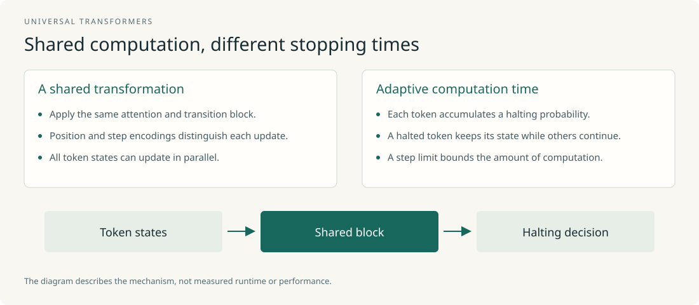

# Report 01 · Universal Transformers: Where Recurrent Depth Began

| Item | Detail |
|---|---|
| Paper | Universal Transformers |
| arXiv | [1807.03819](https://arxiv.org/abs/1807.03819) (Jul 2018), ICLR 2019 |
| Authors | Mostafa Dehghani\*, Stephan Gouws\*, Oriol Vinyals, Jakob Uszkoreit, Łukasz Kaiser (U. Amsterdam / DeepMind / Google Brain) |
| Code | [tensor2tensor](https://github.com/tensorflow/tensor2tensor) |
| In this repo | Original `papers/original/1807.03819.pdf` · Chinese `papers/zh/1807.03819.zh.pdf` |

## At a glance

> **Problem** · Transformers have fixed depth and lack the RNN bias toward re-applying one transformation; they overfit on multi-hop reasoning (bAbI) and fail on algorithmic tasks.  
> **Method** · Replace N distinct layers with one layer applied T times, add position+timestep coordinate embeddings; ACT lets each position decide when to stop.  
> **Result** · bAbI joint-training error 22.1 → 0.29, LAMBADA perplexity 7321 → 142, WMT14 +0.9 BLEU.  
> **Limits** · Poor parameter-to-compute ratio, unstable training, inference cost undiscussed — the research agenda of the next eight years.  
> **Plain words** · Run the same circuit several times: hard tokens get more rounds, easy ones stop early.  

*Figure: one shared block repeated over time steps; positions halt at different steps.*

## One sentence

Replace the Transformer's N distinct layers with one set of parameters applied T times, add a per-position halting mechanism (ACT) that decides how long each symbol "thinks", and you get a parallel-in-time, recurrent-in-depth, Turing-complete sequence model that beats a same-size Transformer on bAbI, LAMBADA, algorithmic tasks, and WMT14 translation.

## 1. The problem

The 2018 Transformer had two weaknesses that were already visible at the time. First, fixed depth: every token goes through the same 6 layers regardless of difficulty. Second, it lacks the RNN's inductive bias toward applying the same transformation repeatedly, so it does badly on algorithmic tasks (copy, reverse, addition) and simply overfits on multi-hop reasoning benchmarks like bAbI (the authors note they tried many hyperparameters and sizes; it always overfit).

Neural GPUs and Neural Turing Machines have recurrence and universal computation, but cannot compete with the Transformer on real language tasks such as translation. UT's goal is to put both sets of strengths into one model.

## 2. Method

### 2.1 Recurrence over depth

Starting from input embeddings $H^0 \in \mathbb{R}^{m\times d}$, each time step $t$ does two things for all $m$ positions in parallel: multi-head self-attention exchanges information across positions, then a position-wise transition function transforms each position:

$$A^t = \mathrm{LN}\big((H^{t-1}+P^t) + \mathrm{MHSA}(H^{t-1}+P^t)\big),\qquad H^t = \mathrm{LN}\big(A^t + \mathrm{Transition}(A^t)\big)$$

After $T$ steps the encoder outputs $H^T$. All time steps share the same attention and transition parameters, so "number of layers" no longer equals "number of parameters". The transition function is either a two-layer position-wise feed-forward network or a depthwise-separable convolution (the latter works better on algorithmic tasks).

### 2.2 Coordinate embeddings: position + time step

Because parameters are shared, the model must know which step it is on. UT generalizes sinusoidal position encodings into two-dimensional coordinate embeddings $P^t$: sinusoidal encodings of position $i$ and time step $t$ are computed separately and summed (Eq. 6–7), then added back to the state at every step. This is the ancestor of every later "timestep encoding" in looped models.

### 2.3 Dynamic halting (ACT)

Graves' (2016) Adaptive Computation Time is attached to each position: at every step the model predicts a halting probability per position; once the cumulative probability crosses a threshold, that position stops updating and its state is copied forward until all positions halt or the step limit is hit. Different tokens therefore receive different "ponder time".

### 2.4 Computational power

With fixed $T$, UT is a Transformer with weights tied across layers. Letting $T$ scale with the input length, UT reduces exactly to a Neural GPU (set self-attention to identity, the transition to a convolution, $T$ = input length), and is therefore Turing-complete given enough memory. The authors stress the key difference from RNNs: an RNN's recurrent step can only access a fixed-size state vector, whereas each UT step attends to every position's representation from the previous step.

## 3. Key experiments and numbers

| Task | Transformer | UT | UT + dynamic halting |
|---|---|---|---|
| bAbI 10K, 20 tasks joint (avg error / failed tasks) | 22.1 (12/20) | 0.47 (0/20) | **0.29 (0/20)** |
| bAbI 1K, joint | 26.8 (14/20) | 8.50 (8/20) | **7.78 (5/20)** |
| Subject–verb agreement, 5 attractors | 0.883 | 0.892 | **0.907** |
| LAMBADA LM test perplexity | 7321 | 319 (fixed 6 steps) | **142** |
| WMT14 En–De BLEU (base) | 28.0 | **28.9** | – |
| Copy / Reverse / Addition (train len 40, test len 400), char acc. | 0.53 / 0.13 / 0.07 | **0.91 / 0.96 / 0.34** | – |
| Learning-to-Execute memorization (Copy/Double/Reverse), seq acc. | 0.63 / 0.55 / 0.26 | **1.0 / 1.0 / 1.0** | – |

Three observations worth isolating:

1. **Ponder time tracks difficulty.** On bAbI questions needing 1, 2, and 3 supporting facts, mean ponder time is 2.3±0.8, 3.1±1.1, and 3.8±2.2 steps. The model allocates compute on demand.
2. **Dynamic halting acts as a regularizer.** On LAMBADA the halting model averages 8.2 steps; fixed 8- and 9-step UTs both beat the 6-step model but neither beats the dynamic one. Taking more steps is not the whole story.
3. **More distractors, bigger advantage.** In subject–verb agreement, UT+ACT's margin over the prior best grows monotonically with attractor count (from 0 to +0.027). The gains from recurrence concentrate on hard instances — a pattern that reappears almost verbatim in the Huginn paper seven years later.

## 4. Why it matters

UT fixed the three ingredients every later work on this line uses: **parameter-shared depth recurrence**, **a conditioning signal re-injected at every step** (coordinate embeddings here, input injection later), and **adaptive halting**. The "model-loop" of today's recurrent-depth literature is UT's original form.

It also left three problems open that define the following seven years of research:

- **Parameter-to-compute ratio.** Sharing parameters collapses parameter count at a given hidden size, which hurts on parameter-dominated tasks like language modeling. UT base beats Transformer base by only 0.9 BLEU on translation — in parameter-rich regimes the marginal value of recurrence is small. This was not properly addressed until MoEUT (2024) and Loopie (2026) combined looping with MoE.
- **Training instability.** ACT's halting probabilities need extra regularization and are hyperparameter-sensitive; deep recurrence is hard to optimize. Huginn later used truncated backpropagation, Loopie used layer-loop, and several 2026 papers derive residual-scaling theory to fix this.
- **Compute cost.** Every extra loop is another full forward pass. UT does not discuss inference latency or the KV cache; those become the subject of PLT, MELT, and Looped Latent Attention in 2025–2026.

## 5. Limitations

- Small scale (WMT base at most); nothing above ~100M parameters.
- ACT gains are inconsistent: the translation experiments use fixed steps, not ACT.
- Encoder–decoder; the decoder-only era needed a redesign (Huginn's prelude–core–coda is the direct descendant).

## 6. Relation to other work

- **Predecessors:** Neural GPU (Kaiser & Sutskever 2016), Neural Turing Machine (Graves 2014), ACT (Graves 2016).
- **Contemporaries:** ALBERT (Lan et al. 2019) uses cross-layer sharing on BERT for compression — same idea, different goal.
- **Direct descendants:** Sparse Universal Transformer (Tan et al. 2023) and MoEUT (Csordás et al. 2024) address the parameter–compute ratio; Giannou et al. (2023) re-prove universality from a "programmable computer" angle; Geiping et al. (2025) scale it to 3.5B.

## 7. Practical takeaways

- Recurrence pays off on tasks that need iteration (multi-hop, algorithmic, long dependencies) and barely at all on pure recall. Split benchmarks along this line when evaluating looped models.
- Adaptive halting is a regularizer, not only a compute saver. RecurTrace and Think-at-Hard (2026) re-confirm this.
- Timestep conditioning (telling the model which step it is on) is in tension with path independence: the Huginn paper reports that feeding the step index breaks extrapolation. UT's choice is not right in every setting.

## Appendix: quick numbers

- Encoder–decoder; parameters shared across time steps; transition = FFN or separable conv.
- bAbI 10K joint error: 22.1% → 0.29%.
- LAMBADA test perplexity: 7321 → 142.
- WMT14 En–De: 28.0 → 28.9 BLEU.
- ACT mean steps vs. required facts: 2.3 / 3.1 / 3.8 (1 / 2 / 3 facts).

## Glossary

| Term | One-line meaning |
|---|---|
| Recurrent depth / looped transformer | The same parameters are applied repeatedly along depth; effective depth = stored layers × loop count, parameters unchanged |
| model-loop / block-loop / layer-loop | Loop the whole stack / only a middle segment / each layer several times before the next; see `assets/figures/en/loop_granularity.svg` |
| Input injection | Re-feed the input embedding at every loop; without it the iteration is unstable |
| Truncated backprop | Compute gradients through only the last k loops so memory is independent of the loop count |
| Adaptive halting (ACT) | Let each token decide how many loops it needs |
| Path independence | Different random initial states converge to the same behavior |
| KV cache | Cached attention keys/values; looped models add one copy per loop, the main memory bottleneck |
| MoE | Mixture of experts: each token activates a small subset of parameters; "20B-A2B" = 20B total, 2B active |
| FLOP-matched vs measured-compute-matched | Aligning theoretical compute vs aligning measured training step time — the activation memory looping saves only shows up in the latter |
| Latent reasoning vs explicit CoT | Extra computation in hidden space vs intermediate steps written as text tokens |
| Fixed point | A state that another loop leaves unchanged; one line of work trains loops to converge to fixed points for stability |
| PLT / CLP | Parallel Loop Transformer / cross-loop position offset — shift the previous round's states by one token so rounds run in parallel |
