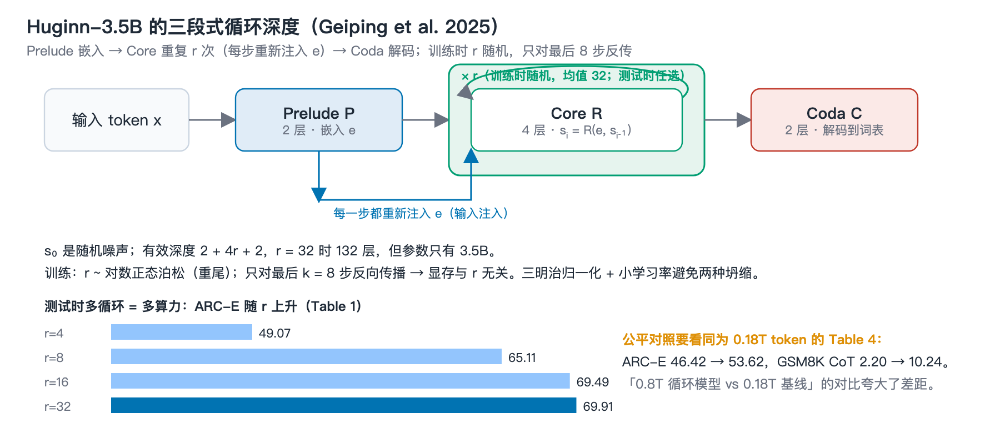

# Report 02 · Scaling up Test-Time Compute with Latent Reasoning: Recurrent Depth at 3.5B

| Item | Detail |
|---|---|
| Paper | Scaling up Test-Time Compute with Latent Reasoning: A Recurrent Depth Approach |
| arXiv | [2502.05171](https://arxiv.org/abs/2502.05171) (Feb 2025) |
| Authors | Jonas Geiping, Sean McLeish, Neel Jain, John Kirchenbauer, Siddharth Singh, Brian R. Bartoldson, Bhavya Kailkhura, Abhinav Bhatele, Tom Goldstein (ELLIS Tübingen / MPI-IS / U. Maryland / LLNL) |
| Model / code | [huginn-0125](https://huggingface.co/tomg-group-umd/huginn-0125) · [recurrent-pretraining](https://github.com/seal-rg/recurrent-pretraining) |
| In this repo | Original `papers/original/2502.05171.pdf` · Chinese `papers/zh/2502.05171.zh.pdf` |

## At a glance

> **Problem** · Can the 2018 recurrent-depth idea be trained at modern LLM scale, and does it really improve with more test-time loops?  
> **Method** · 2-layer prelude + 4-layer looped core + 2-layer coda; loop count sampled per sequence at training (mean 32), backprop through the last 8 steps only; 800B tokens on 4096 GPUs.  
> **Result** · Loops 4 → 32: ARC-E 49.1 → 69.9, GSM8K CoT ≈0 → 42.1; at equal 0.18T tokens the fair baseline comparison gives ARC-E +7.2 and ~5× on GSM8K.  
> **Limits** · Every extra loop is another core forward; weak factual memory (MMLU 31); a single large run whose LR was never cooled.  
> **Plain words** · Few parameters, but the model can think several rounds before speaking; the harder the question, the more the rounds help.  

*Figure (labels in Chinese): the three-stage architecture and training recipe; bottom-right, ARC-E rising with loop count and the correct reading of the fair comparison.*

## One sentence

Pretrain a 3.5B-parameter decoder-only model with a 2-layer prelude, a 4-layer recurrent core, and a 2-layer coda (Huginn-0125) on 800B tokens across 4096 AMD MI250X GPUs, sampling the number of loops randomly during training and backpropagating through only the last 8; at inference, raising the loop count from 4 to 32 lifts ARC-E from 49.1 to 69.9 and GSM8K-CoT from near zero to 42.1, with no chain-of-thought data at all. This paper coined "recurrent depth" and is the first to make it train at modern language-model scale.

## 1. The problem

Mainstream test-time scaling (o1, R1) generates longer chains of thought. The costs: purpose-built long-CoT training data, large context windows, and every intermediate thought squeezed into discrete tokens. The authors test the alternative — let the model iterate in continuous latent space by re-applying one block, unrolling the network to arbitrary depth.

UT proposed this in 2018 but nobody had trained it at modern LLM scale. The question here is engineering: which architecture, initialization, and objective let depth recurrence converge stably at billions of parameters and nearly a trillion tokens, and actually improve with more loops.

## 2. Method

### 2.1 Three-stage architecture: Prelude → Core (looped) → Coda

With $r$ recurrences and input tokens $\mathbf{x}$:

$$\mathbf{e}=P(\mathbf{x}),\qquad \mathbf{s}_0\sim\mathcal{N}(0,\sigma^2 I),\qquad \mathbf{s}_i=R(\mathbf{e},\mathbf{s}_{i-1})\ (i=1..r),\qquad \mathbf{p}=C(\mathbf{s}_r)$$

- **Prelude $P$** (2 layers) embeds tokens into latent space.
- **Core $R$** (4 layers) takes the concatenation of the previous state $\mathbf{s}_{i-1}$ and the embedding $\mathbf{e}$, maps it back to width $h$ through an adapter $A:\mathbb{R}^{2h}\to\mathbb{R}^h$, and runs 4 transformer layers. **$\mathbf{e}$ is re-injected at every step.** The authors' analogy is gradient descent on $E(\mathbf{x},\mathbf{y})$: every step needs the data $\mathbf{y}$; an iteration that sees the data only once cannot be stable. The initial state $\mathbf{s}_0$ is random noise; together with input injection this drives convergence to a steady state independent of initialization (path independence).
- **Coda $C$** (2 layers) decodes to the vocabulary.

Main model shape $(l_P,l_R,l_C)=(2,4,2)$, width $h=5280$, 55 heads × 96, MLP inner 17920. Parameters: 1.5B non-recurrent, 1.5B recurrent core, 0.5B tied embeddings — 3.5B total. At $r=32$ the effective depth is $2+4\times32+2=132$ layers.

### 2.2 Micro design: sandwich normalization

Each layer uses four RMSNorms bracketing attention and MLP ($n_1$–$n_4$). At small scale pre-norm and post-norm both train; at large scale only the sandwich format produces a model that actually uses its recurrence (see the two failed runs in §4). Everything else is standard: RoPE (base 50000), gated SiLU MLP, QK biases.

### 2.3 Objective: random unrolling + truncated backprop

For each training sequence sample $r\sim\Lambda$ and minimize the expected loss

$$\mathcal{L}(\theta)=\mathbb{E}_{\mathbf{x}}\,\mathbb{E}_{r\sim\Lambda}\,L\big(m_\theta(\mathbf{x},r),\mathbf{x}'\big)$$

$\Lambda$ is a log-normal Poisson: $\tau\sim\mathcal{N}(\log\bar r-\tfrac12\sigma^2,\sigma)$, $r\sim\mathrm{Poisson}(e^\tau)+1$, with mean $\bar r=32$ and $\sigma=1/2$. It mostly samples below 32 but has a heavy tail.

**Backpropagate through the last $k=8$ iterations only.** Activation memory and backward compute become independent of $r$, which is what makes the heavy-tailed distribution affordable. The prelude still receives gradients at every step because its output $\mathbf{e}$ is injected at every step. This is truncated BPTT, applied along depth instead of time.

### 2.4 Large-scale training details

- Data: 800B tokens (795B realized), all public, skewed toward code and math; instruction data mixed directly into pretraining. Vocabulary 65536, sequence length 4096.
- Hardware: ORNL Frontier, 4096 MI250X, 21 segments of up to 12 hours; 108.75 TFLOP/s per node (87% achievable utilization), 52–64 TFLOP/s per GPU at 4096 GPUs. Because of weight sharing, even the largest model trains with data parallelism plus optimizer sharding only — no tensor parallelism.
- Optimization: Adam (0.9, 0.95), constant LR $4\times10^{-5}$ after a 4096-step warm-up, no decay; one $r$ per micro-batch synchronized across workers (locked-step sampling) so nobody idles.
- Initialization: Takase et al. (2024), variance $2/(5h)$; output projections $1/(5hl)$ with $l=132$ effective layers.

## 3. Key experiments and numbers

### 3.1 Performance rises monotonically with loop count (Table 1)

| Loops $r$ | ARC-E | ARC-C | HellaSwag | MMLU | OBQA | PiQA | SciQ | WinoGrande |
|---|---|---|---|---|---|---|---|---|
| 4 | 49.07 | 27.99 | 43.46 | 23.39 | 28.20 | 64.96 | 80.00 | 55.24 |
| 8 | 65.11 | 35.15 | 58.54 | 25.29 | 35.40 | 73.45 | 92.10 | 55.64 |
| 16 | 69.49 | 37.71 | 64.67 | 31.25 | 37.60 | 75.79 | 93.90 | 57.77 |
| 32 | **69.91** | **38.23** | **65.21** | **31.38** | **38.80** | **76.22** | 93.50 | **59.43** |

Against other open models it lands near OLMo-7B (2.5T tokens) and behind OLMo-2 (4T tokens, curated data). The authors' own framing: a 3.5B model that spends FLOPs like a 32B one — per-token pretraining FLOPs are close to a 32B dense transformer, and test-time scaling continues up to the FLOP budget of a ~50B model.

### 3.2 Math and code (Tables 2–3)

GSM8K CoT 34.80/42.08 (with system prompt, flexible/strict), Minerva MATH 12.58, MBPP 24.80, HumanEval 23.17. It beats every comparison model except OLMo-2 on math and every general-purpose open model on code. The constant LR allows weight averaging to simulate a cooldown: the EMA model reaches 47.23% GSM8K flexible at $r=64$.

### 3.3 The fair comparison: same data, same setup, non-recurrent baseline (Table 4)

This is the most important table in the paper and the one most often misquoted downstream. The baseline is **the same architecture run once through the core, trained on 180B tokens**; the recurrent model also has a 180B early checkpoint.

| Model | Tokens | ARC-E | HellaSwag | GSM8K CoT |
|---|---|---|---|---|
| Fixed-depth baseline | 0.18T | 46.42 | 37.34 | 1.82/2.20 |
| Recurrent, early ckpt, $r=32$ | 0.18T | 53.62 | 48.80 | 9.02/10.24 |
| Recurrent, early ckpt, $r=1$ | 0.18T | 34.01 | 29.19 | 0.00/0.15 |
| Recurrent, final, $r=32$ | 0.8T | 69.91 | 65.21 | 34.80/42.08 |
| Recurrent, final, $r=1$ | 0.8T | 34.89 | 29.34 | 0.00/0.00 |

Correct reading: **at equal 180B tokens**, the recurrent model beats the baseline by 7.2 points on ARC-E, 11.5 on HellaSwag, and roughly 5× on GSM8K. Some popular write-ups place the 0.8T recurrent model next to the 0.18T baseline as if both were "0.8T", which inflates the gap; the paper has no 0.8T non-recurrent baseline.

The $r=1$ rows carry a second message: from 180B to 800B tokens, $r=1$ performance barely moves (34.01 → 34.89). Everything learned in the last 620B tokens lives **entirely in the iterations of the recurrent block**; the prelude and coda did not get stronger.

### 3.4 Where recurrence helps most

- Hard tasks benefit most (ARC-C); pure fact recall benefits least (SciQ).
- **More context, more loops needed.** ARC-C saturates at 8–12 iterations zero-shot, ~20 with 1 example, 32 with 25–50 examples (Figure 9). The model spends more recurrence to extract more from more context.
- **Open-book vs. closed-book.** Given the relevant fact, OBQA rises from 38.2 to 49.2 (+11.0), nearly closing the gap to OLMo-2. Recurrent models memorize fewer facts but reason more over what is in context.

## 4. Two failed runs: why scaling is hard (§4.3)

- **Failure 1:** parameter-free RMSNorm, no embedding scale, additive adapter $A(\mathbf{s},\mathbf{e})=\mathbf{s}+\mathbf{e}$, peak LR $4\times10^{-4}$. **Hidden-state collapse**: the correlation of hidden states across tokens shoots to 1.0 — the model predicts the same state for every position. Each recurrence mixes the sequence a little more until it collapses.
- **Failure 2:** add embedding scaling, revert to conventional pre-norm, learned adapter. Correlation spikes to 1.0 in the first 150 steps then recovers, but **recurrence collapse** follows: validation perplexity is identical at $r=1$ and $r=32$. The model learned early to ignore the incoming state $\mathbf{s}$ and sits in a no-recurrence local minimum.
- **Success:** back to sandwich norms, LR down 10× to $4\times10^{-5}$. The next 750B tokens train smoothly without loss spikes.

These lessons were later formalized by Loopie (SmallInit), DeepLoop, and "On the Residual Scaling of Looped Transformers" ($\varepsilon=1/N$ scaling).

## 5. Capabilities that come for free (§6)

Each of these needs dedicated training on a standard transformer; Huginn gets them zero-shot:

1. **Per-token adaptive compute.** Stop when the KL between two successive steps' output distributions drops below $5\times10^{-4}$. Steps needed differ by MMLU category: fewest for high-school math, 3.5 more on average for moral scenarios. MT-Bench 5.63 → 5.56.
2. **KV-cache sharing.** Keep only $k$ recurrence slots per token; step $i$ reads/writes slot $i \bmod k$. With budget 4, MT-Bench is 5.86 — no loss. All recurrent KV entries come from the same projection matrices, so they "match".
3. **Continuous chain of thought.** Warm-start $\mathbf{s}_0$ from the previous token's final state $\mathbf{s}_r$ instead of fresh noise; converges 1–2 steps sooner on average. Related to Coconut (Hao et al. 2024), except Huginn pretrains recurrence from scratch and needs no CoT data.
4. **Self-speculative decoding.** Draft with few loops, verify with many; the drafting states are reused during verification, so no separate draft model is needed.

## 6. What happens in latent space (§7)

PCA of trajectories $\{\mathbf{s}_i\}$ (Figures 11–12):

- Most tokens converge monotonically to a fixed point.
- Tokens tied to numerical reasoning (the "3" in a GSM8K problem) fall into **multi-dimensional orbits**, periodic in all three pairs of leading principal directions; structural tokens ("makes", "thinks") also orbit.
- Some key tokens ("wrong") behave as **sliders**: steady drift along one direction, plausibly implementing a step counter.
- Convergence speed is context-dependent: three identical "." tokens in one sentence behave differently; the crux of a question and the start of the answer are "deliberated" longest.
- Path independence holds: different $\mathbf{s}_0$ give the same orbits, fixed points, and drifts.

None of this geometry is in the training objective; it emerges from scale. The authors read it as the model organizing computation spatially in a high-dimensional space rather than linearly as in verbal CoT.

## 7. Limitations

- One large run: 47000 steps, LR never cooled, data mixture never ablated. The authors call it a proof of concept.
- Each extra loop is another core forward; $r=32$ costs 16×+ the inference of an 8-layer dense model, and the KV cache grows linearly in $r$ (§5's sharing mitigates, not solves).
- Weak factual memory (MMLU 31.4, low closed-book OBQA), consistent with the few-parameters-many-FLOPs design.
- Lu et al. (2025) probe Huginn with logit lens and find limited evidence of interpretable "latent CoT", with diminishing returns from extra loops. Viakhirev et al. (2026) classify Huginn as "non-settling" — more loops do not guarantee the decoded answer stays fixed.

## 8. Relation to other work

- Roots: UT (2018); deep-thinking line (Schwarzschild 2021, Bansal 2022: random unrolling + input injection); path-independent equilibrium models (Anil 2022).
- Versus DEQ: DEQ solves for the fixed point directly; Huginn trains by truncated unrolling, which the authors argue scales better.
- Direct successors: Ouro (2.6B, 7.7T tokens, 4 loops), Loopie (MoE, 2-step layer-loop), LoopCoder-v2 (PLT, 2 loops); Geiping's group later connects recurrent-depth models to diffusion LMs with a parallel sampler giving up to 5× speedup (2510.14961); McLeish et al. (2025) study converting pretrained non-recurrent models into recurrent ones.
- §9's prediction has come true: recurrence (good at reasoning) and MoE (good at storage) are complementary and "a future architecture would contain both" — exactly Loopie and SMELT.

## 9. Practical takeaways

- Normalization and initialization look irrelevant at small scale and decide success at large scale. Any small-scale ablation of a looped architecture must check whether the loop is actually used (compare perplexity at $r=1$ and $r=\max$).
- Input injection + random initial state + random loop count + truncated backprop is the current standard recipe for extrapolating recurrent models.
- Recurrent models trade parameters for compute: strong at reasoning over context, weak at storing facts. They gain more than dense models from retrieval or long context at deployment.
- "3.5B behaves like 50B" means FLOP-equivalent, not benchmark-equivalent. The gap to OLMo-2-7B is real.

## Appendix: quick numbers

- Shape (2,4,2), $h=5280$, 3.5B params, 132 effective layers at $r=32$.
- 800B tokens, 4096 MI250X, constant LR $4\times10^{-5}$, $\bar r=32$, truncated backprop $k=8$.
- $r$: 4→32 gives ARC-E 49.07→69.91, HellaSwag 43.46→65.21, GSM8K CoT (strict) →42.08.
- Fair 180B comparison: ARC-E 46.42 vs 53.62; GSM8K CoT 2.20 vs 10.24.
- Adaptive exit threshold KL $<5\times10^{-4}$; KV budget 4 keeps MT-Bench intact.

## Glossary

| Term | One-line meaning |
|---|---|
| Recurrent depth / looped transformer | The same parameters are applied repeatedly along depth; effective depth = stored layers × loop count, parameters unchanged |
| model-loop / block-loop / layer-loop | Loop the whole stack / only a middle segment / each layer several times before the next; see `assets/figures/diagrams/loop_granularity.png` |
| Input injection | Re-feed the input embedding at every loop; without it the iteration is unstable |
| Truncated backprop | Compute gradients through only the last k loops so memory is independent of the loop count |
| Adaptive halting (ACT) | Let each token decide how many loops it needs |
| Path independence | Different random initial states converge to the same behavior |
| KV cache | Cached attention keys/values; looped models add one copy per loop, the main memory bottleneck |
| MoE | Mixture of experts: each token activates a small subset of parameters; "20B-A2B" = 20B total, 2B active |
| FLOP-matched vs measured-compute-matched | Aligning theoretical compute vs aligning measured training step time — the activation memory looping saves only shows up in the latter |
| Latent reasoning vs explicit CoT | Extra computation in hidden space vs intermediate steps written as text tokens |
| Fixed point | A state that another loop leaves unchanged; one line of work trains loops to converge to fixed points for stability |
| PLT / CLP | Parallel Loop Transformer / cross-loop position offset — shift the previous round's states by one token so rounds run in parallel |
