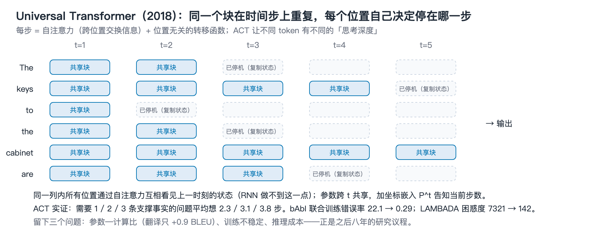

# 解读 01 · Universal Transformers：循环深度的源头

| 项目 | 内容 |
|---|---|
| 论文 | Universal Transformers |
| arXiv | [1807.03819](https://arxiv.org/abs/1807.03819)（2018-07），ICLR 2019 |
| 作者 | Mostafa Dehghani\*、Stephan Gouws\*、Oriol Vinyals、Jakob Uszkoreit、Łukasz Kaiser（阿姆斯特丹大学 / DeepMind / Google Brain） |
| 代码 | [tensor2tensor](https://github.com/tensorflow/tensor2tensor) |
| 本仓库 | 原文 `papers/original/1807.03819.pdf` · 中译 `papers/zh/1807.03819.zh.pdf` |

## 读前速览

> **问题** · Transformer 深度固定，也没有 RNN 那种"把同一个变换反复用"的归纳偏置，在算法任务和多跳推理（bAbI）上直接过拟合。  
> **做法** · 把 N 层不同参数换成同一层重复 T 次，加"位置 + 步数"坐标嵌入；ACT 让每个位置自己决定停在第几步。  
> **结果** · bAbI 联合训练错误率 22.1 → 0.29，LAMBADA 困惑度 7321 → 142，WMT14 翻译 +0.9 BLEU。  
> **局限** · 参数—计算比差（参数主导的任务收益小）、训练不稳、没有讨论推理成本——这三点成了之后八年的研究议程。  
> **大白话** · 让同一个"脑回路"多转几圈：难的词多转几圈，简单的词转一圈就停。  

*图：同一个共享块沿时间步重复，每个位置在不同步数停机（示意）。*

## 一句话

把 Transformer 的 N 层不同参数换成同一组参数重复 T 次，再给每个位置配一个"想多久"的停机机制（ACT），得到一个时间上并行、深度上循环、理论上图灵完备的序列模型；它在 bAbI、LAMBADA、算法任务和 WMT14 翻译上全面超过同规模 Transformer。

## 1. 要解决的问题

2018 年的 Transformer 有两个当时就被指出的缺陷。第一，深度固定：无论输入多难，每个 token 都经过同样的 6 层。第二，缺少 RNN 那种"反复应用同一个变换"的归纳偏置，因此在需要迭代的算法任务上（复制、反转、加法）表现很差，在 bAbI 这类需要多跳推理的任务上直接过拟合（作者注明"换了多组超参和网络规模，始终过拟合"）。

Neural GPU、Neural Turing Machine 这类模型有循环和通用计算能力，但在真实语言任务（翻译）上无法与 Transformer 竞争。UT 的目标是把两边的优点合到一个模型里。

## 2. 核心方法

### 2.1 深度方向的循环

编码器从输入嵌入 $H^0 \in \mathbb{R}^{m\times d}$ 出发，每个时间步 $t$ 对所有 $m$ 个位置并行做两件事：先用多头自注意力交换位置间的信息，再用一个位置无关的转移函数（Transition）逐位置变换：

$$A^t = \mathrm{LN}\big((H^{t-1}+P^t) + \mathrm{MHSA}(H^{t-1}+P^t)\big),\qquad H^t = \mathrm{LN}\big(A^t + \mathrm{Transition}(A^t)\big)$$

$T$ 步之后输出 $H^T$。所有时间步共享同一组注意力和转移函数参数，因此"层数"不再等于"参数量"。转移函数有两种选择：逐位置的两层前馈网络，或深度可分离卷积（后者在算法任务上更好）。

### 2.2 坐标嵌入：位置 + 时间步

因为参数共享，模型必须知道自己"现在是第几步"。UT 把正弦位置编码推广为二维坐标嵌入 $P^t$，对位置 $i$ 和时间步 $t$ 分别计算正弦编码再相加（式 6–7），在每一步重新加到状态上。这是后来所有循环模型里"步数条件化"（timestep encoding）的雏形。

### 2.3 动态停机（ACT）

把 Graves (2016) 的 Adaptive Computation Time 装到每个位置上：每步为每个位置预测一个停机概率，累计超过阈值就停止更新、状态原样复制到后续步，直到所有位置停机或达到最大步数。这样不同 token 得到不同的"思考深度"（ponder time）。

### 2.4 计算能力

固定 $T$ 时，UT 就是一个跨层权重绑定的 Transformer。让 $T$ 随输入长度变化，UT 可以精确还原 Neural GPU（把自注意力设为恒等、转移函数设为卷积、$T=$ 输入长度），因此在有足够内存的前提下是图灵完备的。作者强调这与 RNN 的关键区别：RNN 的循环步只能访问固定大小的状态向量，UT 的每一步都能通过注意力访问上一步所有位置的表示。

## 3. 关键实验与数字

| 任务 | Transformer | UT | UT + 动态停机 |
|---|---|---|---|
| bAbI 10K，20 任务联合训练（平均错误率 / 失败任务数） | 22.1 (12/20) | 0.47 (0/20) | **0.29 (0/20)** |
| bAbI 1K，联合训练 | 26.8 (14/20) | 8.50 (8/20) | **7.78 (5/20)** |
| 主谓一致（5 个干扰名词） | 0.883 | 0.892 | **0.907** |
| LAMBADA 语言建模测试集困惑度 | 7321 | 319（固定 6 步） | **142** |
| WMT14 En-De BLEU（base 规模） | 28.0 | **28.9** | – |
| Copy / Reverse / Addition（训练长 40，测试长 400）字符准确率 | 0.53 / 0.13 / 0.07 | **0.91 / 0.96 / 0.34** | – |
| Learning-to-Execute 记忆任务（Copy/Double/Reverse）序列准确率 | 0.63 / 0.55 / 0.26 | **1.0 / 1.0 / 1.0** | – |

三个值得单独说的观察：

1. **停机步数跟随任务难度。** bAbI 中需要 1、2、3 条支撑事实的问题，平均 ponder time 分别为 2.3±0.8、3.1±1.1、3.8±2.2。模型确实按需分配计算。
2. **动态停机是一种正则化。** LAMBADA 上动态停机模型平均走 8.2 步；作者补训了固定 8 步和 9 步的 UT，两者都好于 6 步，但都不如动态版本。多走步数本身不是全部原因。
3. **干扰越多、优势越大。** 主谓一致任务里，UT+ACT 相对当时最佳模型的优势随干扰名词数量单调增加（从 0 到 +0.027）。循环带来的收益集中在难样本上，这个模式在七年后的 Huginn 论文里以几乎相同的形式重现。

## 4. 为什么重要

UT 定义了这条技术路线此后所有工作的三个基本要素：**参数共享的深度循环**、**每步重新注入的条件信号**（这里是坐标嵌入，后来演变为输入注入）、**自适应停机**。今天 recurrent depth 文献中的 model-loop（整模型循环）就是 UT 的原始形态。

同时它也留下了三个长期没解决的问题，构成后续七年的研究议程：

- **参数—计算比。** 共享参数让同等隐藏维度下的参数量骤减，在语言建模这种"参数主导"的任务上吃亏。翻译任务上 UT base 只比 Transformer base 高 0.9 BLEU，说明在参数充足的场景里循环的边际收益有限。这个问题直到 MoEUT（2024）、Loopie（2026）把循环和 MoE 结合才真正被处理。
- **训练不稳定。** ACT 的停机概率需要额外的正则项且对超参敏感；深度循环的梯度也不好训。后续 Huginn 用截断反传、Loopie 用 layer-loop、多篇 2026 年论文用残差缩放理论来解决。
- **计算成本。** 每多循环一步就多一次完整前向。UT 没有讨论推理时的延迟和 KV cache 问题；这是 PLT、MELT、Looped Latent Attention 等 2025–2026 年工作的主题。

## 5. 局限

- 实验规模小（最大 WMT base），没有在参数量超过 1 亿的设定下验证。
- ACT 的收益不稳定：翻译实验里作者没有使用 ACT，只用固定步数。
- 编码器—解码器结构；decoder-only 时代需要重新设计（Huginn 的 prelude–core–coda 三段式是最直接的继承者）。

## 6. 与本方向其他工作的关系

- **前驱**：Neural GPU（Kaiser & Sutskever 2016）、Neural Turing Machine（Graves 2014）、ACT（Graves 2016）。
- **同期**：ALBERT（Lan et al. 2019）把跨层参数共享当作压缩手段用在 BERT 上，思想相同、目的不同。
- **直接继承**：Sparse Universal Transformer（Tan et al. 2023）、MoEUT（Csordás et al. 2024）解决参数—计算比；Giannou et al. (2023) 从"可编程计算机"角度重新证明循环 Transformer 的通用性；Geiping et al. (2025) 把它做到 3.5B 规模。

## 7. 对从业者的启示

- 循环深度的收益集中在"需要迭代才能解"的任务上（多跳、算法、长依赖），对纯记忆型任务几乎没有帮助。评估循环模型时，应该把基准按这两类拆开看。
- 自适应停机不只是省算力，它还是正则化器。2026 年的 RecurTrace、Think-at-Hard 等工作重新验证了这一点。
- 步数条件化（告诉模型现在是第几步）与"路径独立"目标之间存在张力：Huginn 论文明确指出加入步数输入会破坏外推能力。UT 时代的做法并非在所有设定下都对。

## 附：关键数字速查

- 模型：编码器—解码器，参数跨时间步共享；转移函数为 FFN 或深度可分离卷积。
- bAbI 10K 联合训练错误率：22.1% → 0.29%。
- LAMBADA 测试困惑度：7321 → 142。
- WMT14 En-De：28.0 → 28.9 BLEU。
- ACT 平均步数与所需事实数：2.3 / 3.1 / 3.8（1 / 2 / 3 条事实）。

## 术语小词典

| 术语 | 一句话解释 |
|---|---|
| 循环深度（recurrent depth）/ 循环 Transformer | 同一组参数在深度方向上重复使用；有效深度 = 存储层数 × 循环次数，参数量不变 |
| model-loop / block-loop / layer-loop | 整个层栈循环 / 只循环中间一段 / 每层各自重复几次再下传；见 `assets/figures/diagrams/loop_granularity.png` |
| 输入注入（input injection） | 每一次循环都把原始输入的嵌入重新喂给循环块，否则迭代不稳定 |
| 截断反传（truncated backprop） | 只对最后 k 步循环计算梯度，让显存与循环次数无关 |
| 自适应停机（ACT / adaptive halting） | 让每个 token 自己决定循环几次，难的多算、简单的早停 |
| 路径独立（path independence） | 从不同的随机初始状态出发，循环最终收敛到相同的行为 |
| KV cache | 注意力缓存的键值；循环模型每循环一次都会多一份，是显存瓶颈 |
| MoE（混合专家） | 每个 token 只激活一小部分参数（专家）；"20B-A2B" = 总参数 20B、激活 2B |
| FLOPs 匹配 vs 实测算力匹配 | 前者按理论计算量对齐，后者按实测训练步时对齐——循环模型省下的激活显存只在后者里体现 |
| 潜在推理 vs 显式 CoT | 在隐空间里多算几步 vs 把中间步骤写成文字 token |
| 不动点（fixed point） | 再循环一次输出也不变的状态；一派工作把循环训成朝不动点收敛以保证稳定 |
| PLT / CLP | 并行循环 Transformer / 跨循环位置偏移——把上一轮状态右移一位，使不同轮次能并行执行 |
